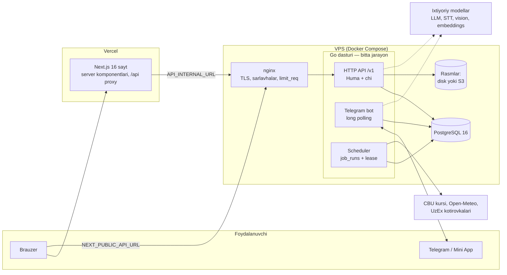

# Bugun — bozor narxlari va talab-taklif tahlili

**Bugun** — O'zbekiston dehqon va ulgurji bozorlari uchun neytral narx-axborot platformasi. Sotuvchi narxini beradi, xaridor uni topadi, tizim esa shu ma'lumotdan bozor narxini (vaznli median), talab-taklif bosimini, mavsum va prognozni hisoblaydi. Kirish nuqtalari: veb-sayt, Telegram bot va bot ichidagi Mini App.

> Umummilliy AI Xakaton, Namangan bosqichi (24–27-sentabr 2026), Tadbirkorlik treki, 19-muammo.
> Asosiy formula: **"Narx bering — xaridor oling"**.

## Mundarija

1. [Muammo](#muammo)
2. [Yechim](#yechim)
3. [Demo yo'li](#demo-yoli)
4. [Qanday ishlaydi](#qanday-ishlaydi)
5. ["AI/ML" aslida nima](#aiml-aslida-nima)
6. [Ma'lumotlar qayerda](#malumotlar-qayerda)
7. [Xavfsizlik](#xavfsizlik)
8. [Ishga tushirish](#ishga-tushirish)
9. [Sozlamalar](#sozlamalar)
10. [Testlar](#testlar)
11. [Cheklovlar](#cheklovlar)
12. [Litsenziyalar va ma'lumot manbalari](#litsenziyalar-va-malumot-manbalari)
13. [Hujjatlar](#hujjatlar)

## Muammo

Tadbirkor ulgurji xarid qilishdan oldin narxni bozorma-bozor yurib yoki telefon qilib bilib oladi. Bozorlar bo'yicha yagona, real vaqtdagi narx va talab-taklif bazasi yo'q, shuning uchun vaqt va pul yo'qotiladi (rasmiy 19-muammo matni). Mavjud manbalar bu bo'shliqni yopmaydi: narxtahlil.uz — chakana va cheklangan mahsulotlar, UzEx — birja kotirovkasi, marketplace'lar — statik chakana e'lonlar, Telegram kanallar — tuzilmasiz postlar.

## Yechim

| Kim | Nima oladi |
|---|---|
| Sotuvchi | Narxni matn, ovoz yoki rasm bilan yuboradi (tasdiqdan keyin saqlanadi), "12 sotuvchi ichida 9-o'rindasiz" kabi bozordagi o'rnini ko'radi, xaridor so'rovlarini (RFQ) oladi, xohlasa narxni avtomatik boshqaradi |
| Xaridor | Mahsulot bo'yicha hudud medianini, eng arzon takliflarni, tahlil va prognozni ko'radi; RFQ yuborib bir nechta taklifni solishtiradi; "narx tushsa xabar ber" |
| Tashkilot, bozor ma'muriyati | Viloyat bo'yicha haftalik PDF hisobot, issiqlik xaritasi, hududlar solishtiruvi |
| Administrator | Shubhali narxlar navbati, kunlik anomaliyalar, g'ayrioddiy sotuvchilar, tizim monitoringi |

Batafsil: [docs/01-loyiha-haqida.md](docs/01-loyiha-haqida.md).

## Demo yo'li

Demo ma'lumot bilan (`seed -history 3`, [ishga tushirish](#ishga-tushirish)) quyidagilarni ketma-ket bosing. Demo ma'lumot ishtirok etgan har bir grafik va raqam yonida **"Demo ma'lumot"** belgisi chiqadi.

**Kirmasdan (hamma uchun):**

1. **`/` — bozor.** Toifani tanlang, savdo turini (ulgurji/chakana) almashtiring, narx bo'yicha saralang.
2. **E'lonni oching (`/elon/{id}`).** Narx va uning bozor medianiga nisbati, sotuvchi reytingi, "Narxlarni solishtirish" va "Tahlil va prognoz" plitkalari.
3. **Mahsulot sahifasi (`/mahsulot/kartoshka`).** Tanlangan hudud bo'yicha median va P25–P75 oralig'i, barcha takliflar arzonidan, talab-taklif zonasi, viloyatlar.
4. **"Tahlil va prognoz" (`/mahsulot/kartoshka/tahlil`).** "Hozir oling / Kuting" maslahati va sabablari, narx tarixi grafigi (g'ayrioddiy kunlar belgilangan), 4 haftalik prognoz oralig'i bilan, mavsum, hafta kunlari, viloyatlar, arbitraj, ob-havo, dollar kursi, CSV.
5. **`/statistika`.** Mahsulot × viloyat issiqlik xaritasi (issiq/sovuq nuqtalar), narxi o'xshash viloyatlar guruhlari, haftaning o'zgarishlari, eng ko'p izlanganlar.
6. **`/xarita`** va **`/solishtirish`** — viloyatlar xaritasi (bosim yoki narx), 4 tagacha chiziqli taqqoslash.

**Telegram orqali kirgandan keyin:**

7. **`/boshlash`** — rol (sotuvchi), hudud, bozor, rozilik.
8. **`/narx`** — `kartoshka optom 4500, piyoz 3800` deb yozing → tasdiq kartochkasi → "To'g'ri" → bozordagi o'rin. Xuddi shu narsa botda oddiy xabar bilan ishlaydi.
9. **`/mahsulotlarim/yangi`** — rasmli e'lon; `/mahsulotlarim` da o'rin, 7 kunlik voronka, avtomatik narx.
10. **Xaridor sifatida `/sorovlar`** — "200 kg kartoshka" so'rovi → sotuvchilar botda taklif beradi → eng arzoni tepada, tejash hisobi bilan → tanlash → ikkala tomon rozi bo'lgach kontakt ochiladi.
11. **Botda:** `/savol Namanganda piyoz qancha?`, `/elon` (Mini App'da e'lon formasi), ovozli xabar yoki narxlar ro'yxati rasmi (model kalitlari sozlangan bo'lsa).
12. **`/admin`** (`ADMIN_TELEGRAM_IDS` dagi foydalanuvchi) — tekshiruv navbati, anomaliyalar, shubhali sotuvchilar, monitoring; **`/kabinet`** — tasdiqlangan tashkilot uchun haftalik PDF.

Hakamlar uchun demo ssenariysi va pitch: [spec.md §18](spec.md#18-demo-ssenariysi-va-pitch).

## Qanday ishlaydi



- **Bitta Go dasturi** (`backend/cmd/api`) ichida HTTP API, Telegram bot va rejalashtiruvchi ishlaydi. Ular bir xil servislarni ishlatadi, shuning uchun narx botdan kelsa ham, saytdan kelsa ham bir xil qoidalardan o'tadi va raqamlar hamma joyda bir xil.
- **Raqamni baza va deterministik kod hisoblaydi.** Vaznli median va kvantillar SQL funksiyalarida (`price_weight`, `weighted_quantile`), tahlil `internal/insight` va `internal/ml` da.
- **Band joy bazada himoyalangan:** unique indekslar, `FOR UPDATE`, qulflar, `job_runs UNIQUE (job, slot)`.
- **Vaqt:** bazada UTC, foydalanuvchiga va jadvallarda `Asia/Tashkent` (`internal/tz`).
- **API → TypeScript:** `make openapi` → `backend/openapi.json` → `npm run api:gen` → `frontend/src/lib/api/gen`.

Batafsil: [docs/02-arxitektura.md](docs/02-arxitektura.md).

## "AI/ML" aslida nima

Tahlil yadrosi — **klassik statistika va qo'lda yozilgan ML** (`backend/internal/ml`, tashqi kutubxonasiz). O'qitilgan model fayli yo'q: hammasi har safar ma'lumotdan qayta hisoblanadi, tasodifiy tanlovlar qat'iy urug'dan (`seed = 42`), ya'ni bir xil ma'lumot doim bir xil natija beradi.

| Vazifa | Usul |
|---|---|
| Bozor narxi | Vaznli median (manba ishonchi × yangilik), P25/P75 |
| Shubhali narx | Robust z-score (median/MAD), mediandan ±50%, sotuvchining oldingi narxidan 5 barobar sakrash, rasmiy etalondan uzoqlik |
| Kunlik anomaliyalar | Ikki qatlamli robust z (viloyatning o'z o'tmishi va boshqa viloyatlar) |
| G'ayrioddiy sotuvchilar | Isolation Forest (oxirgi 60 kun) |
| O'xshash viloyatlar | K-Means, `k` silhouette bo'yicha |
| Issiq va sovuq nuqtalar | Local Moran's I (permutatsiya testi) |
| Prognoz | 3 usul (naive, o'tgan yil, mavsum + trend) backtest bilan musobaqalashadi |
| Tushuntirish | Aniq Shapley qiymatlari (prognoz omillari, avtomatik narx sabablari) |
| Matndan narx | Qoidali parser (lotin/kirill, so'z bilan raqam, qop/yashik → kg) |

**Ixtiyoriy til modellari — standart o'chiq.** Har biri OpenAI-mos API orqali ishlaydi va kalitlari berilganda yoqiladi: kanal postlarini o'qish, `/savol` va `POST /v1/ask` tahlilchisi (tool calling), ovozdan matn (STT), rasmdan narx (vision), katalogga moslash (embeddings), e'lon matnini moderatsiya, maslahatni oddiy tilda yozish. Qoida: **model hech qachon raqam qo'ymaydi.** U faqat o'qiydi, yo'naltiradi yoki so'z bilan ifodalaydi; har bir raqam deterministik funksiyadan keladi, model yozgan matnda funksiyalar qaytarmagan raqam bo'lsa, matn shablon javob bilan almashtiriladi (`internal/numcheck`). Model chaqiruvlari `ai_log` jadvaliga yoziladi: tokenlar, davomiylik, narx; so'rov va javob matni saqlanmaydi.

Batafsil: [docs/12-ml-usullari.md](docs/12-ml-usullari.md), [docs/04-tahlil-metodologiyasi.md](docs/04-tahlil-metodologiyasi.md).

## Ma'lumotlar qayerda

| Nima | Qayerda |
|---|---|
| Barcha yozuvlar (foydalanuvchilar, e'lonlar, narxlar, RFQ, savdolar, tarix) | PostgreSQL 16, 39 ta goose migratsiyasi (`backend/migrations`) |
| E'lon rasmlari | `MEDIA_STORAGE=disk` — Docker `media` hajmi; `s3` — istalgan S3-mos bucket |
| Rejali ishlar holati | `job_runs` (restartdan keyin davom etadi, ikki marta ishlamaydi) |
| Sirlar | Faqat `.env` (lokal) va serverdagi `.env` (`chmod 600`); repoda faqat `.env.example` |
| Zaxira nusxalar | Serverda `backups/` (baza + rasmlar), ixtiyoriy offsite nusxa (rclone) |

Hech narsa faqat xotirada saqlanmaydi: narx qoralamalari, kontaktdan keyingi savollar, eslatmalar — hammasi bazada. Batafsil: [docs/10-malumotlar-va-xavfsizlik.md](docs/10-malumotlar-va-xavfsizlik.md).

## Xavfsizlik

- **Kirish:** faqat Telegram OpenID Connect (PKCE, `state`, `nonce`) yoki Mini App `initData` imzosi. Parol yo'q. Sessiya tokeni bazada faqat SHA-256 xesh sifatida; cookie `HttpOnly`, `SameSite=Lax`, `Secure`.
- **Shaxsiy ma'lumot:** telefon AES-256-GCM bilan shifrlangan, qidiruv uchun HMAC; IP saqlanmaydi (kunlik kalitli xesh); rasmlarning EXIF/GPS ma'lumoti o'chiriladi; loglarda so'rov tanasi yo'q.
- **Tarmoq:** nginx — TLS 1.2/1.3, HSTS, CSP, `X-Frame-Options`, `limit_req`; API faqat `127.0.0.1` da; `X-Forwarded-For` faqat `TRUSTED_PROXIES` dan qabul qilinadi. Sayt — har so'rovga nonce'li CSP (`src/proxy.ts`), xavfsizlik sarlavhalari.
- **Avtorizatsiya:** admin tekshiruvi serverda, egalik SQL darajasida; begona obyektga 404. Yashirin e'lon rasmlarini faqat egasi va admin ko'radi.
- **Limitlar:** API — daqiqasiga 120 so'rov (sozlanadi), bot — foydalanuvchiga daqiqasiga 20 xabar, model funksiyalari — soatlik/daqiqalik chegaralar.
- **Xatolarni kuzatish (ixtiyoriy):** Sentry; cookie, sarlavhalar, IP va telefon raqamlari yuborishdan oldin olib tashlanadi.
- **Repo:** CI har commit'da gitleaks bilan butun tarixni tekshiradi.

## Ishga tushirish

### Lokal (5 daqiqa)

Kerak: Go 1.26, PostgreSQL 16, Node.js LTS.

```bash
# 1. Baza
createdb bugun

# 2. Backend
cd backend
cp .env.example .env                  # DATA_ENCRYPTION_KEY ga: openssl rand -base64 32
make run                              # migratsiyalar o'zi qo'llanadi, API :8080 da
go run ./cmd/seed -history 3          # boshqa terminalda: demo sotuvchilar, e'lonlar, 3 yillik tarix

# 3. Frontend
cd ../frontend
cp .env.example .env.local            # lokalda bo'sh qoldirsa ham bo'ladi
npm install
npm run dev                           # http://localhost:3000
```

Tekshirish: `curl localhost:8080/healthz` → `{"status":"ok","database":"ok"}` (baza ishlamasa 503). Telegram kalitlarisiz sayt ochiladi, faqat kirish va bot o'chiq bo'ladi. Batafsil va muammolar jadvali: [docs/11-ishga-tushirish.md](docs/11-ishga-tushirish.md).

### Production

Backend + Postgres — bitta VPS'da Docker Compose (`deploy/`), nginx TLS bilan; sayt — Vercel. Deploy image'ni git SHA bilan teglaydi, migratsiyani alohida qadamda qo'llaydi va sog'lom bo'lmasa oldingi image'ga avtomatik qaytadi. Kunlik zaxira systemd timer bilan. To'liq qo'llanma: [docs/11-ishga-tushirish.md §7–8](docs/11-ishga-tushirish.md#7-production-server).

## Sozlamalar

Barcha sozlamalar muhit o'zgaruvchilarida; qiymatlar hech qachon repoga yozilmaydi.

| Fayl | Kim uchun |
|---|---|
| [`backend/.env.example`](backend/.env.example) | API: baza, Telegram, jadvallar, algoritm chegaralari, limitlar, S3, Sentry, UzEx |
| [`frontend/.env.example`](frontend/.env.example) | Sayt: API manzillari, sayt manzili, ichki sir, Sentry |
| [`deploy/.env.example`](deploy/.env.example) | Server: compose, zaxira (rclone, heartbeat), deploy |

Har bir o'zgaruvchi, standart qiymati va ma'nosi: [docs/13-sozlamalar.md](docs/13-sozlamalar.md). Noto'g'ri qiymat (masalan `JOB_LEASE_TIMEOUT` < 2 × `JOB_HEARTBEAT`) bilan API ishga tushmaydi va aniq xato chiqaradi.

## Testlar

| Buyruq | Nima tekshiradi |
|---|---|
| `cd backend && make test` | Bazasiz unit testlar |
| `cd backend && make test-db` | Hammasi, bazali integratsiya testlari bilan (`bugun_test` bazasi kerak, `-race -p 1`) |
| `cd frontend && npm run test:e2e` | Playwright: demo yo'li (bozor → mahsulot → tahlil → kirishga yo'naltirish → admin 404), CSP nonce, 390 px'da gorizontal aylanmaslik, demo belgilari |
| `cd frontend && npm run lint && npm run i18n:check` | ESLint, uz/en/ru tarjimalar sinxronligi |
| `cd backend && make eval` | AI komponentlarini belgilangan to'plamlarda o'lchash, natija `backend/eval/RESULTS.md` ga (migratsiya qilingan baza kerak: `EVAL_DATABASE_URL` yoki `DATABASE_URL`) |

**AI o'lchovi** (`backend/eval/RESULTS.md`, 2026-09-26, qoidali yo'llar, oflayn):

| Komponent | Natija |
|---|---|
| Narx ajratish (72 xabar) | Narx aniq to'g'ri 97.3%, mahsulot 100%, birlik va hajm 95.9% |
| Katalogga moslash (60 so'z, 5 tasi katalogda yo'q) | To'g'ri qaror 90%, noto'g'ri avtomatik moslash 0 |
| Tahlilchi yo'naltirishi (40 savol, 8 funksiya) | 100% — lekin savollar belgisini qoidalar mualliflari yozgan, shuning uchun bu baho optimistik |

Ovozdan matn va rasmdan o'qish hali o'lchanmagan (yozib olingan ovozlar va rasmlar to'plami kerak).

**CI** (`.github/workflows/ci.yml`) har push'da: backend (`go vet`, Postgres bilan `go test -race`, `openapi.json` va sqlc kodi yangiligi), frontend (API klient yangiligi, `tsc`, lint, i18n, `build`), e2e (API + seed + Playwright), Docker image'lar (`runtime` ichida `seed` yo'qligi), gitleaks.

## Cheklovlar

Halol ro'yxat — hakamlar so'rashidan oldin:

- **Tarixiy tahlillarning ko'pi sintetik demo tarix ustida.** Jonli narxlar kam bo'lgani uchun `seed -history 3` 3 yillik namunaviy tarix yaratadi. U `synthetic`/`is_demo` bilan belgilangan, jonli medianga aralashmaydi, API `demo_share` qaytaradi va sayt "Demo ma'lumot" belgisini ko'rsatadi. Jonli narxlar kelgan sari demo ulushi kamayadi.
- **Bitta VPS.** API, bot va rejalashtiruvchi bitta jarayonda, Postgres o'sha serverda, replika yo'q; API rate limiter xotirada. Gorizontal kengayish uchun bot va vazifalarni alohida jarayonga ajratish kerak (vazifa lease'lari va migratsiya qulfi bunga tayyor).
- **Ma'lumot joylashuvi.** Sayt Vercel `fra1` (Frankfurt) mintaqasida ishlaydi; sayt serveri API javoblarini o'tkazadi, lekin o'zi ma'lumot saqlamaydi. Spec §14.3 dagi "ma'lumot O'zbekistonda" talabi uchun sayt ham O'zbekistondagi serverga ko'chirilishi kerak.
- **Model funksiyalari kalit talab qiladi.** Tahlilchi, STT, rasmdan narx, embeddings va model moderatsiyasi kalitlarsiz o'chiq; ularsiz qoidali yo'llar ishlaydi (tahlilchi — qoidali javob, moderatsiya — kalit so'zlar, katalogga moslash — lug'at va trigram). Ovoz va rasm kalitsiz qabul qilinmaydi. Saytda: `/tahlilchi` sahifasi, `/narx` da ovoz va rasm tugmalari (funksiya o'chiq bo'lsa ko'rinmaydi), tahlil sahifasida maslahat matni, admin'da model sarfi bo'limi.
- **AI o'lchovi cheklangan:** tahlilchi yo'naltirish to'plami qoidalar mualliflari tomonidan belgilangan (optimistik); STT va rasmdan o'qish o'lchanmagan.
- **UzEx konnektori 3 mahsulotni qamraydi** (bug'doy, armatura, sement) va standart o'chiq (`UZEX_ENABLED`). narxtahlil.uz va OLX konnektorlari yo'q.
- **Bot javoblari faqat o'zbek tilida**; sayt uch tilda.
- **Mom Test suhbatlari va bozor dalillari** spec §2 dagi reja bo'yicha; natijalari repoda yo'q.

## Litsenziyalar va ma'lumot manbalari

**Asosiy kutubxonalar** (hammasi ruxsat beruvchi litsenziyalar):

| Kutubxona | Litsenziya |
|---|---|
| Go: huma/v2, chi, go-chi/cors, httprate, pgx, goose, sqlc, go-telegram/bot, go-pdf/fpdf, caarlos0/env, godotenv, sentry-go | MIT |
| Go: go-oidc, minio-go | Apache-2.0 |
| Go: golang.org/x/image, golang.org/x/oauth2, google/uuid | BSD-3-Clause |
| JS: Next.js, React, Tailwind CSS, shadcn, Base UI, TanStack Query, Hey API, next-intl, next-themes, motion, lenis, zod, react-hook-form, sonner, @sentry/nextjs | MIT |
| JS: d3-array/geo/scale/shape, lucide-react, qrcode.react | ISC |
| JS: Playwright (faqat testlar) | Apache-2.0 |

O'qitilgan ML modeli loyihada yo'q. Ixtiyoriy til/ovoz modellari tashqi xizmat sifatida chaqiriladi; ularning shartlari tanlangan provayderga bog'liq.

**Ma'lumot manbalari:**

| Manba | Nima uchun | Izoh |
|---|---|---|
| hudud.stat.uz (Davlat statistika qo'mitasi) | 14 viloyat chegaralari (`backend/internal/geo/viloyatlar.geojson`) | 2026-09-24 da yuklab olingan, koordinatalar ~10 m gacha yaxlitlangan; alohida litsenziya ko'rsatilmagan, manba ko'rsatiladi |
| O'zbekiston Markaziy banki (cbu.uz) | USD, RUB, KZT kursi | Ochiq API |
| Open-Meteo | Viloyat markazlari ob-havosi | Open-Meteo ma'lumotlari CC BY 4.0 |
| UzEx (uzex.uz) | Birja kotirovkalari, etalon chiziq | Ochiq kotirovkalar ro'yxati, standart o'chiq |
| Openverse (Flickr, StockSnap) | Demo e'lon rasmlari | Faqat CC0 va public domain, har rasm manbasi `backend/cmd/seed/photos_data.go` da |

## Hujjatlar

| Hujjat | Mazmuni |
|---|---|
| [docs/](docs/README.md) | To'liq texnik hujjatlar (13 fayl): arxitektura, narx va tahlil metodologiyasi, bot, sayt, API, xavfsizlik, deploy, ML, sozlamalar |
| [spec.md](spec.md) | Texnik topshiriq va qarorlar tarixi |
| [HOLAT.md](HOLAT.md) | Bajarilgan ishlar holati |
| [backend/openapi.json](backend/openapi.json) | API sxemasi; ishlab turgan API'da `/docs` |
