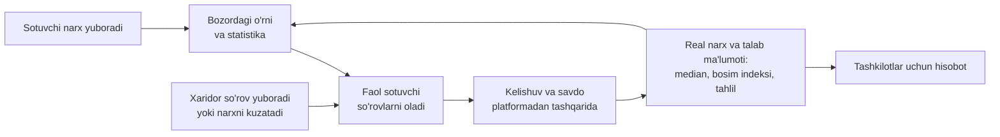

# Loyiha haqida

Bugun — O'zbekiston bozorlaridagi real ulgurji narx va talab-taklif bo'yicha tahliliy platforma. Sotuvchilar narx beradi, xaridorlar ehtiyojini aytadi, platforma esa o'rtada bozor narxini, talab signalini va tahlilni hisoblab, ikkala tomonga qaytaradi. Platforma savdoda vositachi emas: to'lov, buyurtma va yetkazib berish yo'q, savdo tomonlar o'rtasida bevosita bo'ladi.

## Mundarija

1. [Muammo](#muammo)
2. [Yechim va asosiy formula](#yechim-va-asosiy-formula)
3. [Foydalanuvchilar va rollar](#foydalanuvchilar-va-rollar)
4. [Aylanma mexanizm](#aylanma-mexanizm)
5. [Asosiy oqimlar](#asosiy-oqimlar)
6. [Loyiha tamoyillari](#loyiha-tamoyillari)
7. [Funksiyalar xaritasi](#funksiyalar-xaritasi)

## Muammo

Tadbirkor ulgurji xarid qilishda narxni bozorma-bozor yurib yoki sotuvchilarga qo'ng'iroq qilib bilib oladi. Bozorlar bo'yicha yagona, real vaqtdagi narx va talab-taklif bazasi yo'q. Natijada vaqt va pul yo'qotiladi (Umummilliy AI Xakaton, Tadbirkorlik treki, 19-muammo).

Mavjud manbalar bu bo'shliqni yopmaydi:

| Manba | Nima beradi | Nima yetishmaydi |
|---|---|---|
| narxtahlil.uz | Asosiy mahsulotlarning chakana narxi, hududlar kesimida | Ulgurji narx, talab signali va xaridor-sotuvchi aloqasi yo'q |
| UzEx birjasi | Birja kotirovkalari | Bozor darajasidagi mayda ulgurji savdoni qamramaydi |
| Marketlar (OLX va boshqalar) | E'lon va chakana narx | Narxlar statik, bozor narxi va tahlil yo'q |
| Telegram ulgurji kanallar | Kundalik narx postlari | Tuzilmasiz, qidirib va solishtirib bo'lmaydi |

## Yechim va asosiy formula

**"Narx bering — xaridor oling."**

- Sotuvchi narxini saytda, botda yoki oddiy matn bilan yuboradi ("kartoshka 4500, 2 tonna"). Evaziga darhol bozordagi o'rnini ko'radi ("12 sotuvchi ichida 9-o'rindasiz") va xaridor so'rovlarini oladi.
- Xaridor bozor narxini (median), eng arzon takliflarni, tahlilni ko'radi va sotuvchilardan narx so'raydi (RFQ).
- Platforma yig'ilgan narxlar va talab signallaridan bozor narxini, bosim indeksini, mavsum, prognoz va hisobotlarni hisoblaydi.

Uchta farq:

1. Narx sotuvchining o'zidan keladi va 7 kunlik yaroqlilik muddatiga ega — eskirgan narx ko'rsatilmaydi.
2. Talab ma'lumoti (ko'rishlar, qidiruvlar, so'rovlar, savdolar) hech qayerda ochiq yo'q, bu yerda esa u bosim indeksiga aylanadi.
3. Sotuvchi forma to'ldirmasdan, bitta xabar bilan narx beradi.

## Foydalanuvchilar va rollar

Ro'yxatdan o'tish faqat Telegram orqali (bir bosishda). Birinchi kirishdan keyin foydalanuvchi rolni, hududni (tuman yoki shahar) va kerak bo'lsa bozorini tanlaydi hamda shaxsiy ma'lumotlarni qayta ishlashga rozilik beradi.

| Rol | Kim | Nima qila oladi | Tasdiq |
|---|---|---|---|
| Sotuvchi (`seller`) | Bozordagi sotuvchi, ulgurjichi, fermer, xizmat ko'rsatuvchi | E'lon va narx joylash, bozordagi o'rni, statistika, avtomatik narx, xaridor so'rovlariga javob | Kerak emas |
| Xaridor (`buyer`) | Do'kon, oshxona, restoran egasi, ta'minotchi | Narx va tahlilni ko'rish, sotuvchilardan narx so'rash (RFQ), narx kuzatuvi | Kerak emas |
| Bozor ma'muriyati (`market_admin`) | Bozor rahbariyati | O'z viloyati bo'yicha haftalik PDF hisobot | Admin tasdiqlaydi |
| Tashkilot (`org_analyst`) | Savdo-sanoat palatasi, hokimlik, bank, distribyutor | Istalgan viloyat bo'yicha haftalik PDF hisobot | Admin tasdiqlaydi |
| Administrator | Platforma jamoasi | Tekshiruv navbati, rol so'rovlari, savdolar, baholar, voqealar jurnali | `admin` roli yoki `ADMIN_TELEGRAM_IDS` |

Ochiq sahifalar (bozor, mahsulot va e'lon sahifalari, barcha tahlil va statistika) kirmasdan ham ko'rinadi. Sotuvchining kontaktini ochish, narx joylash, so'rov yuborish va kuzatish uchun kirish kerak.

## Aylanma mexanizm

"Tovuq va tuxum" muammosini birinchi kundan beriladigan qiymat hal qiladi: xaridorlar hali kam bo'lsa ham, sotuvchi o'z narxining bozordagi o'rnini darhol ko'radi.

## Asosiy oqimlar

### Sotuvchi narx beradi

1. Saytda e'lon formasi orqali (mahsulot katalogdan tanlanadi, narx, rasm, zaxira) yoki `/narx` sahifasida va botda oddiy matn bilan.
2. Matn tizim tomonidan narx qatorlariga ajratiladi va **tasdiq kartochkasi** ko'rsatiladi. Tasdiqlanmagan narx hech qachon saqlanmaydi.
3. Narx avtomatik tekshiruvdan o'tadi. U bozordan yoki sotuvchining oldingi narxidan keskin farq qilsa, admin ko'rgunicha "tekshiruvda" holatida turadi.
4. Sotuvchi bozordagi o'rnini, 7 kunlik voronkasini (ko'rishlar, bog'lanishlar, savdolar) va narxining bozor medianiga nisbatini ko'radi.
5. Narx 7 kun amal qiladi. Har dushanba bot "Narxlaringiz hali shumi?" deb so'raydi va bitta tugma bilan barchasini uzaytirish mumkin.

Batafsil: [narx metodologiyasi](03-narx-metodologiyasi.md), [avtomatik narx](06-avtomatik-narx.md), [Telegram bot](07-telegram-bot.md).

### Xaridor narx topadi

1. Bosh sahifada (bozor) e'lonlar va "bozordan arzon" takliflar, mahsulot sahifasida tanlangan hudud bo'yicha median va barcha sotuvchilar arzonidan boshlab.
2. Tahlil sahifasida grafik, mavsum, viloyatlar, prognoz va "Hozir oling / Kuting" maslahati.
3. Sotuvchi bilan Telegram yoki telefon orqali to'g'ridan-to'g'ri bog'lanadi.
4. Yoki so'rov (RFQ) yuboradi: mos sotuvchilar narx taklif qiladi, eng arzoni tepada va tejash summasi bilan ko'rsatiladi.
5. Yoki "Narx tushsa xabar ber" orqali kuzatadi: arzon narx chiqsa, bot xabar beradi.

Batafsil: [savdo va talab](05-savdo-va-talab.md), [tahlil metodologiyasi](04-tahlil-metodologiyasi.md).

### Tashkilot hisobot oladi

Tasdiqlangan tashkilot yoki bozor ma'muriyati xodimi `/kabinet` sahifasida viloyat bo'yicha haftalik PDF hisobotni yuklab oladi. Hisobotda faqat kamida 5 ta narxga tayangan agregat raqamlar bor, shaxsiy ma'lumot yo'q.

### Administrator nazorat qiladi

Admin panelida: tekshiruvga tushgan narxlar (sababi bilan), rol so'rovlari, savdolar ro'yxati, moderatsiyadagi past baholar va narx grafiklarida ko'rinadigan bozor voqealari jurnali.

## Loyiha tamoyillari

- **Raqamni statistika hisoblaydi, taxmin qilmaydi.** Median, bosim indeksi, mavsum va prognoz deterministik formulalar bilan hisoblanadi. Bir xil ma'lumotdan har doim bir xil natija chiqadi.
- **Kam ma'lumot yashiriladi.** Median kamida 3 ta narxdan, ochiq statistik raqamlar (qiziqqanlar, savdolar, viloyat o'rtachalari) kamida 5 tadan, reyting kamida 3 ta bahodan boshlab ko'rsatiladi. Yetarli ma'lumot bo'lmasa, "Ma'lumot yig'ilmoqda" deyiladi.
- **Tasdiqsiz narx yo'q.** Matndan ajratilgan narx faqat sotuvchi "To'g'ri" deganidan keyin saqlanadi.
- **Demo ma'lumot belgilanadi.** Tahlil namoyishi uchun yaratilgan uch yillik tarix `demo_share` bilan belgilangan va saytda "Demo ma'lumot" belgisi bilan ko'rsatiladi. Haqiqiy narxlar kelgan sari u almashadi.
- **Vaqt.** Hamma vaqt bazada UTC da saqlanadi va foydalanuvchiga Toshkent vaqtida (`Asia/Tashkent`) ko'rsatiladi. Kunlik hisoblar Toshkent kuni bo'yicha.
- **Shaxsiy ma'lumot minimal.** Telefon shifrlangan holda saqlanadi, xaridorga faqat sotuvchi ruxsat bergan usul ko'rsatiladi. Talab signallarida IP saqlanmaydi. Batafsil: [ma'lumotlar va xavfsizlik](10-malumotlar-va-xavfsizlik.md).
- **Uch til.** Sayt o'zbek (asosiy), ingliz va rus tillarida. API matn emas, barqaror kod qaytaradi, matnni sayt tanlangan tilda chiqaradi.

## Funksiyalar xaritasi

| Funksiya | Qayerda | Hujjat |
|---|---|---|
| Bozor, katalog, filtrlar, e'lon va mahsulot sahifalari | Sayt | [08-veb-sayt](08-veb-sayt.md) |
| E'lon joylash, rasm, 7 kunlik muddat, uzaytirish | Sayt, bot | [03-narx-metodologiyasi](03-narx-metodologiyasi.md) |
| Narxni matn bilan yuborish va tasdiqlash | Sayt (`/narx`), bot | [07-telegram-bot](07-telegram-bot.md) |
| Vaznli median, anomaliya tekshiruvi, bozordagi o'rin | API | [03-narx-metodologiyasi](03-narx-metodologiyasi.md) |
| Avtomatik narx | Sayt, bot, rejali vazifa | [06-avtomatik-narx](06-avtomatik-narx.md) |
| Mahsulot tahlili, mavsum, prognoz, maslahat | Sayt | [04-tahlil-metodologiyasi](04-tahlil-metodologiyasi.md) |
| Bosim indeksi, xarita, issiqlik xaritasi, viloyat sahifasi | Sayt | [04-tahlil-metodologiyasi](04-tahlil-metodologiyasi.md) |
| RFQ (narx so'rash), savdolar, reyting, kuzatuv | Sayt, bot | [05-savdo-va-talab](05-savdo-va-talab.md) |
| Telegram kanallardan narx o'qish, `/savol` | Bot | [07-telegram-bot](07-telegram-bot.md) |
| Haftalik PDF hisobot | Sayt (`/kabinet`) | [04-tahlil-metodologiyasi](04-tahlil-metodologiyasi.md) |
| Admin paneli | Sayt (`/admin`) | [08-veb-sayt](08-veb-sayt.md) |
| API, xato kodlari | API | [09-api](09-api.md) |
| Arxitektura, rejali vazifalar | Server | [02-arxitektura](02-arxitektura.md) |
| Ishga tushirish va deploy | — | [11-ishga-tushirish](11-ishga-tushirish.md) |

## Qayerda joylashgan

- `spec.md` — texnik topshiriq va qarorlar tarixi.
- `HOLAT.md` — fazalar va bajarilgan qadamlar.
- `backend/` — Go API, bot, rejali vazifalar va tahlil yadrosi.
- `frontend/` — Next.js sayt.
- `deploy/` — server uchun Docker Compose va deploy skriptlari.
