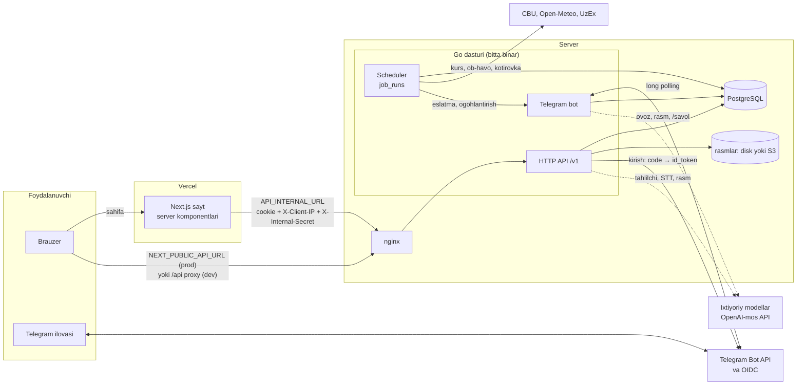

# Tizim arxitekturasi

Bugun uchta asosiy qismdan iborat: Vercel'da ishlaydigan Next.js veb-sayt, bitta Go dasturi (HTTP API, Telegram bot va rejalashtirilgan ishlar birga) va PostgreSQL bazasi. Go dasturi serverda Docker ichida, nginx orqasida ishlaydi; e'lon rasmlari serverning diskida yoki S3-mos omborda saqlanadi. Bu hujjat komponentlarni, so'rov qanday yurishini, Go paketlarini, rejalashtirilgan ishlarni, tashqi ma'lumot manbalarini, ixtiyoriy model funksiyalarini va vaqt zonasi qoidalarini tushuntiradi.

## Mundarija

1. [Komponentlar](#1-komponentlar)
2. [Diagramma va so'rov oqimi](#2-diagramma-va-sorov-oqimi)
3. [Go paketlari xaritasi](#3-go-paketlari-xaritasi)
4. [Texnologiyalar va nima uchun](#4-texnologiyalar-va-nima-uchun)
5. [Sayt qanday render qilinadi](#5-sayt-qanday-render-qilinadi)
6. [OpenAPI → TypeScript mijoz](#6-openapi--typescript-mijoz)
7. [Rejalashtirilgan ishlar](#7-rejalashtirilgan-ishlar)
8. [Tashqi ma'lumot manbalari](#8-tashqi-malumot-manbalari)
9. [Vaqt zonasi qoidalari](#9-vaqt-zonasi-qoidalari)
10. [Ixtiyoriy model funksiyalari](#10-ixtiyoriy-model-funksiyalari)
11. [Ishga tushish va to'xtash](#11-ishga-tushish-va-toxtash)
12. [Qayerda joylashgan](#qayerda-joylashgan)

## 1. Komponentlar

| Komponent | Qayerda ishlaydi | Vazifasi |
|---|---|---|
| Veb-sayt (Next.js 16, React 19) | Vercel, `fra1` mintaqasi (`frontend/vercel.json`) | Sahifalar, kabinet, admin paneli. Server komponentlari API'ni server tomondan chaqiradi, brauzer esa to'g'ridan-to'g'ri API domeniga murojaat qiladi |
| Go dasturi (`backend/cmd/api`) | Serverda Docker konteyner `api` | Bitta binar ichida: HTTP API (`/v1/...`), Telegram bot (long polling), rejalashtiruvchi (scheduler). Migratsiyalar lokalda shu yerda, productionda alohida `migrate` binari bilan |
| PostgreSQL 16 | Serverda Docker konteyner `postgres` | Barcha ma'lumotlar. Median va kvantillar ham bazada (`price_weight`, `weighted_quantile` SQL funksiyalari) hisoblanadi |
| Rasm ombori | `MEDIA_STORAGE=disk`: `api` konteynerining `media` hajmi (`MEDIA_DIR=/data/media`); `MEDIA_STORAGE=s3`: istalgan S3-mos bucket | E'lon rasmlari JPEG ko'rinishida, `GET /media/{key}` orqali (faol e'lon rasmlari `S3_PUBLIC_BASE_URL` ga yo'naltirilishi mumkin) |
| nginx | Serverning o'zida | TLS, xavfsizlik sarlavhalari, `limit_req`; tashqi so'rovlarni `127.0.0.1:8090` dagi API'ga uzatadi, haqiqiy IP'ni `X-Real-IP` ga yozadi, JSON'ni gzip qiladi, `/api/` prefiksini ham qabul qiladi |
| Tashqi monitorlar | UptimeRobot, healthchecks.io, Sentry (ixtiyoriy) | `/healthz`, rejalashtiruvchi va zaxira heartbeat'lari, xatolar ([ishga tushirish, 11-bo'lim](11-ishga-tushirish.md#11-monitoring)) |
| Telegram | Tashqi xizmat | OIDC orqali kirish (`oauth.telegram.org`), bot xabarlari |

Muhim qaror: API, bot va rejalashtiruvchi **bitta jarayonda** ishlaydi (`backend/cmd/api/main.go`). Ular bir xil servislarni (`pricing`, `market`, `rfq`, `deals`, `watch`, `insight`) bo'lishadi, shuning uchun narx botdan kelsa ham, saytdan kelsa ham bir xil qoidalardan o'tadi. Bot `BOT_ENABLED=false` yoki `TELEGRAM_BOT_TOKEN` bo'sh bo'lsa ishga tushmaydi (bitta bot tokenini faqat bitta jarayon o'qiy oladi).

## 2. Diagramma va so'rov oqimi

### Oddiy so'rov yo'li

1. Foydalanuvchi sahifani ochadi. Vercel'dagi Next.js server komponenti API'ni `API_INTERNAL_URL` bo'yicha chaqiradi va tashrif buyuruvchining `bugun_session` cookie'sini hamda IP'sini uzatadi (5-bo'lim).
2. Brauzerdagi interaktiv qismlar (tugmalar, formalar, React Query) API'ga `publicApiUrl` bo'yicha boradi: productionda bu `NEXT_PUBLIC_API_URL` (saytga qo'shni subdomen), lokalda `/api` (Next.js rewrite, `frontend/next.config.ts`).
3. nginx so'rovni `127.0.0.1:8090` ga uzatadi. API konteyneri faqat localhost'ga ochilgan (`deploy/docker-compose.yml`), ya'ni tashqaridan faqat nginx orqali kiriladi.
4. Go'dagi chi router middleware'lari tartibi: `RequestID` → `realIP` (forward sarlavhalari faqat `TRUSTED_PROXIES` dan) → so'rov logi → CORS → `Recoverer` → `errtrack` (panic va 5xx Sentry'ga, sozlangan bo'lsa) → `REQUEST_TIMEOUT` (15 s) → (faqat `/v1` va `/healthz` uchun) daqiqasiga `RATE_LIMIT_PER_MINUTE` (120) so'rov limiti → tashrif buyuruvchi kaliti → Huma operatsiyasi (`backend/internal/httpapi/server.go`).
5. Handler servis qatlamini chaqiradi, servis esa `sqlc` yaratgan so'rovlar orqali bazaga yozadi/o'qiydi.

### Kirish (login) oqimi

1. Sayt foydalanuvchini `GET /v1/auth/telegram/start?return_to=/...` ga yo'naltiradi.
2. API `state`, `nonce` va PKCE `verifier` yaratadi, `state` xeshini `oauth_states` jadvaliga 10 daqiqaga yozadi va Telegram'ga 302 qaytaradi.
3. Telegram `GET /v1/auth/telegram/callback` ga qaytaradi. API `state` ni bir martalik o'chirib o'qiydi, kodni `id_token` ga almashtiradi, imzo va `nonce` ni tekshiradi.
4. Foydalanuvchi `telegram_id` bo'yicha yaratiladi yoki yangilanadi, telefon shifrlanadi, sessiya yaratiladi va cookie qo'yiladi. Roli yo'q foydalanuvchi `/boshlash` ga, qolganlar `return_to` ga yuboriladi.

Mini App ichida muqobil yo'l: sayt `Telegram.WebApp.initData` ni `POST /v1/auth/telegram/webapp` ga yuboradi, API imzoni bot tokeni bilan va yoshini (`TELEGRAM_WEBAPP_MAX_AGE`) tekshiradi va xuddi shunday sessiya cookie'sini qo'yadi. Sayt buni tashrif davomida bir marta, sessiya bo'lmaganda qiladi (`components/telegram-app.tsx`).

Batafsil: [ma'lumotlar va xavfsizlik](10-malumotlar-va-xavfsizlik.md).

### Bot oqimi

Bot webhook ishlatmaydi: ishga tushganda webhook'ni o'chiradi va `getUpdates` bilan xabarlarni o'zi so'raydi (`backend/internal/bot/bot.go`). Qabul qilinadigan yangilanishlar: `message`, `edited_message`, `callback_query`, `channel_post`, `edited_channel_post`, `my_chat_member` (`backend/internal/bot/channels.go`). Bot foydalanuvchini sayt orqali kirishda saqlangan `telegram_id` bo'yicha taniydi, o'zining alohida ro'yxatdan o'tishi yo'q. Har foydalanuvchiga daqiqasiga `BOT_MESSAGES_PER_MINUTE` (20) xabar limiti bor (`throttle.go`). Buyruqlar va narx matnini tahlil qilish: [Telegram bot](07-telegram-bot.md).

## 3. Go paketlari xaritasi

| Paket | Vazifasi |
|---|---|
| `cmd/api` | Asosiy dastur: konfiguratsiya, baza, (ixtiyoriy) migratsiya, servislar, bot, scheduler va HTTP serverni ishga tushiradi; `ai.go` — model funksiyalarini ulaydi |
| `cmd/migrate` | Migratsiyalarni alohida qadam sifatida qo'llaydi: `migrate up`, `migrate status` |
| `cmd/mediasync` | Diskdagi rasmlarni S3 bucket'ga nusxalaydi (`-dry-run` — faqat sanaydi) |
| `cmd/openapi` | Serverni ishga tushirmasdan `openapi.json` ni chiqaradi (`make openapi`) |
| `cmd/seed` | Demo sotuvchilar, e'lonlar, rasmlar va (ixtiyoriy) narx tarixini yaratadi yoki `-purge` bilan o'chiradi |
| `internal/config` | Muhit o'zgaruvchilarini o'qiydi (`.env` faqat developmentda) va tekshiradi: noto'g'ri qiymat bilan dastur ishga tushmaydi ([sozlamalar](13-sozlamalar.md)) |
| `internal/store` | PostgreSQL pool'ini ochadi (sessiya `timezone=UTC`, `plan_cache_mode=force_custom_plan`) va goose migratsiyalarini advisory lock ostida qo'llaydi |
| `internal/tz` | Yagona vaqt zonasi: `Asia/Tashkent` (tzdata binar ichida) |
| `internal/errtrack` | Ixtiyoriy Sentry: panic, 5xx va muvaffaqiyatsiz ishlar; shaxsiy ma'lumot yuborishdan oldin tozalanadi |
| `internal/store/db` | `sqlc` yaratgan tipli so'rovlar (`backend/queries/*.sql` dan) |
| `internal/httpapi` | Marshrutlar, middleware, Huma operatsiyalari, xato konverti, sessiya cookie, talab signallari |
| `internal/auth` | Telegram OIDC kirish (discovery, PKCE, `id_token` tekshiruvi) |
| `internal/secure` | Tasodifiy tokenlar, SHA-256 token xeshi, AES-256-GCM shifrlash va HMAC xesh |
| `internal/pricing` | Erkin matndan narx ajratib oluvchi qoidali parser va narx servisi |
| `internal/analytics` | Deterministik statistika: vaznli median, anomaliya, bozordagi o'rin, bosim indeksi, avtomatik narx omillari |
| `internal/market` | Sotuvchi e'lonlari, rasmlar, "Sotildi", avtomatik narx (`Reprice`) |
| `internal/insight` | Tahlil sahifasi: kunlik tarix (`price_daily`), mavsum, prognoz, xarita, hudud sharhi, taqqoslash; 10 daqiqalik kesh |
| `internal/rfq` | Xaridor so'rovlari (RFQ) va sotuvchi takliflari |
| `internal/deals` | Bitimlar: kontakt ochilgandan keyingi savollar, tasdiqlash |
| `internal/watch` | Kuzatuvlar va arzonlash ogohlantirishlari |
| `internal/ask` | `/savol` savollariga qoidalar asosida javob (tahlilchining qoidali yo'li) |
| `internal/analyst` | Narx savollari tahlilchisi (`/savol`, `POST /v1/ask`): model sozlangan bo'lsa qat'iy funksiyalarni tool calling bilan chaqiradi, aks holda `ask` qoidalari; javobda jadval va manbalar |
| `internal/llm` | OpenAI-mos chat, STT, vision va embeddings mijozi; soatlik limit, `ai_log` ga yozish |
| `internal/ailog` | `ai_log`: har model chaqiruvining hajmi, vaqti, narxi (matnsiz) |
| `internal/numcheck` | Model yozgan matnda funksiyalar qaytarmagan raqam yo'qligini tekshiradi |
| `internal/speech` | Ovozli yozuv formatini va uzunligini STT'ga yuborishdan oldin tekshiradi |
| `internal/photoprice` | Narxlar ro'yxati rasmidan qoralama: model matnni o'qiydi, parser va `Verify` tekshiradi |
| `internal/catalogmatch` | Erkin so'zni katalogga moslash: lug'at, trigram, ixtiyoriy embeddings |
| `internal/moderation` | E'lon matnini tekshirish: kalit so'zlar va ixtiyoriy model; faqat tekshiruvga ushlaydi |
| `internal/advice` | Tahlil maslahatini oddiy tilda: shablon yoki (ixtiyoriy) model, raqamlar tekshiriladi |
| `internal/channels` | Ulangan Telegram kanal va guruhlaridan narx o'qish |
| `internal/bot` | Telegram bot: buyruqlar, tugmalar, eslatmalar, bildirishnomalar |
| `internal/jobs` | Toshkent vaqti bo'yicha rejalashtiruvchi, `job_runs` orqali bir martalik ishga tushirish, lease va tashqi heartbeat |
| `internal/external` | Markaziy bank kurslari, Open-Meteo ob-havosi, UzEx kotirovkalari |
| `internal/monitor` | Tizim monitoringi: manba yangiligi, kechikkan ishlar, ogohlantirishlar |
| `internal/ml` | Robust statistika, Isolation Forest, K-Means, Local Moran's I, Shapley ([ML usullari](12-ml-usullari.md)) |
| `internal/geo` | Viloyat chegaralari (ichiga joylangan GeoJSON) |
| `internal/media` | Rasmni tekshirish, kichraytirish, qayta kodlash; disk (`LocalStore`) va S3 ombori |
| `internal/report` | Haftalik viloyat hisobotini PDF qilib chiqarish |

## 4. Texnologiyalar va nima uchun

| Qatlam | Tanlov | Sabab |
|---|---|---|
| Backend tili | Go 1.26 | Bitta statik binar, kichik Docker image (alpine), API + bot + scheduler bitta jarayonda oson ishlaydi |
| HTTP | chi v5 + Huma v2 | chi — middleware (CORS, rate limit, timeout); Huma — kiruvchi ma'lumotni sxema bo'yicha tekshiradi va OpenAPI'ni koddan avtomatik chiqaradi |
| Baza | PostgreSQL 16, pgx v5, sqlc, goose | Tranzaksiyalar va unique indekslar band joylarni bazaning o'zida himoya qiladi; sqlc SQL'dan tipli Go kod yaratadi; goose migratsiyalari dastur ichiga joylangan |
| Qidiruv | `pg_trgm` | Mahsulot nomi bo'yicha noaniq qidiruv |
| Kirish | Telegram OIDC (`go-oidc`, `oauth2`) | Parol yo'q; telefon va bot ruxsati bir qadamda olinadi |
| Bot | `go-telegram/bot` | Long polling, alohida webhook serveri kerak emas |
| PDF | `go-pdf/fpdf` | Haftalik hisobot |
| Rasm | `golang.org/x/image`, `minio-go` | Kichraytirish va JPEG'ga qayta kodlash; S3-mos ombor |
| Xatolar | `sentry-go`, `@sentry/nextjs` | Ixtiyoriy xatolarni kuzatish |
| Frontend | Next.js 16 (App Router), React 19, Tailwind 4, shadcn/Base UI | Server komponentlari sahifani serverda tayyorlaydi, SEO va tez birinchi ko'rinish |
| Ma'lumot olish | `@hey-api/openapi-ts` + TanStack Query | API tiplari va funksiyalari `openapi.json` dan yaratiladi |
| Grafiklar | d3 (`d3-scale`, `d3-shape`, `d3-geo`, `d3-array`) | O'z grafik to'plami, xarita |
| Tillar | `next-intl` | O'zbek (asosiy), ingliz, rus |

## 5. Sayt qanday render qilinadi

- Sahifalar asosan **server komponentlari**. Ular API'ni `frontend/src/lib/server-api.ts` dagi yordamchilar orqali chaqiradi.
- `withCookies()` har bir server so'roviga quyidagilarni qo'shadi:
  - `cookie` — tashrif buyuruvchining cookie'lari (shu jumladan `bugun_session`), shunda API foydalanuvchini taniydi;
  - `x-client-ip` — tashrif buyuruvchining IP'si (`x-forwarded-for` ning birinchi qiymati yoki `x-real-ip`);
  - `x-internal-secret` — `INTERNAL_API_SECRET` qiymati.
  IP va sir faqat `INTERNAL_API_SECRET` o'rnatilgan bo'lsa yuboriladi. So'rovlar `cache: "no-store"` bilan ketadi.
- API tomonda (`clientKey`, `via` — `backend/internal/httpapi/server.go`): agar `X-Client-IP` bor va `X-Internal-Secret` `INTERNAL_SECRET` ga teng bo'lsa (vaqt bo'yicha teng solishtirish, `subtle.ConstantTimeCompare`), rate limit kaliti `fwd:<visitor IP>` bo'ladi. Aks holda kalit ulanish IP'si, ya'ni saytning barcha tashrif buyuruvchilari bitta limitni bo'lishadi. Logda bu `via=site`, `site-unverified` yoki `direct` deb yoziladi.
- Shu kalit talab signallari uchun ham ishlatiladi: kirmagan tashrif buyuruvchi IP'si bo'yicha, lekin faqat kalitli xesh ko'rinishida saqlanadi ([ma'lumotlar va xavfsizlik](10-malumotlar-va-xavfsizlik.md)).
- `getCurrentUser()`: cookie bo'lmasa API'ga umuman bormaydi. Faqat 401 "chiqib ketgan" deb hisoblanadi; 429 yoki 5xx da foydalanuvchi kirish sahifasiga otilmaydi, xato ko'rsatiladi.
- Katalog (hududlar, bozorlar, mahsulotlar) Next.js `unstable_cache` bilan 1 soat keshlanadi.

## 6. OpenAPI → TypeScript mijoz

1. Go'da har bir operatsiya `huma.Register` bilan ro'yxatdan o'tadi; kirish/chiqish strukturalari teglari (`maxLength`, `enum`, `doc`) sxemaga aylanadi.
2. `make openapi` (`go run ./cmd/openapi > openapi.json`) serverni ishga tushirmasdan `backend/openapi.json` ni yozadi. Hozir unda 82 ta operatsiya bor.
3. Frontendda `npm run api:gen` (`openapi-ts`, sozlamasi `frontend/openapi-ts.config.ts`) `../backend/openapi.json` dan `frontend/src/lib/api/gen/` ni yaratadi: `types.gen.ts`, `sdk.gen.ts`, fetch mijozi va TanStack Query yordamchilari.
4. Mijoz sozlamasi `frontend/src/lib/api/client-config.ts`: serverda `API_INTERNAL_URL` (standart `http://localhost:8080`), brauzerda `publicApiUrl`; har doim `credentials: "include"`.

Qoida: backendda API o'zgarsa, `make openapi` va `npm run api:gen` ketma-ket ishga tushiriladi va ikkala natija bir commit'da bo'ladi.

## 7. Rejalashtirilgan ishlar

Rejalashtiruvchi `backend/internal/jobs/jobs.go` da (tashqi kutubxona emas, o'zimiz yozgan). U har daqiqada tekshiradi. Har bir ishning "sloti" (rejadagi vaqti) `job_runs` jadvaliga `UNIQUE (job, slot)` bilan yoziladi, shuning uchun:

- bitta slot ikki nusxa ishlasa ham faqat bir marta bajariladi;
- server o'chib qolib, **oyna** (window) ichida qayta yoqilsa, o'tkazib yuborilgan slot baribir bajariladi;
- oyna o'tib ketsa, slot tashlab ketiladi.
- har bir ish o'z goroutine'ida ishlaydi: uzoq ish (masalan, 3 yillik yuklash) boshqalarini to'xtatib turmaydi, hali tugamagan ish qayta boshlanmaydi;
- **lease:** ishlayotgan ish har `JOB_HEARTBEAT` (1 daqiqa) da `job_runs.heartbeat_at` ni yangilaydi. Ishga tushishda faqat lease'i `JOB_LEASE_TIMEOUT` (5 daqiqa) dan eski tugallanmagan ishlar bo'shatiladi — ikkinchi nusxa birinchisining tirik ishini bo'shatib yubormaydi, qulagan jarayonning ishi esa qayta olinadi;
- **tashqi heartbeat:** `HEARTBEAT_URL` berilsa, rejalashtiruvchi tirik ekanida har `HEARTBEAT_INTERVAL` (5 daqiqa) da unga ping yuboradi;
- muvaffaqiyatsiz ish Sentry'ga ham yuboriladi (sozlangan bo'lsa).

Barcha vaqtlar **Asia/Tashkent** bo'yicha va muhit o'zgaruvchilarida sozlanadi (`SCHEDULE_*`, [sozlamalar, 3-bo'lim](13-sozlamalar.md#3-backend-rejali-ishlar)). Jadvaldagi vaqtlar — standart qiymatlar.

| Ish (`job`) | Vaqt | Oyna | Nima qiladi | Bot kerakmi |
|---|---|---|---|---|
| `auto_pricing` | har kuni 07:30, 12:00, 16:30 | 3 soat | Avtomatik rejimdagi e'lonlar narxini qayta hisoblaydi (`market.Reprice`), o'zgarishlarni botga yuboradi | Yo'q (bot bo'lsa xabar beradi) |
| `price_daily` | har soat (soat boshida) | 1 soat | Kecha va bugun uchun `price_daily` kunlik tarixini qayta quradi (`insight.RefreshRecent`) | Yo'q |
| `sessions_cleanup` | har kuni 04:30 | 20 soat | Muddati o'tgan sessiyalar va tugallanmagan kirish holatlarini (`oauth_states`) o'chiradi | Yo'q |
| `fx_daily` | har kuni 10:15 | 20 soat | Markaziy bank kurslari (USD, RUB, KZT); birinchi ishga tushishda 3 yil orqaga to'ldiradi | Yo'q |
| `weather_daily` | har kuni 06:30 | 20 soat | Viloyat markazlari ob-havosi; birinchi ishga tushishda 3 yil orqaga | Yo'q |
| `weekly_reminder` | dushanba 09:00 | 6 soat | Sotuvchilarga haftalik eslatma: narxlarni tekshirish va e'lonlarni yana bir haftaga uzaytirish | Ha |
| `deal_prompts` | har 15 daqiqada | 15 daqiqa | Kontakt ochilganidan keyin xaridorga "sotib oldingizmi?" savoli; kechasi yuborilmaydi (09:00–20:00, kuniga ko'pi bilan 3 ta) | Ha |
| `seller_deal_digest` | har kuni 19:00 | 1 soat | Bugun kontakti ochilgan sotuvchilarga qisqa xulosa | Ha |
| `watch_alerts` | har kuni 08:00 va 17:00 | 2 soat | Kuzatuvchilarga arzonroq narx yoki median tushgani haqida xabar (har kuzatuvga kuniga ko'pi bilan bir marta) | Ha |
| `rating_prompts` | har kuni 11:00 | 3 soat | Uch kun oldin tasdiqlangan bitimlar uchun xaridordan baho so'raydi | Ha |
| `price_anomalies_year` | har kuni 03:30 | 20 soat | Oxirgi 365 kun kunlik anomaliyalari ([ML usullari](12-ml-usullari.md)) | Yo'q |
| `seller_scores` | har kuni 04:00 | 20 soat | Isolation Forest sotuvchi ballari | Yo'q |
| `uzex_quotes` | har kuni 18:30 | 20 soat | UzEx kotirovkalari → `reference_prices` (faqat `UZEX_ENABLED=true`) | Yo'q |
| `ai_log_cleanup` | har kuni 04:45 | 20 soat | `AI_LOG_RETENTION_DAYS` dan eski `ai_log` qatorlari | Yo'q |
| `monitoring` | har soat | 1 soat | Tizim tekshiruvlari, ogohlantirishlar; bot bo'lsa adminlarga xabar | Yo'q |

Bot o'chirilgan bo'lsa, "Bot kerakmi: Ha" belgilangan beshta ish ro'yxatga umuman qo'shilmaydi (`backend/cmd/api/main.go`). Algoritmlar tafsiloti: [avtomatik narx](06-avtomatik-narx.md), [savdo va talab](05-savdo-va-talab.md), [tahlil metodologiyasi](04-tahlil-metodologiyasi.md).

Rejalashtiruvchidan tashqari bir martalik vaqtli ishlar ham bazada saqlanadi: masalan kontaktdan keyingi savollar `deal_prompts` jadvalida `due_at` bilan turadi, shuning uchun restart ularni yo'qotmaydi va takrorlamaydi.

## 8. Tashqi ma'lumot manbalari

| Manba | Qayerda | Nima olinadi | Qanday |
|---|---|---|---|
| O'zbekiston Markaziy banki (cbu.uz) | `internal/external/fx.go`, `CBUBase` | USD, RUB, KZT kursi (1 birlik uchun so'm) → `fx_daily` | Kalit kerak emas; kun bo'yicha JSON arxiv; so'rovlar orasida 150 ms pauza; birinchi marta 3 yil (`3*365` kun) |
| Open-Meteo | `internal/external/weather.go` | Viloyat markazlarida kunlik min/max harorat va yog'in → `weather_daily` | Arxiv API (o'tgan kunlar) va prognoz API (oxirgi kunlar); so'rovlar orasida 1 s pauza; birinchi marta 3 yil |
| hudud.stat.uz (Davlat statistika qo'mitasi) | `internal/geo/viloyatlar.geojson` | Viloyat chegaralari, id = SOATO kodi | Bir marta yuklab olingan (2026-09-24) va binar ichiga joylangan; koordinatalar 4 xonagacha yaxlitlangan (~10 m) |
| Bayramlar taqvimi | migratsiya `00029_holiday_calendar.sql` | 2023–2027 yillar: Ramazon, hayitlar, Navro'z, Yangi yil, to'y mavsumi → `market_events` | Qo'lda kiritilgan; oy taqvimidagi sanalar 1 kunga farq qilishi mumkin |
| UzEx (uzex.uz) | `internal/external/uzex.go` → `reference_prices` | Birja kotirovkalari: bug'doy (3-sinf), armatura (12 mm), qopdagi sement; tonna narxi mahsulot asosiy birligiga o'tkaziladi | `UZEX_ENABLED=true` bo'lsa har kuni `SCHEDULE_UZEX` (18:30) da; kalit kerak emas; standart o'chiq. Etalon narx medianga kirmaydi: `GET /v1/products/{slug}/references` alohida chiziq sifatida beradi va sotuvchilar kam bo'lsa tekshiruv chegarasi bo'ladi. Monitoring 4 kun yangilanmasa ogohlantiradi |
| narxtahlil.uz | `reference_prices.source = narxtahlil` | Rasmiy chakana narxlar | **Konnektor yo'q**, faqat sxema tayyor |
| Openverse (Flickr, StockSnap) | `cmd/seed` | Demo e'lonlar uchun qo'lda tanlangan CC0/public domain fotosuratlar (`photos_data.go`) | Faqat seed paytida, diskda keshlanadi |

`source_runs` jadvali sxemada bor (00002), lekin hozirgi kodda ishlatilmaydi.

## 9. Vaqt zonasi qoidalari

- **Saqlash — UTC.** Barcha vaqtlar `timestamptz`. Pool har ulanishda `timezone=UTC` qo'yadi (`internal/store/store.go`), dastur boshida `time.Local = time.UTC` (`cmd/api/main.go`). Docker'dagi Postgres ham `TZ: UTC`.
- **Ko'rsatish — Asia/Tashkent.** API vaqtlarni RFC 3339 (UTC) ko'rinishida beradi; sayt va bot ularni Toshkent vaqtida chiqaradi.
- **Kun satrlari — Toshkent sanasi.** "Kun" ma'nosidagi qiymatlar (`series.date`, `StatsDay.date`, `scope.from/to`, voqea sanalari, `demand_events.day`, `listing_events.day`, `deals.day`, `price_reasons.day`) Toshkent kalendari bo'yicha `YYYY-MM-DD`. Bazada ular `(now() AT TIME ZONE 'Asia/Tashkent')::date` bilan hisoblanadi.
- **Haftalar dushanbadan boshlanadi.**
- **Bitta manba:** `internal/tz` paketi (`tz.Tashkent`) — barcha paketlar zonani shu yerdan oladi.
- **Rejalashtiruvchi Toshkent soati bo'yicha**. Binar `time/tzdata` ni ichiga oladi, shuning uchun zoneinfo bo'lmagan serverda ham `Asia/Tashkent` topiladi; topilmasa UTC+5 qat'iy zona ishlatiladi (O'zbekistonda yozgi vaqt yo'q).

## 10. Ixtiyoriy model funksiyalari

Hammasi standart o'chiq va OpenAI-mos API orqali ishlaydi (provayder tanlash — sozlama). O'chiq bo'lsa deterministik yoki qoidali yo'l ishlaydi, javob shakli bir xil qoladi. Yoqilganini `GET /v1/ai/features` aytadi.

| Funksiya | Nima qiladi | O'chiq bo'lsa | Sozlama |
|---|---|---|---|
| Kanal postlari | Qoidalar o'qiy olmagan postdan narx nomzodlari | Post o'qilmaydi | `LLM_*` |
| Tahlilchi (AI-5) | `/savol` va `POST /v1/ask`: model 8 ta qat'iy funksiyadan tanlaydi (narx statistikasi, haftalik trend, eng arzon takliflar, bosim, viloyatlar, prognoz, anomaliyalar, top talab) va javobni yozadi | Qoidali marshrut, shablon matn | `ANALYST_ENABLED` |
| Ovoz (AI-1) | Botdagi ovozli xabar va `POST /v1/prices/transcribe` → matn → odatiy parser | Ovoz qabul qilinmaydi | `STT_*` |
| Rasmdan narx (AI-3) | Narxlar ro'yxati rasmi → matn → parser va `Verify` → qoralama | Rasm qabul qilinmaydi | `VISION_MODEL` |
| Katalogga moslash (AI-4) | "pamidor", "помидор" → pomidor; ishonch past bo'lsa sotuvchi tanlaydi | Lug'at va trigram | `EMBEDDINGS_MODEL` |
| Maslahat matni (AI-6) | "Hozir oling / Kuting" sabablarini oddiy tilda | Shablon | `ADVICE_TEXT_ENABLED` |
| Moderatsiya (AI-7) | E'lon matnini tasniflash | Faqat kalit so'zlar | `MODERATION_ENABLED` |

Umumiy qoidalar: model **raqam bermaydi** — barcha raqamlar deterministik funksiyalardan, model matnidagi har son `numcheck` bilan tekshiriladi, mos kelmasa shablon javob beriladi; model taklif qilgan narx katalog, birlik va matnda aynan yozilgan bo'lishi bilan tekshiriladi va sotuvchi tasdig'isiz saqlanmaydi; model xatosi yoki kechikishi asosiy oqimni to'xtatmaydi; har chaqiruv `ai_log` ga yoziladi (matnsiz), admin uni `GET /v1/admin/ai-usage` da ko'radi. Batafsil: [ML usullari](12-ml-usullari.md#9-ixtiyoriy-til-modellari).

## 11. Ishga tushish va to'xtash

1. Sozlamalar o'qiladi va tekshiriladi; xato bo'lsa dastur to'xtaydi.
2. Sentry (sozlangan bo'lsa), baza pool'i, `MIGRATE_ON_START=true` bo'lsa migratsiyalar (advisory lock).
3. Servislar, model funksiyalari, bot va rejalashtiruvchi fon goroutine'larida ishga tushadi.
4. HTTP server: `ReadHeaderTimeout` 5 s, `WriteTimeout` = `HTTP_WRITE_TIMEOUT`, `IdleTimeout` = `HTTP_IDLE_TIMEOUT`.
5. SIGTERM kelganda: HTTP server 10 soniya ichida yopiladi, keyin dastur bot va rejalashtiruvchini **kutadi** (ish tugashi, botning oxirgi xabari) — baza pool'i ular tugagandan keyin yopiladi. Server o'zi xato bilan to'xtasa, bot va rejalashtiruvchi ham to'xtatiladi.

## Qayerda joylashgan

- `backend/cmd/api/main.go` — ishga tushirish, servislar, jadval ro'yxati
- `backend/cmd/api/ai.go` — model funksiyalari va ularning ishlari
- `backend/internal/config/` — sozlamalar va tekshiruv
- `backend/internal/httpapi/server.go` — router, middleware, rate limit kaliti
- `backend/internal/jobs/jobs.go` — rejalashtiruvchi
- `backend/internal/external/fx.go`, `weather.go`, `uzex.go` — tashqi manbalar
- `backend/internal/tz/tz.go` — vaqt zonasi
- `backend/internal/geo/` — viloyat chegaralari
- `backend/internal/store/store.go` — baza ulanishi va migratsiyalar
- `backend/cmd/openapi/main.go`, `backend/openapi.json` — API tavsifi
- `frontend/next.config.ts` — `/api` proxy
- `frontend/src/lib/api/client-config.ts`, `frontend/src/lib/server-api.ts` — API mijozi va server komponentlari
- `frontend/openapi-ts.config.ts` — TypeScript mijoz generatori
- `deploy/docker-compose.yml`, `deploy/nginx/` — production muhiti
