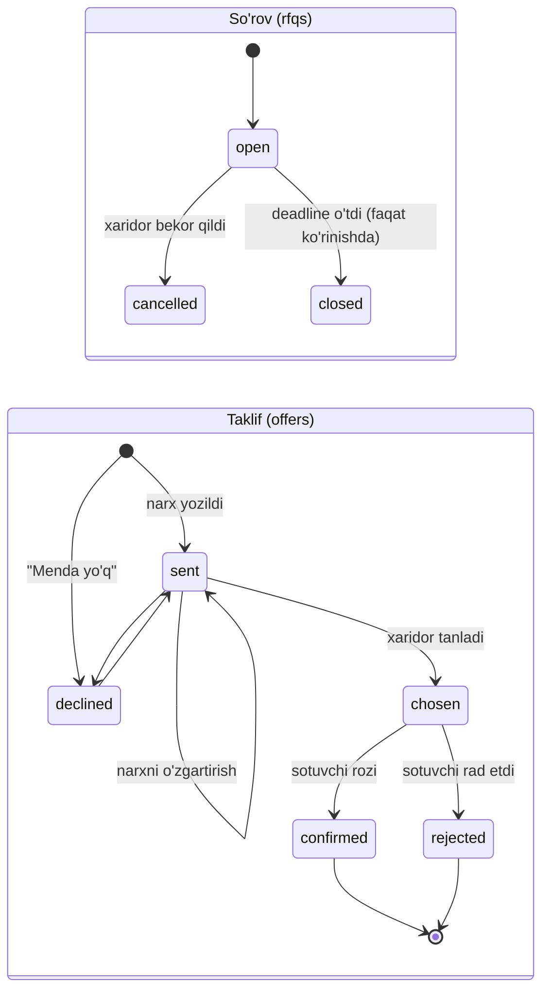

# Savdo va talab

Bu hujjat platformadagi savdo jarayonini va talab signallarini tushuntiradi: xaridorning narx so'rovi (RFQ) va sotuvchilarning takliflari, savdolar (deal) qanday yoziladi va tasdiqlanadi, savdodan keyingi savollar, sotuvchi reytingi, narx kuzatuvlari, talab signallari (`demand_events`) va e'lon qiziqishi (`listing_events`). Asosiy g'oya: kontaktni ochish faqat **qiziqish**, savdo emas. Savdo faqat kimdir "bo'ldi" deb aytganda yoziladi, ikkala tomon aytganda esa tasdiqlanadi. Barcha raqamlar `backend/` kodidan olingan.

## Mundarija

1. [RFQ: narx so'rovi](#1-rfq-narx-sorovi)
2. [Savdolar (deals)](#2-savdolar-deals)
3. [Savdodan keyingi savollar](#3-savdodan-keyingi-savollar)
4. ["Sotildi" tugmasi va zaxira](#4-sotildi-tugmasi-va-zaxira)
5. [Savdo narxi medianda](#5-savdo-narxi-medianda)
6. [Reyting](#6-reyting)
7. [Kuzatuvlar (watches)](#7-kuzatuvlar-watches)
8. [Talab signallari](#8-talab-signallari-demand_events)
9. [E'lon qiziqishi va voronka](#9-elon-qiziqishi-va-voronka)
10. [Kod bilan spec o'rtasidagi farqlar va e'tibor talab qiladigan joylar](#10-kod-bilan-spec-ortasidagi-farqlar-va-etibor-talab-qiladigan-joylar)
11. [Qayerda joylashgan](#qayerda-joylashgan)

---

## 1. RFQ: narx so'rovi

### 1.1 G'oya

Xaridor "menga 2 tonna kartoshka kerak" deb so'rov ochadi. So'rov o'sha **viloyatda** shu mahsulotdan faol e'loni bor sotuvchilarga boradi. Sotuvchilar narx yozadi yoki "Menda yo'q" deydi. Xaridor bitta taklifni tanlaydi, sotuvchi rozilik beradi. Shundan keyingina ikkala tomon bir-birining kontaktini ko'radi. Har bir taklif narxi bozor medianiga `rfq_offer` manbasi sifatida qo'shiladi (vazn 1.0).

### 1.2 Kim so'rov ocha oladi va cheklovlar

`rfq.CanBuy`: foydalanuvchi roli `buyer` va hududi (`region_id`) tanlangan bo'lishi kerak. So'rov xaridorning viloyatiga yoziladi.

| Cheklov | Qiymat | Kodda |
|---|---|---|
| Bir vaqtda ochiq so'rovlar | ko'pi bilan **3** ta | `rfq.MaxOpen` |
| Muddat | **1–7 kun**, standart **3 kun** | `DefaultDays = 3`, `MaxDays = 7` |
| Miqdor | `0 < miqdor ≤ 10 000 000` (mahsulotning asosiy birligida) | `maxQuantity` |
| Eng yuqori narx (`max_price_som`) | ixtiyoriy, 50 – 50 000 000 so'm | `minPriceSom`, `maxPriceSom` |
| Izoh | 300 belgigacha | `maxNote` |

"Ochiq" deganda `status = 'open'` va `deadline > now()` tushuniladi (`CountOpenRFQs`). 3 ta cheklov ikki parallel so'rovda ham buzilmasligi uchun `Create` tranzaksiyada avval foydalanuvchi qatorini qulflaydi (`LockUser ... FOR UPDATE`), keyin sanaydi.

`max_price_som` faqat sotuvchiga ko'rsatiladi ("Xaridor narxi: ... so'mgacha"). Undan qimmat taklif rad etilmaydi: `Offer` bu chegarani tekshirmaydi.

### 1.3 Kimga yuboriladi

`RFQRecipients` so'rovi quyidagi sotuvchilarni tanlaydi:

- shu mahsulotdan `status = 'active'` va `valid_until > now()` bo'lgan e'loni bor;
- e'lonning hududi so'rov bilan **bir viloyatda** (`COALESCE(r.parent_id, r.id) = province_id`, ya'ni tuman o'z viloyatiga tenglashtiriladi);
- xaridorning o'zi emas.

Savdo turi bo'yicha filtr yo'q: chakana e'loni bor sotuvchi ham so'rovni oladi. Taklif berish huquqi ham xuddi shu shart bilan tekshiriladi (`SellerCanOffer`). Shart bajarilmasa, `ErrNotEligible` qaytadi ("Javob berish uchun viloyatda shu mahsulotdan faol e'loningiz bo'lishi kerak").

So'rov ochilishi bilan `demand_events` jadvaliga `rfq` turidagi talab signali ham yoziladi (8-bo'lim).

### 1.4 Holatlar

So'rovning (`rfqs.status`) holatlari:

| Holat | Ma'nosi |
|---|---|
| `open` | ochiq, muddati o'tmagan |
| `closed` | muddati o'tgan. **Bazada saqlanmaydi**: API `rfqStatus()` bilan `open` + `deadline` o'tgan so'rovni `closed` deb ko'rsatadi |
| `cancelled` | xaridor bekor qildi (`POST /v1/rfqs/{id}/cancel`, faqat `open` holatidan) |

Taklifning (`offers.status`) holatlari:

| Holat | Ma'nosi |
|---|---|
| `sent` | sotuvchi narx yozdi |
| `declined` | sotuvchi "Menda yo'q" dedi (narx `NULL`) |
| `chosen` | xaridor tanladi, sotuvchi javobini kutmoqda |
| `confirmed` | sotuvchi rozi bo'ldi, kontaktlar almashildi, savdo yozildi |
| `rejected` | sotuvchi tanlangandan keyin rad etdi |



Qoidalar (`rfq.go`, `queries/rfq.sql`):

- Taklif (`Offer`) faqat `open` va muddati o'tmagan so'rovga beriladi, aks holda `ErrClosed`.
- Bitta sotuvchi bitta so'rovga bitta taklif beradi (`UNIQUE (rfq_id, seller_id)`). Narxni yoki "Menda yo'q"ni xaridor tanlamaguncha (`sent`/`declined` holatida) o'zgartirish mumkin (`UpsertOffer ... WHERE offers.status IN ('sent','declined')`). Tanlangandan keyin o'zgartirish `ErrOfferLocked` beradi.
- `Choose` faqat so'rov egasi va `sent` holatidagi taklif uchun. `Answer` faqat taklif egasi (sotuvchi) va `chosen` holatidagi taklif uchun.
- Tanlash va javob faqat `cancelled` so'rovda to'xtatiladi. Muddat o'tgan (`closed`) so'rovda ham xaridor tanlashi va sotuvchi javob berishi mumkin; sotuvchining kiruvchi ro'yxati (`SellerInbox`) `chosen`/`confirmed` takliflarni muddatdan keyin ham ko'rsatadi.
- Xaridor bir nechta taklifni tanlashi mumkin: kod "faqat bitta tanlov" degan cheklov qo'ymaydi.

### 1.5 Taklif narxi bozor medianida

Har bir `sent` taklif `price_observations` jadvaliga yoziladi (`recordOfferPrice`):

- `source = 'rfq_offer'` (vazn 1.0, qarang [narx metodologiyasi](03-narx-metodologiyasi.md)), `trade_type = 'ulgurji'`;
- `region_id` sotuvchining hududi, `valid_until` so'rovning `deadline`i, ya'ni narx so'rov yopilishi bilan mediandan chiqadi;
- avval shu taklifning eski kuzatuvi `expired` qilinadi, keyin yangisi qo'shiladi (bitta taklifga bitta jonli kuzatuv, `price_obs_one_offer_idx`);
- narx viloyatdagi ulgurji narxlarga nisbatan chetlanish (`analytics.IsOutlier`) bo'lsa, `status = 'review'` bo'ladi va medianga kirmaydi;
- "Menda yo'q" narx qo'shmaydi, faqat eski kuzatuvni o'chiradi;
- taklif o'chirilsa (so'rov yoki akkaunt bilan), trigger `offers_retire_prices` uning narxini darhol `expired` qiladi (migratsiya `00014`).

### 1.6 Tejash (savings) hisobi

Xaridor so'rov sahifasida (`GET /v1/rfqs/{id}`) viloyat ulgurji medianini va tejashni ko'radi:

```
tejash = max(0, (median − eng_arzon) × miqdor)
```

- `median` — so'rov viloyatidagi ulgurji weighted median (`ProductStats`); narxlar 3 tadan kam bo'lsa `0`, tejash ham `0`;
- `eng_arzon` — `declined` va `rejected` bo'lmagan takliflar ichidagi eng past narx (`sent`, `chosen`, `confirmed` hisobga olinadi);
- `miqdor` — so'rovdagi miqdor (asosiy birlikda).

Agar `eng_arzon ≥ median`, natija `0` (`rfq.Savings`). Har bir taklif uchun `diff_percent = round(100 × (narx − median) / median)` ham beriladi.

**Misol.** Namangan viloyatida kartoshka ulgurji medianasi 4 200 so'm/kg. Xaridor 2 000 kg so'radi. Takliflar: 4 100, 3 900, 4 400 so'm. Eng arzoni 3 900.

```
tejash = (4 200 − 3 900) × 2 000 = 600 000 so'm
diff_percent: 4 100 → −2%, 3 900 → −7%, 4 400 → +5%
```

### 1.7 Kontakt almashish

Kontakt faqat taklif `confirmed` bo'lgandan keyin ochiladi (`rfq.Parties`, boshqa holatda `ErrBadState`). `GET /v1/offers/{id}/contact` har bir tomonga **qarshi tomonning** kontaktini beradi va faqat o'sha odam ruxsat bergan usulda:

- `contact_telegram = true` va Telegram username bor bo'lsa — `https://t.me/<username>`;
- `contact_phone = true` va telefon bor bo'lsa — shifrlangan `phone_enc` ochilib, telefon raqami;
- ikkalasi ham yo'q bo'lsa — `404 contact_hidden`.

Botda rozilikdan keyin xaridorga sotuvchining, sotuvchiga xaridorning Telegram username'i yuboriladi (ruxsat bo'lsa). Telefon raqami botda yuborilmaydi, u faqat saytda ochiladi (`contactLine`). Tomonlar rozilikkacha bir-birining ismini ham ko'rmaydi: xaridor sotuvchining ommaviy ismini ko'radi, sotuvchi xaridorning ismini faqat rozilikdan keyin ko'radi.

Sotuvchi rozi bo'lganda (`confirmed`) shu tranzaksiyada `deals` jadvaliga `source = 'rfq'` savdo yoziladi (2-bo'lim).

---

## 2. Savdolar (deals)

### 2.1 Asosiy qoida

Kontaktni ochish savdo emas. Savdo (`deals` qatori) faqat kimdir "sotdim" yoki "oldim" deb aytganda paydo bo'ladi. Ikkala tomon aytganda savdo `confirmed` bo'ladi. Bazada `deals_confirmed_by_both` cheklovi bor: `confirmed` savdoda `buyer_confirmed_at` va `seller_confirmed_at` ikkalasi ham to'ldirilgan bo'lishi shart.

### 2.2 Manbalar (`source`)

| Manba | Qachon yoziladi | Boshlang'ich holat |
|---|---|---|
| `rfq` | sotuvchi tanlangan RFQ taklifiga rozi bo'lganda (`RecordRFQDeal`). `listing_id` — sotuvchining shu mahsulotdagi eng oxirgi yangilangan ulgurji e'loni; narx taklifdan, miqdor taklifdan yoki so'rovdan | darhol `confirmed` (ikkala vaqt `now()`) |
| `contact` | kontakt ochilgandan keyin xaridor "Ha, oldim" desa (`RecordBuyerContactDeal`) yoki sotuvchi kechki savolda "sotdim" desa (`RecordSellerContactDeal`) | `reported` |
| `seller_marked` | sotuvchi e'londagi "Sotildi" tugmasini bossa va tasdiqlanadigan xaridor xabari bo'lmasa (`RecordSellerMarkedDeal`) | `reported` |

`contact` manbali xaridor savdosi bir xaridor, bir e'lon va bir Toshkent kuni uchun bitta (`deals_contact_once_a_day_idx`).

### 2.3 Holatlar (`status`)

| Holat | Ma'nosi |
|---|---|
| `reported` | faqat bir tomon aytdi |
| `confirmed` | ikkala tomon aytdi (yoki RFQ kelishuvi) |
| `disputed` | sxemada bor, lekin **kod uni hech qachon o'rnatmaydi**. Faqat `SetDetails` uni tekshiradi (bahsli savdoni o'zgartirib bo'lmaydi) va admin filtrida (`GET /v1/admin/deals?status=disputed`) bor |

### 2.4 Xaridor va sotuvchi javoblari qanday juftlanadi

Juftlash **e'lon bo'yicha**, oxirgi **7 kun** ichida va **eng eskisidan** boshlab bo'ladi.

**Xaridor "Ha, oldim" desa** (`deals.buyerSaysYes`):

1. `LockSellerReportedDeal`: shu e'londa oxirgi 7 kunda sotuvchi aytgan, xaridori yo'q (`buyer_id IS NULL`), `reported` holatidagi (`contact` yoki `seller_marked`) eng eski savdo qidiriladi.
2. Topilsa — `ConfirmDealByBuyer`: xaridor unga biriktiriladi, savdo `confirmed`.
3. Topilmasa — xaridorning o'z `reported` savdosi yoziladi.

**Sotuvchi "sotdim" desa** (kechki savol, `deals.SellerSold`, yoki "Sotildi", `market.MarkSold`):

1. `LockBuyerReportedDeal`: shu e'londa oxirgi 7 kunda xaridor aytgan, sotuvchi hali tasdiqlamagan eng eski `reported` savdo.
2. Topilsa — `ConfirmDealBySeller`: savdo `confirmed`, natijada `matched = true`.
3. Topilmasa — sotuvchining xaridorsiz `reported` savdosi yoziladi.

Juftlash xaridorning shaxsini solishtirmaydi: e'londa bitta ochiq sotuvchi xabari bo'lsa, shu e'lon bo'yicha "oldim" degan birinchi xaridor uni tasdiqlaydi.

**Misol.** Dushanba kuni ikki xaridor A va B pomidor e'lonining kontaktini ochdi. Kechqurun 19:00 da sotuvchi "sotdim" tugmasini bir marta bosdi: xaridor javobi hali yo'q, shuning uchun `contact`, `reported`, `buyer_id = NULL` savdo yoziladi. Seshanba kuni A "Ha, oldim" desa, u shu savdoni topadi va `confirmed` qiladi. Chorshanba kuni B ham "Ha" desa, ochiq sotuvchi savdosi qolmagan: B uchun alohida `reported` savdo ochiladi. U sotuvchi yana "sotdim" demaguncha tasdiqlanmaydi.

### 2.5 Miqdor va narxni to'ldirish

`deals.SetDetails` (botda "Savdo #N" xabariga javob sifatida):

- faqat savdoning ikki tomoni, savdo yozilganidan keyin **7 kun** ichida (`DetailsWindow`), `disputed` bo'lmasa;
- miqdor `0 < q ≤ 10 000 000`, narx 50 – 50 000 000 so'm;
- **xaridor raqamlari ustun**: xaridor istalgan vaqtda yozadi, sotuvchi faqat bo'sh maydonni to'ldira oladi;
- har o'zgarishdan keyin savdo narxi mediandagi o'rnida qayta hisoblanadi (5-bo'lim).

---

## 3. Savdodan keyingi savollar

### 3.1 Xaridorga savol (kontaktdan 24 soat keyin)

Kirgan foydalanuvchi e'lon kontaktini ochganda (`revealContact`), bu sotuvchining o'zi bo'lmasa:

1. `contact_reveals` jadvaliga yozuv tushadi;
2. `contact` turidagi talab signali va e'lon hodisasi yoziladi;
3. `deals.ScheduleAfterContact` `deal_prompts` jadvaliga savol rejalashtiradi: `due_at = now + 24 soat` (`AskAfter`).

Rejalashtirish qoidalari (`ScheduleDealPrompt`):

- shu xaridor shu e'lon haqida oxirgi **7 kunda** so'ralgan bo'lsa (savol yaratilgan bo'lsa), yangisi qo'yilmaydi;
- bitta xaridor va e'lon uchun bir vaqtda faqat bitta ochiq savol (`deal_prompts_open_idx`);
- sotuvchi o'z e'loni haqida so'ralmaydi.

Yuborish (`deal_prompts` jobi, har **15 daqiqada**, `deals.TakeDue`):

| Qoida | Qiymat |
|---|---|
| Tungi tinchlik | Toshkent vaqti bilan **20:00 dan 09:00 gacha** yuborilmaydi (`QuietTo = 9`, `QuietFrom = 20`) |
| Kunlik limit | bir xaridorga Toshkent kuni ichida ko'pi bilan **3** ta savol (`MaxPerDay`); qolganlari ertaga |
| Eskirish | vaqti kelganidan keyin **3 kun** ichida yuborilmagan savol `expired` bo'ladi |
| Dublikat yo'q | savol yuborishdan oldin `sent` deb belgilanadi: server qulasa bitta savol yo'qolishi mumkin, lekin ikki marta ketmaydi. Ikki server bo'lsa `FOR UPDATE SKIP LOCKED` |

Tugmalar va javoblar:

| Tugma | Natija |
|---|---|
| "Ha, oldim" (`yes`) | 2.4-bo'limdagi juftlash; keyin "Savdo #N: qancha va 1 kg necha so'mdan?" savoli. "Miqdor va narxni aytmayman" tugmasi bilan o'tkazib yuborish mumkin |
| "Hali gaplashyapmiz" (`talking`) | **48 soatdan** keyin yana bir marta so'raladi. Bu tugma faqat birinchi savolda chiqadi: jami ko'pi bilan **2** marta so'raladi (`MaxAsks`) |
| "Yo'q" (`no`) | savol yopiladi |

### 3.2 Sotuvchiga kechki savol (19:00)

`seller_deal_digest` jobi har kuni Toshkent vaqti bilan **19:00** da (1 soatlik oyna) ishlaydi. Bugun (Toshkent kuni) kontakti ochilgan e'lonlari bor, boti yoqilgan sotuvchilarga bitta xabar boradi:

- har e'lon uchun "bugun N kishi raqamingizni ochdi" (N — `listing_events` dagi noyob kontakt ochganlar);
- ko'pi bilan **8** ta e'lon ko'rsatiladi, har biri ostida "sotdim" tugmasi (`s:sold:<listing>`);
- "Bugun sotuv bo'lmadi" tugmasi.

"Sotdim" har savdo uchun bir marta bosiladi va `deals.SellerSold` ni chaqiradi. Savdo narxi hali bo'lmasa, bot "Savdo #N" orqali miqdor va narxni so'raydi.

---

## 4. "Sotildi" tugmasi va zaxira

Sotuvchi e'lonni "sotildi" deb belgilaydi: saytda `POST /v1/listings/{id}/sold`, botda `/mening` ostidagi tugma (`x:sold:<listing>`) va "Sotildi #N" xabariga javob. Mantiq `market.MarkSold` da:

1. Miqdor `0 < q ≤ 10 000 000`, narx ixtiyoriy (50 – 50 000 000).
2. E'londa zaxira (`stock`) ko'rsatilgan bo'lsa va `q > zaxira` bo'lsa — xato `more_than_stock` ("Zaxiradagidan ko'p sotib bo'lmaydi").
3. Shu e'londa xaridor aytgan tasdiqlanmagan savdo bo'lsa — u tasdiqlanadi (`matched`), xaridorning miqdor/narxi ustun, sotuvchiniki faqat bo'sh joyni to'ldiradi. Aks holda `seller_marked` savdo yoziladi.
4. Savdo narxi medianga moslanadi (`SyncDealPrice`).
5. Zaxira bor bo'lsa: `qoldiq = zaxira − q`. `qoldiq ≤ 0` bo'lsa e'lon **yashiriladi** (`hidden`, `sold_out = true`) va zaxira `NULL` bo'ladi. Zaxira ko'rsatilmagan e'lon o'zgarmaydi.

**Misol.** E'londa 500 kg zaxira. Sotuvchi "200 5800" deb yozdi: 200 kg, 5 800 so'mdan. Qoldiq 300 kg, e'lon faol qoladi. Keyin "300" deb yozsa, qoldiq 0, e'lon yashiriladi va bot "Zaxira tugadi, e'lon yashirildi" deydi.

---

## 5. Savdo narxi medianda

Tasdiqlangan savdoning kelishilgan narxi eng ishonchli narx sifatida medianga qo'shiladi (`market.SyncDealPrice`, migratsiya `00021`):

- har o'zgarishdan keyin eski kuzatuv `expired` bo'ladi, keyin kerak bo'lsa yangisi qo'shiladi;
- faqat `status = 'confirmed'`, `price_som` bor va `source <> 'rfq'` savdolar (RFQ savdosining narxi `rfq_offer` sifatida allaqachon medianda);
- `source = 'deal'`, vazn **1.0**, `valid_until = now + 7 kun`, savdo turi e'londan (e'lon bo'lmasa `ulgurji`);
- xatoni ushlash: narx e'lon narxining `[0.5 ×; 2 ×]` oralig'idan tashqarida bo'lsa, `status = 'review'` va medianga kirmaydi.

**Misol.** E'lon narxi 6 000 so'm/kg. Xaridor savdo narxini 13 000 deb yozdi (ehtimol xato): `13 000 > 2 × 6 000 = 12 000`, shuning uchun narx `review` ga tushadi. 5 800 yozilsa, `active` bo'lib medianga qo'shiladi.

Mahsulot sahifasidagi `interest` blokida oxirgi 7 kundagi tasdiqlangan savdolar soni va ularning narx medianasi (`percentile_cont(0.5)`) ko'rsatiladi. Har bir raqam faqat **5 dan** boshlab chiqadi (`minPublic`).

---

## 6. Reyting

Qoidalar (`deals.Rate`, `deals.Comment`, `queries/ratings.sql`, `httpapi/ratings.go`):

1. **Kim baholaydi:** faqat `confirmed` savdoning xaridori, faqat bot orqali. Bir savdoga bitta baho (`ratings.deal_id UNIQUE`); qayta bosilsa yulduzlar yangilanadi.
2. **Qachon so'raladi:** `rating_prompts` jobi har kuni **11:00** da (3 soatlik oyna). U tasdiqlanganiga (`GREATEST(buyer_confirmed_at, seller_confirmed_at)`) **3 kundan 30 kungacha** bo'lgan, xaridori bor, boti yoqilgan, hali so'ralmagan va baholanmagan savdolarni oladi. Bir ishga tushishda ko'pi bilan 200 ta. `rating_asked_at` qo'yiladi, shuning uchun har savdo **bir marta** so'raladi.
3. **Baho:** 1–5 yulduz tugmalari. Keyin "Baho #N" xabariga javob sifatida ixtiyoriy izoh, **300 belgigacha**.
4. **Moderatsiya:** yulduz **≤ 2** va izoh bo'sh bo'lmasa, baho `held` bo'ladi: izoh admin ko'rmaguncha chiqmaydi. Boshqa hollarda `published`. `hidden` qilingan baho keyingi o'zgarishlarda ham `hidden` qoladi.
5. **Admin:** `GET /v1/admin/ratings/held` va `POST /v1/admin/ratings/{id}/decision` (`publish: true` → `published`, `false` → `hidden`). Yashirish faqat izohni yashiradi, yulduzlar hisobda qoladi.
6. **Ko'rsatish:** sotuvchida kamida **3** ta baho bo'lganda (`minRatings`). O'rtacha **barcha** baholar bo'yicha (held/hidden ham), bir kasr xonagacha yaxlitlanadi. Oxirgi **3** ta `published` izoh ko'rsatiladi.

**Misol.** Sotuvchida baholar: 5, 4, 1 (izohi "tarozi kam tortdi", `held`). Soni 3, o'rtacha `(5+4+1)/3 = 3.33 → 3.3`. Izohlar ro'yxatida faqat 5 va 4 yulduzli izohlar bor (agar izoh yozilgan bo'lsa). 1 yulduzli izoh admin qaroridan keyin chiqadi.

---

## 7. Kuzatuvlar (watches)

### 7.1 Qo'shish

Foydalanuvchi mahsulotni viloyatda (yoki butun respublikada) kuzatadi: saytda `POST /v1/watches`, botda `/savol` javobi ostidagi "Kuzatish" tugmasi.

| Qoida | Qiymat |
|---|---|
| Limit | bir foydalanuvchiga **20** ta (`MaxPerUser`); mavjud kuzatuvni qayta qo'shish limitga kirmaydi |
| Noyoblik | `(user_id, product_id, trade_type, COALESCE(province_id, 0))` bo'yicha bitta (`watches_once_idx`) |
| Qayta qo'shish | saytdan — faqat `max_price` ni yangilaydi (bo'sh yuborilsa chegara olib tashlanadi); botdan — saytda qo'yilgan chegarani saqlab qoladi (`watch.Follow`) |
| `max_price` | ixtiyoriy, 50 – 50 000 000. Bo'sh bo'lsa chegara "medianadan 5% past" |
| Savdo turi | `ulgurji` (standart) yoki `chakana` |
| Hudud | tuman berilsa uning viloyati olinadi; `0` = butun respublika |
| Boshlang'ich `peak_median` | joriy median, agar narxlar ≥ 3 bo'lsa |

Limit parallel so'rovlarda ham buzilmasligi uchun foydalanuvchi qatori qulflanadi. Saytdan qo'shish `watch` turidagi talab signalini ham yozadi.

### 7.2 Tekshirish va xabar

`watch_alerts` jobi har kuni **08:00** va **17:00** da (2 soatlik oyna) boti yoqilgan foydalanuvchilarning barcha kuzatuvlarini tekshiradi (`watch.Check`). Ikki trigger bor:

**1) Arzonroq yangi e'lon.**

```
chegara = max_price                    (agar berilgan bo'lsa)
chegara = floor(median × (1 − 0.05))   (aks holda, narxlar ≥ 3 bo'lsa)
```

Oxirgi tekshiruvdan (`checked_at`) keyin qo'yilgan, `narx ≤ chegara` bo'lgan faol e'lon narxi qidiriladi (`CheapestNewListing`). Kuzatuvchining o'z e'lonlari hisobga olinmaydi. Topilsa eng arzoni xabar qilinadi.

**2) Median tushishi.**

```
median_hozir ≤ peak_median × (1 − 0.05)
```

`peak_median` oxirgi xabardan beri kuzatilgan eng yuqori median. Median ko'tarilsa, `peak` ham ko'tariladi. Xabar yuborilganda `peak` joriy medianga tushiriladi, keyingi tushish shu yerdan o'lchanadi. Median `WatchMedian` bilan hisoblanadi: tanlangan viloyat yoki respublika bo'yicha barcha faol kuzatuvlarning weighted medianasi. Narxlar 3 tadan kam bo'lsa, median triggeri ishlamaydi.

**Kuniga bir marta:** agar `notified_at` bugungi Toshkent kuni bo'lsa, yangi xabar yuborilmaydi. Shunda ham `checked_at` yangilanadi: o'sha oraliqdagi arzon e'lon keyingi tekshiruvda qayta xabar qilinmaydi.

**Misol.** Kuzatuv: piyoz, Namangan, `max_price` yo'q. Qo'shilganda median 5 200 edi (`peak = 5 200`).

- Ertalab 08:00 da median 5 000, chegara `floor(5 000 × 0.95) = 4 750`. Kecha kechqurun 4 700 so'mlik yangi e'lon chiqqan: **arzon narx xabari**.
- Median tushishi: `5 000 ≤ 5 200 × 0.95 = 4 940`? Yo'q, bu trigger ishlamaydi.
- Xabar yuborilgani uchun `peak = 5 000` bo'ladi. Keyingi kun median 4 740 bo'lsa, `4 740 ≤ 5 000 × 0.95 = 4 750`: **median tushishi xabari** ("Median 5 000 dan 4 740 so'mga tushdi (−5,2%)").

---

## 8. Talab signallari (`demand_events`)

### 8.1 Nima yoziladi

Talab signali — kimdir mahsulotga qiziqqanining izi. Signallar bosim indeksi, "eng ko'p qidirilgan" ro'yxati va mahsulot sahifasidagi qiziqish uchun ishlatiladi (qarang [tahlil metodologiyasi](04-tahlil-metodologiyasi.md)).

| `kind` | Qayerda yoziladi | Kim hisoblanadi |
|---|---|---|
| `view` | mahsulot sahifasi (`GET` mahsulot, `getProduct`) | kirgan foydalanuvchi, aks holda IP |
| `search` | katalog qidiruvi mahsulot topsa (`browseProducts`): nomi yoki slug'i aniq mos kelgani, bo'lmasa birinchi natija | foydalanuvchi yoki IP |
| `contact` | e'lon kontakti ochilganda | faqat kirgan foydalanuvchi |
| `rfq` | RFQ ochilganda | xaridor |
| `question` | `/savol` (bot) mahsulotni tanisa | faqat bog'langan foydalanuvchi |
| `watch` | saytdan kuzatuv qo'shilganda | foydalanuvchi |

Viloyat (`province_id`): foydalanuvchi ko'rayotgan hudud, bo'lmasa uning o'z hududi, bo'lmasa `NULL` (`demandProvince`).

### 8.2 Kuniga bir marta, IP saqlanmaydi

- Bitta tashrifchi bitta mahsulot va tur bo'yicha **Toshkent kunida bir marta** hisoblanadi: `UNIQUE (kind, product_id, viewer_key, day)`, `ON CONFLICT DO NOTHING`.
- `viewer_key` — `"<kun>|u:<user_id>"` yoki `"<kun>|ip:<ip>"` satrining hashi. Sayt, RFQ va botdagi `/savol` hammasi bir xil `secure.Sealer.Hash` (maxfiy kalitli HMAC-SHA-256) ishlatadi, shuning uchun bir kunda bir odamning turli signallari bitta kalitga tushadi.
- Kun hash ichida bo'lgani uchun bir odamni kunlar bo'yicha bog'lab bo'lmaydi.
- **Saqlanmaydi:** IP manzil, foydalanuvchi ID, brauzer ma'lumoti. Faqat tur, mahsulot, viloyat, kalit, kun va vaqt.
- Yozish "best-effort": xato bo'lsa log qilinadi, asosiy so'rov buzilmaydi. Shifrlash kaliti (`sealer`) sozlanmagan bo'lsa yoki IP aniqlanmasa, signal yozilmaydi.

**Misol.** Anonim tashrifchi bir kunda kartoshka sahifasini 7 marta ochdi: bitta `view`. Keyin kirib, kontakt ochsa: bitta `contact`, lekin uning kaliti `u:` bilan, shuning uchun `view` dagi `ip:` kalitidan farq qiladi. Ertasi kuni u yana ochsa, yangi kalit va yangi `view`.

---

## 9. E'lon qiziqishi va voronka

### 9.1 `listing_events` va xom `views`

Bitta e'lonning qiziqishi ikki xil sanaladi:

| O'lchov | Qanday sanaladi | Qayerda ko'rinadi |
|---|---|---|
| `listings.views` (xom hisoblagich) | e'lon sahifasining **har bir** ochilishi `+1` (`IncrementListingView`), qayta yuklash ham. Faqat sotuvchining o'zi hisobga olinmaydi | saytdagi e'lon kartasi |
| `listing_events` (`view`, `contact`) | noyob tashrifchi, e'lon, tur va Toshkent kuni bo'yicha bir marta (`listing_events_once_idx`), `demand_events` bilan bir xil kunlik kalit. Sotuvchining o'zi yozilmaydi | statistika, voronka, avtomatik narx |

Shuning uchun `views` noyob ko'rishlardan doim katta yoki teng bo'ladi.

### 9.2 Voronka va statistika

- **Mahsulotlarim** (`SellerFunnels`, `funnel_7d`): har e'lon uchun oxirgi 7 Toshkent kunidagi noyob ko'rishlar, kontaktlar va savdolar (`confirmed` + `reported`).
- **E'lon statistikasi** `GET /v1/me/listings/{id}/stats?days=7|30`: kunlik qatorlar (`series`), jami `views`, `contacts`, `contact_rate = contacts / views` (3 kasr, ko'rish bo'lmasa 0), `deals_confirmed`, `deals_reported`, `sold_quantity`.
- **Bozor bilan solishtirish** (`market`): shu viloyatda shu mahsulot va savdo turidagi boshqa faol e'lonlar **kamida 5 ta** bo'lsa (`minPublic`). E'lon boshiga o'rtacha ko'rish va kontakt (bir kasr) hamda umumiy `contact_rate`. Kamroq bo'lsa, bu blok yuborilmaydi, chunki alohida sotuvchini ajratib olish mumkin bo'lib qoladi.

**Misol.** 7 kunda 120 noyob ko'rish, 9 kontakt: `contact_rate = 0.075`. Viloyatda 6 ta boshqa e'lon jami 480 ko'rish va 60 kontakt olgan: e'lon boshiga 80 ko'rish, 10 kontakt, `contact_rate = 0.125`. Sotuvchi e'loni ko'p ko'rilayotganini, lekin kam bog'lanilayotganini ko'radi (narx qimmat bo'lishi mumkin).

---

## 10. Kod bilan spec o'rtasidagi farqlar va e'tibor talab qiladigan joylar

- **`disputed` holati ishlatilmaydi.** Jadval va admin filtri bor, lekin savdoni bu holatga o'tkazadigan kod yo'q.
- **`closed` RFQ holati bazaga yozilmaydi.** U faqat API javobida hisoblanadi. Muddat o'tgan so'rovda ham taklif tanlash va rozilik berish mumkin (faqat `cancelled` to'xtatadi).
- **Botdan kuzatuv qo'shish talab signalini yozmaydi**, faqat saytdan qo'shish yozadi.
- **`max_price_som` RFQ da faqat ma'lumot uchun.** Undan qimmat takliflar ham qabul qilinadi.
- **Reyting o'rtachasi** `held` va `hidden` baholarni ham o'z ichiga oladi (yulduzlar doim hisoblanadi, bu ataylab qilingan).
- **Savdo juftlash e'lon bo'yicha**, xaridor shaxsi bo'yicha emas (2.4-bo'lim).
- **Savol boti o'chiq xaridorga ham "yuborilgan" deb belgilanadi**: `TakeDue` `bot_enabled` ni tekshirmaydi, bot faqat yuborishni o'tkazib yuboradi. Bunday savol kunlik 3 ta limitga ham kiradi.

---

## Qayerda joylashgan

- `backend/internal/rfq/rfq.go` — RFQ xizmati: `Create`, `Offer`, `Choose`, `Answer`, `Cancel`, `Parties`, `Savings`, `recordOfferPrice`
- `backend/internal/httpapi/rfq.go` — RFQ endpointlari, `rfqStatus`, tejash va `diff_percent`, `offerContact`
- `backend/queries/rfq.sql` — `RFQRecipients`, `SellerCanOffer`, `UpsertOffer`, `SellerInbox`, `OfferParties`
- `backend/internal/deals/deals.go` — `ScheduleAfterContact`, `TakeDue`, `Answer`, `SellerSold`, `SetDetails`, `Rate`, `Comment`
- `backend/queries/deals.sql`, `backend/queries/ratings.sql` — savdo va reyting so'rovlari
- `backend/internal/market/sold.go` — `MarkSold`, `SyncDealPrice`
- `backend/internal/watch/watch.go`, `backend/queries/watches.sql` — kuzatuvlar
- `backend/internal/httpapi/demand.go` — `recordDemand`, `recordListingEvent`, `visitor`, `demandProvince`
- `backend/internal/httpapi/browse.go` — `getProduct`, `browseProducts`, `revealContact`
- `backend/internal/httpapi/feed.go` — `getListing` (xom `views` va `listing_events`)
- `backend/internal/httpapi/funnel.go`, `backend/queries/funnel.sql` — voronka, statistika, `ProductInterest`, admin savdolari
- `backend/internal/httpapi/ratings.go` — reytingni ko'rsatish va moderatsiya
- `backend/internal/bot/deals.go`, `rating.go`, `watch.go`, `rfq.go` — bot tomoni (qarang [Telegram bot](07-telegram-bot.md))
- `backend/cmd/api/main.go` — rejalashtirilgan ishlar: `deal_prompts`, `seller_deal_digest`, `watch_alerts`, `rating_prompts`
- `backend/migrations/00013_rfq_flow.sql`, `00014`, `00015_demand_events.sql`, `00018_deals.sql`, `00019_listing_events.sql`, `00020_deal_prompts.sql`, `00021_deal_prices.sql`, `00022_watches.sql`, `00023_ratings.sql`
