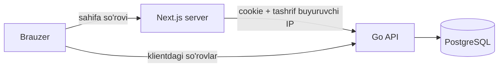

# Veb-sayt

Sayt — platformaning asosiy kirish nuqtasi: bozor (e'lonlar), mahsulot va narx tahlili, sotuvchi kabineti, narx so'rovlari, statistika sahifalari va admin paneli. U Next.js da yozilgan, uch tilda (o'zbek, ingliz, rus) va yorug'/qorong'i mavzuda ishlaydi, telefonda ilovadek, Telegram bot ichida esa Mini App sifatida ochiladi. Bu hujjat sahifalar, ma'lumot oqimi, tillar, mavzu, grafiklar va Mini App qanday ishlashini tushuntiradi.

## Mundarija

1. [Texnologiyalar](#texnologiyalar)
2. [Sahifalar xaritasi](#sahifalar-xaritasi)
3. [Navigatsiya](#navigatsiya)
4. [Ma'lumot oqimi](#malumot-oqimi)
5. [Tillar](#tillar)
6. [Xatolarni ko'rsatish](#xatolarni-korsatish)
7. [Mavzu: yorug', qorong'i, tizim](#mavzu-yorug-qorongi-tizim)
8. [Grafiklar](#grafiklar)
9. [Telefon va Telegram Mini App](#telefon-va-telegram-mini-app)
10. [Xavfsizlik, SEO va sozlamalar](#xavfsizlik-seo-va-sozlamalar)
11. [Qulaylik va sifat](#qulaylik-va-sifat)

## Texnologiyalar

| Qism | Tanlov | Nima uchun |
|---|---|---|
| Freymvork | Next.js 16 (App Router, Turbopack), React 19 | Sahifalar serverda tayyorlanadi: tez ochiladi, qidiruv tizimlari va Telegram ko'rinishi uchun to'liq HTML |
| Stil | Tailwind CSS v4, shadcn komponentlari (Base UI asosida) | Yagona dizayn tokenlari, mavzular CSS o'zgaruvchilari orqali |
| Server bilan ishlash | Hey API (OpenAPI dan TypeScript klient), TanStack Query | API turlari backenddan avtomatik; kesh, qayta yuklash va optimistik yangilash |
| Formalar | react-hook-form + zod | Xatolar maydon yonida, uch tilda |
| Tillar | next-intl | Server va klient komponentlarida bir xil tarjima; kalitlar TypeScript bilan tekshiriladi |
| Mavzu | next-themes | Yorug', qorong'i, tizim; sahifa chizilishidan oldin qo'llanadi |
| Grafiklar | d3-scale, d3-shape, d3-geo + o'zimizning SVG komponentlar | Kichik hajm, mavzu ranglari, to'liq nazorat |
| Harakat | motion, Lenis (faqat kompyuterda) | Silliq o'tishlar; telefonda tabiiy aylantirish saqlanadi |
| Bildirishnomalar | sonner | Toast xabarlar |
| Rasmlar | `next/image` (`components/photo.tsx`) | O'lchamga mos, keshlanadigan rasm nusxalari; faqat saytning `/api/media` va API'ning `/media` manzillaridan |
| Xatolarni kuzatish | `@sentry/nextjs` (ixtiyoriy) | `NEXT_PUBLIC_SENTRY_DSN` bo'lmasa SDK umuman yuklanmaydi |
| Testlar | Playwright (`e2e/`) | Demo yo'li desktop va 390 px telefonda |

## Sahifalar xaritasi

| Manzil | Kim uchun | Nima bor |
|---|---|---|
| `/` | Hamma | Bozor: toifalar, filtrlar (savdo turi, narx oralig'i, mahsulot), saralash, cheksiz yuklanadigan e'lonlar |
| `/katalog` | Hamma | Xuddi shu bozor, katalog manzilida |
| `/elon/{id}` | Hamma | E'lon: rasmlar galereyasi, narx va bozor medianiga nisbati, narx ostida "Narxlarni solishtirish" va "Tahlil va prognoz" plitkalari, sotuvchi va uning reytingi (bosilsa do'koniga o'tadi), bog'lanish, sotuvchining boshqa e'lonlari |
| `/sotuvchi/{id}` | Hamma | Sotuvchi do'koni: nomi, hududi, qachondan beri, toifalar, reyting va sharhlar, barcha faol e'lonlari. Telefon va Telegram ko'rsatilmaydi |
| `/mahsulot/{slug}` | Hamma | Mahsulot: tanlangan hudud bo'yicha median va oraliq, qiziqish, talab-taklif zonasi, viloyatlar, barcha takliflar arzonidan (har birida "Do'kon" havolasi); "Tahlil va prognoz", "Narx tushsa xabar ber" |
| `/mahsulot/{slug}/tahlil` | Hamma | Mahsulot tahlili: sarlavha ostida solishtirish, xarita va viloyatlar jadvaliga tezkor havolalar, maslahat, grafik (g'ayrioddiy kunlar grafik ostida belgilanadi: ✕ — chiqarilgan, chiziqda bo'shliq; ? — tekshirilmoqda), prognoz va u qanday tuzilgani (usullar xatosi, har haftaning omillari), mavsum, hafta kunlari, viloyatlar, arbitraj, rekordlar, keskin o'zgarishlar, ob-havo, kurs, CSV |
| `/statistika` | Hamma | Mahsulot × viloyat narx issiqlik xaritasi (issiq va sovuq nuqtalar belgisi bilan), viloyatlar guruhlari (K-Means, xaritada guruh rangida), haftaning o'zgarishlari, eng ko'p so'ralganlar |
| `/hudud/{id}` | Hamma | Viloyat: pasport, narx indeksi, mahsulotlar, taqchil va ortiqcha, narxi o'xshash viloyatlar, boshqa viloyatda sotish imkoniyatlari |
| `/solishtirish` | Hamma | 4 tagacha mahsulot × viloyat chizig'i, so'mda yoki indeksda |
| `/xarita` | Hamma | Viloyatlar xaritasi: talab-taklif zonasi yoki narx bo'yicha |
| `/kirish` | Mehmon | Telegram orqali kirish |
| `/boshlash` | Yangi foydalanuvchi | Rol, hudud, bozor, toifalar va rozilik |
| `/profil` | Kirgan | Ma'lumotlar, "Do'konim" (o'z do'koni sahifasi), bog'lanish usullari, kuzatuvlar, bot, hisobni o'chirish |
| `/mahsulotlarim` | Sotuvchi | E'lonlar: holat, bozordagi o'rin, 7 kunlik voronka, uzaytirish, "Sotildi", yashirish, o'chirish |
| `/mahsulotlarim/yangi` | Sotuvchi | Yangi e'lon: mahsulot tanlash, rasmlar, narx, qo'shimcha ma'lumot, jonli ko'rinish |
| `/mahsulotlarim/{id}` | Sotuvchi | Tahrirlash, statistika va narx (avtomatik narx va o'zgarishlar tarixi) tablari |
| `/narx` | Sotuvchi | Narxlarni oddiy matn bilan yuborish, tasdiq kartochkasi, natija (o'rin, tekshiruv) |
| `/sorovlar`, `/sorovlar/{id}` | Xaridor | Narx so'rovi yuborish, takliflarni solishtirish, tanlash, kontakt |
| `/kabinet` | Rolga qarab | Sotuvchi: kelgan so'rovlar. Xaridor: `/sorovlar` ga o'tadi. Tashkilot va bozor ma'muriyati: haftalik PDF hisobot |
| `/admin` | Administrator | Tekshiruv (narx yoki matn sababi bilan), rollar, savdolar, baholar, voqealar jurnali, monitoring ogohlantirishlari, narx anomaliyalari (tasdiqlash yoki rad etish), shubhali sotuvchilar |

**Model funksiyalari:** AI yordamchi har sahifaning o'ng pastki burchagida (`components/analyst/chat-widget.tsx`): tugma bosilganda kompyuterda oyna, telefonda to'liq ekran bo'lib ochiladi, kodi faqat birinchi ochilganda yuklanadi; `/tahlilchi` — xuddi shu suhbatning katta sahifasi (`POST /v1/chat`): davom savollari («Andijonda-chi?»), aniqlashtirish tugmalari, jadval va manbalar; suhbat `localStorage` da saqlanadi, javob matni faqat oddiy matn sifatida chiqadi, taklif qilingan harakatlar (narxni kuzatish, so'rov yuborish) faqat tasdiqlash oynasidan keyin bajariladi; admin panelida «Yordamchi» bo'limi (`GET /v1/admin/chat/stats`, `/v1/admin/chat/unanswered`); `/narx` sahifasida ovoz va rasm tugmalari (`POST /v1/prices/transcribe`, `/v1/prices/from-photo`); tahlil sahifasida maslahatning oddiy tildagi matni (`GET /v1/products/{slug}/advice-text`); admin panelida model sarfi bo'limi (`GET /v1/admin/ai-usage`). Qaysi funksiya yoqilganini sayt `GET /v1/ai/features` dan biladi.

Kirish talab qiladigan sahifalar kirmagan foydalanuvchini `/kirish?keyin=<sahifa>` ga yuboradi, kirgach o'sha sahifaga qaytaradi. Sessiya cookie'si umuman bo'lmasa bu yo'naltirish sahifa chizilishidan oldin `src/proxy.ts` da (haqiqiy 307) bo'ladi, `/admin` esa 404 qaytaradi; sahifalarning o'zi ham sessiyani serverda tekshiradi. Ro'yxatdan o'tishni tugatmagan foydalanuvchi `/boshlash` ga yo'naltiriladi.

## Navigatsiya

- **Header:** logo, qidiruv (mahsulot nomi bo'yicha, tarjima va o'zbekcha nom bilan), keng ekranda "Statistika", mavzu, til, hudud tanlash, sotuvchiga "E'lon joylash", profil menyusi yoki "Kirish".
- **Telefondagi pastki menyu:** "Bosh" va "Tahlil" hamma uchun. Sotuvchi "Arzon" tabi o'rniga o'rtadagi "+" tugmasini va "Mening" tabini oladi. Xaridorda "Arzon" va "So'rovlar", mehmonda "Arzon" tablari. Oxirida "Profil" yoki "Kirish".
- **Profil menyusi:** sotuvchiga "Mahsulotlarim" va "Kelgan so'rovlar", xaridorga "So'rovlarim", tashkilotga "Kabinet", hammaga "Kuzatuvlarim", admin uchun "Boshqaruv".
- **Footer:** toifalar, xaridorlar uchun, sotuvchilar uchun va "Tahlil" (statistika, solishtirish, xarita) ustunlari.
- **Hudud tanlash** header'da cookie'ga (`bugun_region`) yoziladi va barcha narxlar shu hudud bo'yicha hisoblanadi. Havolada `?region=` bo'lsa (masalan botdagi narx ogohlantirishida), u cookie'dan ustun turadi.

## Ma'lumot oqimi

- **Server komponentlari** sahifani API dan olingan ma'lumot bilan tayyorlaydi. So'rovga foydalanuvchining sessiya cookie'si va IP manzili qo'shiladi (`X-Client-IP` + `X-Internal-Secret`). Shunda API ko'rishlarni va so'rovlar limitini sayt serveri bo'yicha emas, har bir tashrif buyuruvchi bo'yicha hisoblaydi.
- **Klient komponentlari** (formalar, tugmalar, filtrlar) API ni to'g'ridan-to'g'ri chaqiradi. Buni TanStack Query va generatsiya qilingan funksiyalar (`src/lib/api/gen`) bajaradi.
- **API turlari avtomatik:** backend `openapi.json` ni chiqaradi, `npm run api:gen` undan TypeScript turlari va funksiyalarni yaratadi. Backenddagi o'zgarish frontendda tur xatosi sifatida darhol ko'rinadi.
- **Filtrlar optimistik:** toifa, savdo turi, saralash, davr yoki viloyat bosilganda tugma darhol almashadi. Pastdagi ro'yxat yoki grafik yangi ma'lumot kelguncha xira holda ekranda qoladi — sakrash va bo'sh ekran bo'lmaydi.
- **Fayllar:** CSV va PDF havolalari API ning ochiq manziliga olib boradi (`apiFileUrl`), sessiya cookie'si u yerga ham yetadi.

## Tillar

- **Til tanlash:** header'dagi til menyusi tanlovni `NEXT_LOCALE` cookie'siga bir yilga yozadi. Manzil barcha tillarda bir xil qoladi, shuning uchun bot yuboradigan havolalar ham har qanday tilda ishlaydi. Standart til — o'zbek.
- **Tarjima fayllari:** `src/messages/<uz|en|ru>/<nom>.json`, har bir mavzu uchun alohida fayl (`market`, `analytics`, `rfq`, `errors`, `codes` va boshqalar). `npm run i18n:index` ulardan har bir til uchun `index.ts` yaratadi.
- **Tekshiruv:** `npm run i18n:check` quyidagilarni tekshiradi:
  - ingliz va rus fayllarida o'zbekchadagi barcha kalitlar bor;
  - har bir xabar ICU sintaksisi bo'yicha to'g'ri o'qiladi;
  - `{o'zgaruvchilar}` va `<teglar>` hamma tilda bir xil;
  - `index.ts` fayllari eskirmagan.
- **Ko'plik shakllari:** ingliz va rus tillarida ICU plural qoidalari ishlatiladi ("1 seller / 5 sellers", "1 продавец / 5 продавцов").
- **Katalog nomlari:** API mahsulot, toifa, viloyat va bozor nomlarini o'zbekcha yuboradi. Sayt ularni `catalog.en.json` va `catalog.ru.json` lug'atlari orqali tarjima qiladi. Qidiruv tarjima nomini ham, o'zbekcha nomni ham topadi.
- **Kodlar orqali tarjima:** API matn o'rniga barqaror kod yuboradi, sayt esa uni tanlangan tilga aylantiradi. Bu quyidagilarga tegishli:
  - xato kodlari;
  - tekshiruv sabablari;
  - bosim zonalari;
  - maslahat sabablari (`advice.items`);
  - parser xabarlari (`problems[].code`, `hints`).
- **Sana va raqamlar:**
  - Barcha vaqt Toshkent vaqtida ko'rsatiladi. O'zbekcha oy nomlari saytning o'zida yozilgan, chunki brauzerlarda `uz` sana formati bir xil emas.
  - Narxlar minglik bo'luvchi bilan: "4 500".
  - Foizlar tilga qarab: "3,2%" (uz, ru) va "3.2%" (en).
- **Bayramlar:** bazada o'zbekcha saqlanadi. Ma'lum bayram nomlari (Navro'z, Qurbon hayiti, Ramazon va boshqalar) lug'at orqali tarjima qilinadi.
- **Tarjima qilinmaydigan matn:** foydalanuvchi kiritgan matn o'zgarishsiz ko'rsatiladi. Bunga sotuvchi va do'kon nomlari, e'lon tavsifi, admin yozgan voqea nomlari kiradi.

## Xatolarni ko'rsatish

- API har bir xatoda `code` va maydon xatolarida `errors[].code` + `params` qaytaradi (masalan `more_than_stock {stock: 2000}`). Sayt ularni `errors` tarjimalari orqali ko'rsatadi: forma maydoni yonida yoki toast sifatida.
- Bitta maydonda xato bo'lsa, toast umumiy "Ma'lumotlarni tekshiring" emas, aniq sababni aytadi.
- Sessiya tugagan bo'lsa (401), toast'da "Kirish" tugmasi chiqadi va kirgandan keyin foydalanuvchi o'sha sahifaga qaytadi.
- API band bo'lsa (429 yoki server xatosi), kirgan foydalanuvchi kirish sahifasiga otilmaydi, xato sahifasi va "Qayta urinish" tugmasi ko'rsatiladi.
- **Xato va yuklanish sahifalari:** har asosiy bo'limda o'z `error.tsx` (`admin`, `kabinet`, `profil`, `mahsulotlarim`, `narx`, `sorovlar`, `statistika`, `xarita`, `solishtirish`, `hudud/[id]`, `mahsulot/[slug]/tahlil`) va `loading.tsx` skeleti bor; butun ilova yiqilsa `global-error.tsx`. Ushlangan xatolar Sentry sozlangan bo'lsa unga yuboriladi.
- **Biznes limitlari** (RFQ soni va muddati, avtomatik narx oralig'i, rasmlar soni va hajmi, kuzatuvlar, taqqoslash chiziqlari) `GET /v1/meta/limits` dan olinadi (`components/limits.tsx`), sayt ularni o'zida qotirmaydi. So'rov kelguncha yoki xato bo'lsa standart qiymatlar ishlatiladi, API baribir qayta tekshiradi.
- **Demo belgisi:** API javobidagi `demo_share` 0 dan katta bo'lsa (`components/demo-badge.tsx`) grafik, prognoz, klaster, taqqoslash va admin ro'yxatlarida "Demo ma'lumot" belgisi va ulushi chiqadi.

## Mavzu: yorug', qorong'i, tizim

- Header'dagi quyosh/oy tugmasi uchta variantni beradi: yorug', qorong'i, tizim. Tanlov brauzerda saqlanadi va sahifa chizilishidan oldin qo'llanadi, shuning uchun oq miltillash bo'lmaydi.
- Barcha ranglar CSS o'zgaruvchilari (tokenlar) orqali beriladi (`--background`, `--card`, `--primary`, `--warm-soft` va boshqalar). Har bir token qorong'i mavzu uchun alohida tanlangan, shunchaki teskari qilinmagan.
- Narx signali ranglari: arzon — yashil (`primary`), qimmat — iliq sariq (`warm`). Rang hech qachon yolg'iz ishlatilmaydi, yonida strelka yoki matn bo'ladi.
- Brauzerning yuqori paneli (`theme-color`) va toast'lar ham tanlangan mavzuga ergashadi.
- Telegram ichida "tizim" Telegram mavzusini bildiradi. Foydalanuvchining aniq tanlovi esa undan ustun turadi. Telegram header rangi ham saytga moslanadi.

## Grafiklar

Grafiklar `src/components/charts/` dagi kichik SVG komponentlar:

| Komponent | Qayerda | Nima chizadi |
|---|---|---|
| `LineChart` | Narx tarixi, indeks, solishtirish, ob-havo, dollar kursi | Chiziqlar, oraliq soyasi (p25–p75, prognoz), voqealar belgilari, kursor bilan eng yaqin sanaga yopishadigan tooltip |
| `ColumnChart` | Mavsum, hafta kunlari, e'lon statistikasi | Asos chizig'idan yuqori/pastga ustunlar (indeks) yoki guruhlangan ustunlar |
| `BarList` | Viloyatlar reytingi, sabablar, faollik | Gorizontal ustunlar, qiymati yozilgan |
| `Choropleth` | Xarita | 14 viloyat chegarasi (GeoJSON, d3-geo), bosiladigan va klaviatura bilan tanlanadigan |

Qoidalar:

- **Bitta o'q.** Ikki xil o'lchov (masalan narx va dollar kursi) bitta grafikka chizilmaydi, har biri o'z grafigida bo'ladi. Ikki o'qli grafik yolg'on bog'liqlik ko'rsatishi mumkin.
- **Ranglar tekshirilgan.** Kategoriyali ranglar va "arzon ↔ qimmat" jufti rang ajrata olmaydiganlar (daltonizm) uchun ham ajralishi validator bilan tekshirilgan. Ular yorug' va qorong'i fonlar uchun alohida tanlangan.
- **Raqamni tooltip'siz ham o'qish mumkin.** Asosiy qiymatlar yozilgan, narx tarixida "Jadval" ko'rinishi bor, xarita ostida viloyatlar jadvali bor.
- **Klaviatura:** grafikda chap va o'ng strelkalar sana bo'yicha yuradi, ustun va viloyatlarga Tab bilan o'tish mumkin.
- **Kam ma'lumot:** kerakli ma'lumot yetarli bo'lmasa, grafik o'rniga "Ma'lumot yig'ilmoqda" ko'rsatiladi (masalan hafta kunlari farqi 1% dan kam bo'lsa).

## Telefon va Telegram Mini App

- **Telefon:**
  - Pastki menyu ilovadagidek ishlaydi. Klaviatura ochilganda pastki panellar yashirinadi.
  - Kiritish maydonlari 16px dan kichik emas, shuning uchun iPhone sahifani kattalashtirmaydi.
  - Barcha sahifalar 320–390px kenglikda gorizontal aylantirishsiz ishlaydi, keng jadvallar o'z qutisi ichida suriladi.
  - Dialoglar telefonda pastdan chiqadigan varaq, kompyuterda markazdagi oyna.
- **Telegram Mini App:** bot ichida ochilganda sayt buni URL'dagi `tgWebApp…` parametrlaridan aniqlaydi va:
  - to'liq balandlikda ochiladi, pastga surganda yopilib ketmaydi;
  - Telegram'ning xavfsiz hududlariga (kamera kesigi, Telegram tugmalari) moslashadi;
  - Telegram'ning "Orqaga" tugmasini ishlatadi;
  - tab va toggle bosilganda yengil tebranish (haptic) beradi;
  - Telegram mavzusi va header rangiga moslashadi.
- **Botdan e'lon qo'shish:** `/elon` buyrug'i `/mahsulotlarim/yangi` ni Mini App sifatida ochadi. Mini App ichida sessiya bo'lmasa, sayt `Telegram.WebApp.initData` ni bir marta `POST /v1/auth/telegram/webapp` ga yuboradi va foydalanuvchi kirish sahifasisiz kiradi.

## Xavfsizlik, SEO va sozlamalar

- **Content-Security-Policy** har so'rovga yangi nonce bilan `src/proxy.ts` da qo'yiladi (`src/lib/csp.ts`): skriptlar faqat nonce yoki `'strict-dynamic'` bilan (Telegram skripti shu yo'l bilan yuklanadi), `object-src 'none'`, `frame-ancestors` faqat sayt va Telegram web, API va Sentry manbalari `connect-src` da. Qolgan sarlavhalar `next.config.ts` da: `Referrer-Policy`, `X-Content-Type-Options`, `Permissions-Policy`, productionda HSTS; `X-Powered-By` o'chiq. E2E test har sahifada nonce'li CSP borligini tekshiradi.
- **SEO:** `sitemap.ts` (asosiy sahifalar, har mahsulot va uning tahlili, viloyatlar, 600 tagacha faol e'lon va sotuvchilar; soatda bir marta yangilanadi), `robots.ts` (`/admin`, `/kabinet`, `/profil`, `/mahsulotlarim`, `/kirish`, `/boshlash`, `/api/` yopiq), sayt va har mahsulot uchun OG rasm (`opengraph-image.tsx`), sahifalarda `generateMetadata`.
- **Production sozlamalari:** `API_INTERNAL_URL` va sayt manzili (`NEXT_PUBLIC_SITE_URL`, Vercel'da production domeni) bo'lmasa build va server xato bilan to'xtaydi (`src/lib/env.ts`) — jimgina localhost'ga murojaat qilmaydi. To'liq ro'yxat: [sozlamalar, 10-bo'lim](13-sozlamalar.md#10-frontend).

## Qulaylik va sifat

- **Qulaylik (accessibility):** barcha ikonka-tugmalarda `aria-label` bor. Fokus holati ko'rinadi. Holat faqat rang bilan emas, matn yoki ikonka bilan ham bildiriladi. Kontrast WCAG talabiga moslangan.
- **Harakat:** o'tishlar faqat shaffoflik orqali — kontent sakramaydi. Tizimda "harakatni kamaytirish" yoqilgan bo'lsa, animatsiyalar o'chadi.
- **Tezlik:** sahifalar serverda tayyorlanadi. Uzoqdagi kartochkalar chizilmaydi. Rasmlar kichraytirilgan nusxada (480px) yuklanadi, yuklashdan oldin brauzerda siqiladi.
- **Tekshiruvlar:**
  - `npx tsc --noEmit` — turlar;
  - `npx eslint` — kod sifati;
  - `npm run i18n:check` — tarjimalar;
  - `npx next build` — production build;
  - `npm run test:e2e` — Playwright smoke testlari (desktop va 390 px).
  Hammasi CI'da har push'da ishlaydi ([ishga tushirish, 5-bo'lim](11-ishga-tushirish.md#5-testlar-va-ci)).

## Qayerda joylashgan

- `frontend/src/app/` — sahifalar (har bir papka bitta manzil).
- `frontend/src/components/` — komponentlar; `charts/` grafiklar, `analytics/`, `stats/`, `rfq/`, `seller/`, `admin/`, `cabinet/` bo'limlar bo'yicha, `ui/` asosiy elementlar.
- `frontend/src/lib/server-api.ts`, `src/lib/server/*.ts` — server tomonidagi API chaqiruvlari.
- `frontend/src/lib/api/gen/` — OpenAPI dan generatsiya qilingan klient (qo'lda o'zgartirilmaydi).
- `frontend/src/lib/errors.ts` — API xatolarini tarjima qilish.
- `frontend/src/lib/i18n/` — sana, birlik, foiz formatlari, katalog nomlari, bayramlar.
- `frontend/src/messages/` — tarjimalar; `frontend/scripts/i18n-*.mjs` — indeks va tekshiruv.
- `frontend/src/components/theme.tsx`, `theme-switcher.tsx` — mavzu; `telegram-app.tsx`, `src/lib/telegram.ts` — Mini App.
- `frontend/src/app/globals.css` — dizayn tokenlari, grafik ranglari, Mini App o'lchamlari.
- `frontend/src/proxy.ts`, `src/lib/csp.ts`, `src/lib/env.ts`, `src/lib/sentry.ts`, `src/instrumentation*.ts` — CSP, sozlamalar, xatolarni kuzatish.
- `frontend/src/app/sitemap.ts`, `robots.ts`, `opengraph-image.tsx`, `src/lib/og.tsx` — SEO.
- `frontend/src/components/limits.tsx`, `src/lib/limits.ts` — API limitlari.
- `frontend/e2e/`, `frontend/playwright.config.ts` — testlar.
