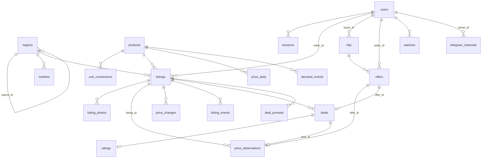

# Ma'lumotlar modeli, maxfiylik va xavfsizlik

Bugun barcha ma'lumotni bitta PostgreSQL bazasida saqlaydi. Sxema 39 ta goose migratsiyasi bilan quriladi: lokalda API ishga tushganda o'zi qo'llaydi, productionda deploy ularni alohida qadamda qo'llaydi ([ishga tushirish](11-ishga-tushirish.md#8-deploy-va-orqaga-qaytish)). Bu hujjat asosiy jadvallarni va ularni himoya qiluvchi cheklovlarni (unique indekslar, CHECK'lar, triggerlar), keyin esa maxfiylik va xavfsizlik qoidalarini tushuntiradi: Telegram orqali kirish, sessiyalar, telefonni shifrlash, akkauntni o'chirish, nima umuman saqlanmasligi, rasmlar va ularga kirish, tarmoq himoyasi qatlamlari, xatolarni kuzatish, admin huquqi, sirlar, zaxira nusxalar va migratsiyalar mosligi.

## Mundarija

1. [Umumiy qoidalar](#1-umumiy-qoidalar)
2. [ER diagramma (yadro)](#2-er-diagramma-yadro)
3. [Jadvallar](#3-jadvallar)
4. [Bazadagi himoyalar](#4-bazadagi-himoyalar)
5. [Kirish va sessiyalar](#5-kirish-va-sessiyalar)
6. [Shaxsiy ma'lumotlar](#6-shaxsiy-malumotlar)
7. [Nima saqlanmaydi](#7-nima-saqlanmaydi)
8. [Rasmlar](#8-rasmlar)
9. [Tarmoq himoyasi va limitlar](#9-tarmoq-himoyasi-va-limitlar)
10. [Xatolarni kuzatish](#10-xatolarni-kuzatish)
11. [Admin huquqi](#11-admin-huquqi)
12. [Sirlar, zaxira va migratsiyalar](#12-sirlar-zaxira-va-migratsiyalar)
13. [Ma'lum kamchiliklar](#13-malum-kamchiliklar)
14. [Qayerda joylashgan](#qayerda-joylashgan)

## 1. Umumiy qoidalar

- Pul — `BIGINT`, butun so'm. Miqdorlar — `NUMERIC(14, 3)`.
- Vaqt — `TIMESTAMPTZ`, UTC. "Kun" ustunlari (`day`) — Toshkent sanasi: `(now() AT TIME ZONE 'Asia/Tashkent')::date`.
- Holat va turlar matn bo'lib, har biri `CHECK (... IN (...))` bilan cheklangan.
- Ma'lumotnoma jadvallari (hududlar, bozorlar, mahsulotlar) `SMALLINT` id'li va migratsiyalar bilan to'ldiriladi.
- Sxema `backend/migrations/*.sql` da, SQL so'rovlari `backend/queries/*.sql` da; Go kodi ular asosida `sqlc` bilan yaratiladi.

## 2. ER diagramma (yadro)

## 3. Jadvallar

### 3.1 Ma'lumotnoma

| Jadval | Nima saqlaydi | Muhim ustun va cheklovlar |
|---|---|---|
| `regions` | Respublika, viloyat, tuman, shahar | `kind IN (respublika, viloyat, tuman, shahar)`, `parent_id` (daraxt), `soato` (rasmiy SOATO kodi, unique), `slug` unique |
| `markets` | Bozorlar | `region_id`, `kind IN (dehqon, ulgurji, qurilish)` |
| `products` | Mahsulot katalogi | `category` (7 toifa), `base_unit IN (kg, litr, dona, m2, m3, xizmat)`, `synonyms TEXT[]` (GIN indeks), nom bo'yicha trigram indeks |
| `unit_conversions` | Qop, yashik, bog' kabi birliklarni asosiy birlikka aylantirish | PK `(product_id, unit)`, `base_quantity > 0` |

### 3.2 Foydalanuvchilar va kirish

| Jadval | Nima saqlaydi | Muhim ustun va cheklovlar |
|---|---|---|
| `users` | Profil | `telegram_id` unique (tabiiy kalit); `telegram_username`, `display_name`; `phone_enc` (shifrlangan telefon), `phone_hash` (qidiruv uchun HMAC, unique emas — ikki akkaunt bir raqamda bo'lishi mumkin, 00004); `role`, `role_approved`; `region_id`, `market_id`, `categories`; `public_name`; `consent_at`; `bot_enabled`; `contact_telegram` (standart true), `contact_phone` (standart false); `is_demo` |
| `sessions` | Sayt sessiyalari | PK `token_hash` (token emas, uning SHA-256 xeshi), `user_id` (CASCADE), `expires_at` |
| `oauth_states` | Tugallanmagan Telegram kirishlari | `state_hash`, PKCE `code_verifier`, `nonce`, `return_to`, `expires_at` (10 daqiqa). O'qilganda o'chiriladi, ya'ni bir martalik |

### 3.3 E'lonlar va narxlar

| Jadval | Nima saqlaydi | Muhim ustun va cheklovlar |
|---|---|---|
| `listings` | Sotuvchi e'lonlari (har bir sotuvchi narxi — e'lon) | `variety` ≤60, `description` ≤1000; `price_som > 0`; `min_order`, `stock > 0`; `trade_type IN (ulgurji, chakana)`; `status IN (active, review, hidden, rejected)`; `review_reason` (narx: `jump_from_previous`, `far_from_market`, `far_from_reference`; matn: `content_spam`, `content_abuse`, `content_prohibited`, `content_off_category`), `review_note`; `valid_until` (7 kun); `views` (xom hisoblagich); avtomatik narx: `price_min`, `price_max`, `pricing_mode`, `pricing_goal`, `manual_price_at`. **Unique `(seller_id, product_id, variety, trade_type)`** |
| `listing_photos` | E'lon rasmlari | `storage_key` unique, `width`, `height`, `position`; e'lon bilan CASCADE |
| `price_observations` | Barcha manbalardan kelgan har bir narx (tarix) | `source IN (seller, seller_auto, rfq_offer, deal, telegram_channel, olx, uzex, narxtahlil)`; `status IN (active, expired, review, rejected)`; `observed_at`, `valid_until`; bog'lanishlar `listing_id`, `offer_id`, `deal_id`, `seller_id` (SET NULL); kanal posti `tg_chat_id`, `tg_message_id`. Har bir e'lon, taklif va bitim uchun **bittadan ortiq faol narx bo'lmaydi** (qisman unique indekslar) |
| `price_drafts` | Botda yoki saytda yozilgan, hali tasdiqlanmagan narx matni | `items JSONB`, `expires_at` (1 soat). Tasdiqlanmagan narx `price_observations` ga hech qachon yozilmaydi |
| `price_changes` | Avtomatik narx o'zgarishlari | `old_price`, `new_price`, `status IN (applied, reverted)`, `reasons JSONB` (omillar), `reverted_at` |
| `price_reasons` | Sotuvchi narxni ≥10% o'zgartirgandan keyin tanlagan sabab | `direction IN (up, down)`, `reason` (10 ta kod), **unique `(listing_id, day)`** |
| `price_daily` | Tahlil uchun kunlik tarix: mahsulot × savdo turi × viloyat × kun | `median`, `p25`, `p75`, `min_price`, `max_price`, `offers`, `demo_share`, `synthetic` (demo tarix). PK `(product_id, trade_type, province_id, day)` |
| `contact_reveals` | Kontakt ochilishlari jurnali (suiiste'molni ko'rish uchun) | `listing_id`, `viewer_id` (SET NULL) |

Median qanday hisoblanishi: [narx metodologiyasi](03-narx-metodologiyasi.md). Bazada ikki yordamchi funksiya bor: `price_weight(source, observed_at)` (manba ishonchi × yangilik) va `weighted_quantile(prices, weights, q)`; kunlik tarix uchun `source_trust(source)`.

### 3.4 Savdo va talab

| Jadval | Nima saqlaydi | Muhim ustun va cheklovlar |
|---|---|---|
| `rfqs` | Xaridor so'rovlari | `quantity > 0`, `deadline`, `max_price_som`, `note`, `status IN (open, closed, cancelled)`; xaridor bilan CASCADE |
| `offers` (RFQ takliflari) | Sotuvchi takliflari | **Unique `(rfq_id, seller_id)`** — bir so'rovga bitta taklif; `status IN (sent, chosen, confirmed, rejected, declined)`; `declined` dan boshqa holatda narx shart |
| `deals` | Kimdir "bo'ldi" degan sotuvlar | `source IN (rfq, contact, seller_marked)`, `status IN (reported, confirmed, disputed)`; `confirmed` faqat ikkala tomon tasdiqlagan bo'lsa (CHECK); o'zi bilan bitim mumkin emas (CHECK); `offer_id` unique; kontakt orqali — bir xaridor, e'lon va kun uchun bitta (qisman unique) |
| `deal_prompts` | Kontakt ochilgandan keyin xaridorga beriladigan "sotib oldingizmi?" savollari | `due_at`, `sent_at`, `asks`, `answer IN (yes, talking, no, expired)`; bir xaridor va e'lon uchun bitta ochiq savol (qisman unique) |
| `ratings` | Sotuvchiga baho | Faqat tasdiqlangan bitimga, bir marta (`deal_id` unique); `stars` 1–5; `comment` ≤300; `status IN (published, held, hidden)` |
| `watches` | Kuzatuvlar | `province_id` (NULL = mamlakat), `trade_type`, `max_price`, `peak_median`, `notified_at`. Unique `(user_id, product_id, trade_type, COALESCE(province_id, 0))` |
| `demand_events` | Talab signallari: ko'rish, qidiruv, kontakt, RFQ, savol, kuzatuv | `viewer_key` (kalitli xesh), `day`. **Unique `(kind, product_id, viewer_key, day)`** — bir tashrif buyuruvchi kuniga bir marta |
| `listing_events` | Bitta e'longa qiziqish: ko'rish va kontakt | Unique `(listing_id, kind, viewer_key, day)`; sotuvchining o'z tashriflari yozilmaydi |
| `question_log` | `/savol` savollari | `question` matni, `product_id`, `region_id`, `user_id` (SET NULL) |

Batafsil: [savdo va talab](05-savdo-va-talab.md).

### 3.5 Tahlil konteksti va xizmat jadvallari

| Jadval | Nima saqlaydi |
|---|---|
| `market_events` | Bozor voqealari (sovuq, eksport, bayram…): `kind` 12 turdan biri, `starts_on`/`ends_on` (CHECK: tugash ≥ boshlanish), viloyat/mahsulot/toifa, `source_url` (`^https?://`), `is_demo`. Bayramlar taqvimi 2023–2027 migratsiya bilan kiritilgan |
| `fx_daily` | Markaziy bank kursi: `ccy IN (USD, RUB, KZT)`, `rate > 0`, PK `(ccy, day)` |
| `weather_daily` | Viloyat markazi ob-havosi: `tmin`, `tmax`, `precip`, PK `(province_id, day)` |
| `telegram_channels` | Bot qo'shilgan kanal va guruhlar: `chat_id` unique, `owner_id`, `added_by_tg`, `province_id`, `status IN (active, pending, disabled)`; `active` bo'lishi uchun egasi va viloyati shart (CHECK) |
| `job_runs` | Rejalashtirilgan ishlar: unique `(job, slot)` — slot bir marta bajariladi; `heartbeat_at` — ishlayotgan ishning lease'i (00038) |
| `reference_prices` | Rasmiy etalon narxlar (UzEx, narxtahlil): mahsulot, savdo turi, hudud (`NULL` — respublika), asosiy birlikdagi narx va manbaning o'z narxi/birligi, `quoted_on` (Toshkent kuni). Kuniga bitta qator (unique indeks). `price_observations` dan alohida, shuning uchun hech qachon medianga kirmaydi (00039) |
| `ai_log` | Har bir model chaqiruvi: funksiya, model, tokenlar, audio uzunligi, davomiylik, taxminiy narx, natija, `user_id` (SET NULL), `input_hash` (kalitli qisqa xesh). **So'rov va javob matni saqlanmaydi.** `AI_LOG_RETENTION_DAYS` (90) kundan keyin o'chiriladi (00040) |
| `product_embeddings` | Katalogga moslash uchun mahsulot vektorlari: `model`, `source_hash` (katalog yoki model o'zgarsa qayta hisoblanadi) (00041) |
| `source_runs` | Sxemada bor, hozirgi kodda ishlatilmaydi |

## 4. Bazadagi himoyalar

Muhim qoidalar dastur kodida emas, bazaning o'zida turadi, shuning uchun parallel so'rovlar ham ularni buzolmaydi:

| Himoya | Qayerda | Nima beradi |
|---|---|---|
| Bitta e'lon: sotuvchi × mahsulot × nav × savdo turi | `listings_seller_product_idx` (00007) | Takroriy e'lon o'rniga mavjudi yangilanadi (upsert); tahrirda to'qnashuv — 409 `listing_exists` |
| Bitta faol narx har bir e'lon/taklif/bitim uchun | `price_obs_one_active_idx`, `price_obs_one_offer_idx`, `price_obs_one_deal_idx` | Bitta sotuvchi medianni ko'p nusxa bilan siljita olmaydi |
| Bir so'rovga bitta taklif | `offers UNIQUE (rfq_id, seller_id)` | Ikki marta bosish ikkita taklif yaratmaydi |
| Signal kuniga bir marta | `demand_events_once_idx`, `listing_events_once_idx` | Sahifani yangilab talabni sun'iy oshirib bo'lmaydi |
| Slot bir marta | `job_runs UNIQUE (job, slot)` | Ikki nusxa yoki restartda ish takrorlanmaydi |
| Bir martalik tokenlar | `ConsumeOAuthState`, `ConsumePriceDraft` — `DELETE ... RETURNING` | Kirish holati va qoralama ikki marta ishlatilmaydi |
| O'chirilgan e'lon narxi medianadan darhol chiqadi | trigger `listings_retire_prices` (00008) | `BEFORE DELETE ON listings` — bog'liq faol narxlar `expired` bo'ladi |
| O'chirilgan taklif narxi ham | trigger `offers_retire_prices` (00014) | Xuddi shunday, `offers` uchun |
| Tasdiqlangan bitim ikki tomonli | `deals_confirmed_by_both` CHECK | |
| Avtomatik narx chegarasiz yoqilmaydi | `listings_auto_needs_bounds` CHECK | `auto` rejimda `price_min ≤ price_max` shart |

## 5. Kirish va sessiyalar

- **Parol yo'q.** Kirish faqat Telegram OpenID Connect orqali (`oauth.telegram.org`, `backend/internal/auth/telegram.go`). So'raladigan ruxsatlar: `openid`, `profile`, `phone`, `telegram:bot_access` (bot foydalanuvchiga yoza oladi).
- Oqim himoyalari: PKCE (S256), tasodifiy `state` (faqat xeshi saqlanadi, 10 daqiqa, bir martalik), `nonce` `id_token` ichida tekshiriladi, `id_token` imzosi Telegram kalitlari bilan tekshiriladi.
- `return_to` faqat lokal yo'l bo'lishi mumkin (`/` bilan boshlanadi, `//` va `\` yo'q) — ochiq redirect imkonsiz.
- **Sessiya:** 32 bayt tasodifiy token cookie'ga yoziladi, bazada faqat uning SHA-256 xeshi (`sessions.token_hash`) saqlanadi. Baza o'g'irlansa ham undan sessiya tokeni olib bo'lmaydi.
- **Cookie `bugun_session`:** `HttpOnly` (JavaScript o'qiy olmaydi), `SameSite=Lax`, `Secure` (sayt `https` bo'lsa), `Path=/`, `Domain=COOKIE_DOMAIN`, muddati `SESSION_TTL` (standart 30 kun).
- Chiqish (`POST /v1/auth/logout`) sessiya qatorini o'chiradi va cookie'ni tozalaydi.
- Muddati o'tgan sessiyalar va tugallanmagan kirish holatlari har kecha 04:30 da `sessions_cleanup` vazifasi bilan o'chiriladi.

## 6. Shaxsiy ma'lumotlar

### Telefon raqami

- Telefon Telegram kirishidan olinadi (foydalanuvchi ruxsat bersa) va `+` hamda raqamlarga normallanadi.
- `phone_enc` — **AES-256-GCM** bilan shifrlangan (har safar yangi tasodifiy nonce). Kalit — `DATA_ENCRYPTION_KEY` (32 bayt, base64); noto'g'ri kalit bilan dastur ishga tushmaydi.
- `phone_hash` — **HMAC-SHA256** (kalit shifrlash kalitidan `bugun/lookup-hash` yorlig'i bilan chiqariladi). Raqamni ochmasdan solishtirish uchun.
- Profilda raqam **maskalangan** holda ko'rsatiladi: `••••• 12 34` (5 ta nuqta va oxirgi 4 raqam).
- To'liq raqam faqat foydalanuvchi o'zi ruxsat bergan holda (`contact_phone = true`) va faqat kirgan foydalanuvchi kontaktni ochganda beriladi. Telegram username ham shunday (`contact_telegram`). Standart: Telegram ochiq, telefon yopiq.

### Rozilik

- Profilni saqlash uchun `consent: true` shart (aks holda `consent_required`). `consent_at` birinchi saqlashda yoziladi va o'chirilmaydi.

### Ochiq ko'rinadigan ism

- E'lonlarda sotuvchi nomi — `public_name`, u bo'lmasa `display_name` ning birinchi so'zi.
- RFQ qutisida sotuvchi xaridorning kimligini ko'rmaydi; kontaktlar faqat ikkala tomon rozi bo'lgandan keyin ochiladi.

### Akkauntni o'chirish

`DELETE /v1/me` `users` qatorini o'chiradi. Keyin bazadagi bog'lanishlar bo'yicha:

| Nima | Nima bo'ladi |
|---|---|
| `sessions`, `price_drafts`, `watches`, `deal_prompts` | O'chiriladi (CASCADE) |
| `listings` (va `listing_photos`, `price_changes`, `listing_events`, `price_reasons`) | O'chiriladi; trigger ularning faol narxlarini darhol `expired` qiladi |
| `rfqs`, `offers` | O'chiriladi; taklif narxlari trigger bilan `expired` bo'ladi |
| `deals` | Sotuvchi sifatida — o'chiriladi; xaridor sifatida — `buyer_id` bo'shatiladi |
| `ratings` | O'chiriladi |
| `price_observations` | Narx raqami statistika uchun qoladi, `seller_id` bo'shatiladi |
| `question_log`, `contact_reveals`, `telegram_channels.owner_id`, `market_events.created_by` | Bog'lanish bo'shatiladi (SET NULL) |
| `demand_events` | Foydalanuvchiga umuman bog'lanmagan |

## 7. Nima saqlanmaydi

- **IP manzillar saqlanmaydi.** Talab signallari va e'lon hodisalarida `viewer_key = HMAC(kun + "|" + tashrif_buyuruvchi)` yoziladi, bunda tashrif buyuruvchi `u:<user id>` yoki `ip:<IP>`. Kun kalitga qo'shilgani uchun bir odamni kunlar bo'yicha kuzatib bo'lmaydi.
- **So'rov tanalari va query satrlari logga yozilmaydi.** Access log faqat metod, yo'l, holat, vaqt, so'rov id va `via` ni yozadi (`backend/internal/httpapi/logging.go`).
- **Sessiya va kirish tokenlari** faqat xesh sifatida.
- **Telefon ochiq holda** saqlanmaydi.
- **Rasmdagi EXIF** (shu jumladan GPS) saqlanmaydi (8-bo'lim).
- **Model funksiyalariga yuborilgan narsa saqlanmaydi:** ovozli yozuv, narxlar ro'yxati rasmi, savol matni va model javobi. `ai_log` faqat hajm, vaqt, narx va kalitli xeshni yozadi. Ovozdan olingan matn va rasmdan o'qilgan narxlar oddiy narx qoralamasi bo'ladi (1 soat, tasdiqlanmasa o'chadi).
- Demo akkauntlar (`is_demo`) soxta raqamlar (`+998 90 000 xx xx`) bilan va username'siz yaratiladi.

## 8. Rasmlar

- Qabul qilinadi: JPEG, PNG, WebP; fayl ≤10 MB (`MEDIA_MAX_UPLOAD_BYTES`), ≤40 megapiksel (`MEDIA_MAX_PIXELS`); e'longa ≤5 ta (`MAX_PHOTOS_PER_LISTING`). Hajm o'qishdan oldin, piksel soni dekoddan oldin tekshiriladi.
- Har bir rasm dekodlanadi va **JPEG'ga qayta kodlanadi**: to'liq nusxa uzun tomoni ≤1600 px, sifat 82; kichik nusxa 480 px, sifat 78. Qayta kodlash EXIF'ni, shu jumladan GPS'ni, olib tashlaydi.
- Fayl nomi tasodifiy kalit (`[A-Za-z0-9_-]{20,64}.jpg`), yo'lga aylantirishdan oldin regex bilan tekshiriladi (path traversal yo'q).
- **Ombor:** `MEDIA_STORAGE=disk` — `MEDIA_DIR` (Docker'da `media` hajmi); `MEDIA_STORAGE=s3` — istalgan S3-mos bucket (`S3_*`). Diskdan S3 ga o'tishdan oldin `cmd/mediasync` mavjud rasmlarni nusxalaydi (hech narsani o'chirmaydi, qayta ishga tushirsa bo'ladi). Rasmlar repozitoriyga tushmaydi.
- **Kirish qoidalari** (`GET /media/{key}`, `backend/internal/httpapi/media.go`):

| E'lon holati | Kim ko'radi | Kesh |
|---|---|---|
| `active` | Hamma | `public, max-age=31536000, immutable`; `S3_PUBLIC_BASE_URL` bo'lsa bucket'ga 302 |
| `review`, `hidden`, `rejected` | Faqat e'lon egasi va admin (sessiya cookie bo'yicha), har doim API orqali | `private, no-store` |
| E'lon o'chirilgan | Hech kim | — |

  Ruxsati yo'q odamga **404** qaytadi (403 emas), shunda yashirin rasm borligi ham oshkor bo'lmaydi.
- E'lon yoki akkaunt o'chirilganda uning rasmlari (to'liq va kichik nusxa) ombordan ham o'chiriladi.

## 9. Tarmoq himoyasi va limitlar

Himoya bir necha qatlamda. Har qatlam o'zidan keyingisiga ishonmaydi.

| Qatlam | Nima qiladi | Qayerda |
|---|---|---|
| nginx: TLS | 80-port faqat ACME va HTTPS'ga 301; TLS 1.2/1.3, Mozilla intermediate shifrlari (DHE'siz), sessiya tiketlari o'chiq | `deploy/nginx/bugun.conf` |
| nginx: sarlavhalar | `Strict-Transport-Security` (1 yil, subdomenlar), `X-Content-Type-Options: nosniff`, `X-Frame-Options: DENY`, `Referrer-Policy: strict-origin-when-cross-origin`, `Permissions-Policy` (kamera, mikrofon, joylashuv, to'lov, USB o'chiq), qat'iy `Content-Security-Policy` (`default-src 'none'`; `/docs` o'z siyosatini beradi), `server_tokens off` | `deploy/nginx/bugun-security.inc` |
| nginx: limitlar | To'g'ridan-to'g'ri mijoz: IP bo'yicha 10 so'rov/s (burst 40), 50 ta bir vaqtdagi ulanish; `X-Internal-Secret` yuborgan sayt serveri: 100 so'rov/s (burst 300); rasmlar: 50 so'rov/s (burst 200). Oshsa 429. Soxta sarlavha faqat kattaroq nginx byudjetiga olib boradi — API sirni baribir tekshiradi | `bugun.conf` |
| nginx: IP | `X-Real-IP` va `X-Forwarded-For` ni ulanish manzili bilan **qayta yozadi** (qo'shmaydi); tana ≤11 MB | `bugun-proxy.inc`, `bugun.conf` |
| Docker | API faqat `127.0.0.1:API_PORT` da; tashqaridan faqat nginx orqali | `deploy/docker-compose.yml` |
| API: ishonchli proxy | `X-Real-IP`/`X-Forwarded-For` faqat ulanish `TRUSTED_PROXIES` dan kelsa o'qiladi (standart localhost, compose'da Docker ko'prigi `172.16.0.0/12`). Aks holda so'rov o'z manzili bo'yicha hisoblanadi — API to'g'ridan-to'g'ri ochilib qolsa ham IP'ni soxtalashtirib limitdan qochib bo'lmaydi | `internal/httpapi/realip.go` |
| API: so'rov limiti | Mijoz kaliti uchun daqiqasiga `RATE_LIMIT_PER_MINUTE` (120), `/media` bundan mustasno. Sayt serveri tashrif buyuruvchi IP'sini faqat to'g'ri `INTERNAL_SECRET` bilan uzata oladi | `internal/httpapi/server.go` |
| API: vaqt va hajm | Handler `REQUEST_TIMEOUT` (15 s), butun javob `HTTP_WRITE_TIMEOUT` (60 s), tana 1 MB (rasm — 10 MB) | `server.go`, `cmd/api/main.go` |
| API: kiruvchi ma'lumot | Sxema bo'yicha tekshiriladi, noma'lum maydonlar rad etiladi | Huma |
| Bot | Har Telegram foydalanuvchisiga daqiqasiga `BOT_MESSAGES_PER_MINUTE` (20) xabar va tugma bosish (token bucket); oshsa bir marta ogohlantiradi, qolganlari tashlanadi. Guruh va kanallarda bot hech qachon javob yozmaydi | `internal/bot/throttle.go` |
| Model funksiyalari | Soatlik chegaralar (`LLM_MAX_PER_HOUR`, `STT_MAX_PER_HOUR`), tahlilchi uchun foydalanuvchiga daqiqalik `ANALYST_PER_MINUTE`; oshsa qoidali yo'l yoki 429 `ai_limit` | `internal/llm`, `internal/analyst` |
| Sayt | Har so'rovga yangi nonce bilan `Content-Security-Policy` (`script-src 'nonce-…' 'strict-dynamic'`, `object-src 'none'`, `frame-ancestors` faqat o'zi va Telegram web), `Referrer-Policy`, `nosniff`, `Permissions-Policy`, productionda HSTS; kirmagan foydalanuvchi himoyalangan sahifalardan `/kirish` ga, `/admin` dan 404 ga | `frontend/src/proxy.ts`, `src/lib/csp.ts`, `next.config.ts` |

Moderatsiya tomoni:

- Narx anomaliyalari tekshiruvga (`review`) tushadi, admin hal qiladi: [narx metodologiyasi](03-narx-metodologiyasi.md).
- E'lon matni kalit so'z qoidalari bilan (va `MODERATION_ENABLED` bo'lsa model bilan ham) tekshiriladi: spam, haqorat, taqiqlangan mahsulot, boshqa mahsulot haqidagi matn. Belgi faqat tekshiruvga ushlaydi, hech qachon rad etmaydi; model xatosi yoki kechikishi e'lonni to'xtatmaydi.
- Past baholi izohlar admin tekshiruvigacha ko'rsatilmaydi.
- Bot faqat egasi ulagan kanal va guruhlarni o'qiydi.

## 10. Xatolarni kuzatish

Ixtiyoriy: backendda `SENTRY_DSN`, saytda `NEXT_PUBLIC_SENTRY_DSN`. Bo'sh bo'lsa hech narsa yuklanmaydi va yuborilmaydi.

- **Backend** (`internal/errtrack`): panic'lar, 5xx javoblar va muvaffaqiyatsiz rejali ishlar yuboriladi. Yuborishdan oldin (`Scrub`): cookie'lar, `Authorization`, `X-Internal-Secret`, `X-Client-IP` va forward sarlavhalari, so'rov tanasi va foydalanuvchi IP'si olib tashlanadi; har qanday matndagi bot tokenlari `[token]`, telefon raqamlari `[phone]` bilan almashtiriladi.
- **Sayt** (`src/lib/sentry.ts`): `sendDefaultPii: false`; cookie, avtorizatsiya, IP sarlavhalari, `phone`, `contact`, Mini App `initData` kabi kalitlar `[filtered]`, matndagi telefonlar `[phone]`, so'rov tanasi o'chiriladi, foydalanuvchidan faqat `id` qoladi. Source map'lar faqat `SENTRY_AUTH_TOKEN` bilan yuklanadi va ochiq build'dan o'chiriladi.
- Unumdorlik izlari standart o'chiq (`*_TRACES_SAMPLE_RATE=0`).

## 11. Admin huquqi

Admin — ikki yo'l bilan:

1. `users.role = 'admin'` (faqat bazada qo'lda qo'yiladi; `PUT /v1/me/profile` `admin` rolini qabul qilmaydi), yoki
2. foydalanuvchining Telegram id'si `ADMIN_TELEGRAM_IDS` muhit o'zgaruvchisida.

Admin tekshiruvdagi e'lonlarni, rol so'rovlarini, bitimlarni, baholarni va voqealar jurnalini boshqaradi va barcha viloyatlar hisobotini oladi. `market_admin` va `org_analyst` rollari admin tasdig'isiz faqat oddiy foydalanuvchi huquqida qoladi.

Diqqat: `role = admin` bo'lgan foydalanuvchi profil formasini saqlasa, boshqa rol tanlashga majbur bo'ladi va (agar `ADMIN_TELEGRAM_IDS` da bo'lmasa) admin huquqini yo'qotadi. Shuning uchun adminlarni `ADMIN_TELEGRAM_IDS` orqali berish ishonchliroq.

## 12. Sirlar, zaxira va migratsiyalar

### Sirlar

- Barcha sirlar (bot tokeni, OIDC client secret, shifrlash kaliti, baza paroli, ichki sir, model va S3 kalitlari, Sentry DSN) faqat muhit o'zgaruvchilarida: lokalda `.env`, serverda `/srv/bugun/.env` (`chmod 600`, `deploy` foydalanuvchisiga tegishli). Repozitoriyda faqat bo'sh qiymatli `.env.example` lar.
- Dastur ishga tushganda joriy papkada `.env` bo'lsa uni o'qiydi, lekin productionda konteyner ichida bunday fayl yo'q: qiymatlar Docker `env_file` orqali beriladi. Deploy skriptlari `.env` ni **o'qiydi, `source` qilmaydi** — qiymatdagi shell belgilari bajarilmaydi.
- Frontend sirlari (`INTERNAL_API_SECRET`, `SENTRY_AUTH_TOKEN`) faqat serverda yoki build'da, hech qachon `NEXT_PUBLIC_` bilan emas.
- CI har push'da gitleaks bilan butun git tarixini tekshiradi.

### Zaxira nusxalar

- `deploy/backup.sh` bazani (`pg_dump`, custom format, o'qib tekshiriladi) va **rasmlar hajmini** (`tar.gz`) `BACKUP_DIR` ga yozadi; fayllar faqat egasiga o'qiladi (`umask 077`); `BACKUP_RETENTION_DAYS` (14) kundan eskilari o'chiriladi.
- **Offsite:** `RCLONE_REMOTE` berilsa yangi fayllar boshqa joyga (masalan S3/B2 bucket) nusxalanadi, `RCLONE_RETENTION_DAYS` dan eskilari u yerda ham o'chiriladi. Faqat serverdagi nusxa server bilan birga yo'qolishi mumkin, shuning uchun productionda offsite tavsiya etiladi.
- **Qachon:** har kuni 02:30 Toshkent (systemd timer `deploy/systemd/bugun-backup.timer`, o'tkazib yuborilsa keyin bajariladi) va har deploy'dan oldin. Natija `BACKUP_HEARTBEAT_URL` ga ping qilinadi — zaxira to'xtab qolsa tashqi monitor xabar beradi.
- **Tiklash:** `deploy/restore.sh` (baza va/yoki rasmlar, keyin `migrate up`).
- **Sinov (2026-09-26):** 14 MB dump taxminan 4 soniyada olindi, tiklash taxminan 9 soniya; 35 ta jadvalning hammasida qatorlar soni mos keldi (`price_daily` 1 440 544, `listings` 317, `users` 69). Batafsil: [ishga tushirish, 10-bo'lim](11-ishga-tushirish.md#10-zaxira-va-tiklash).
- `S3` rasm ombori ishlatilsa, rasmlar zaxirasi bucket tomonida (versiyalash yoki replikatsiya) sozlanadi: `backup.sh` faqat Docker `media` hajmini arxivlaydi.

### Migratsiyalar va moslik

- Migratsiyalar Postgres advisory lock ostida qo'llanadi (`internal/store`): API va `cmd/migrate` bir vaqtda migratsiya qilolmaydi, ikkinchisi kutadi.
- Productionda `MIGRATE_ON_START=false`: `deploy.sh` yangi image bilan `migrate up` ni alohida qadamda bajaradi, xato bo'lsa eski API'ga tegmaydi.
- **Orqaga qaytish migratsiyani qaytarmaydi.** Shuning uchun har relizdagi migratsiya oldingi reliz kodi bilan ishlashi kerak: **faqat qo'shuvchi o'zgarishlar** (yangi jadval, standartli yoki `NULL` ustun, indeks, kengroq CHECK). Ustunni o'chirish yoki qayta nomlash ikki relizga bo'linadi: avval kod undan foydalanmay qo'yadi, keyingi relizda o'chiriladi. (Istisno: 00040 hech qachon yozilmagan eski `ai_log` jadvalini almashtirgan.)
- Rejali ishlar ham ikki nusxaga tayyor: slot `UNIQUE (job, slot)` bilan bir marta olinadi, ishlayotgan ish `JOB_HEARTBEAT` (1 daqiqa) da lease'ini yangilaydi va ishga tushishda faqat lease'i `JOB_LEASE_TIMEOUT` (5 daqiqa) dan eski bo'lgan tugallanmagan ish bo'shatiladi — ikkinchi nusxa birinchisining tirik ishini tortib olmaydi.

## 13. Ma'lum kamchiliklar

- `listings.views` har bir begona so'rovda oshadi (takrorlanishlar bilan); noyob sonlar `listing_events` da.
- API va bot limitlari jarayon xotirasida: API bir nechta nusxada ishlasa, har nusxaning o'z hisobi bo'ladi (nginx limitlari baribir umumiy).
- Sayt serveri Vercel `fra1` (Frankfurt) mintaqasida; u ma'lumot saqlamaydi, lekin API javoblari u orqali o'tadi. Spec §14.3 (ma'lumot O'zbekistonda) uchun saytni ham mahalliy serverga ko'chirish kerak.

## Qayerda joylashgan

- `backend/migrations/` — sxema, triggerlar, SQL funksiyalar
- `backend/queries/` — barcha SQL so'rovlar
- `backend/internal/secure/secure.go` — tokenlar, xesh, AES-GCM, HMAC
- `backend/internal/auth/telegram.go` — Telegram OIDC
- `backend/internal/httpapi/auth.go`, `session.go` — kirish, cookie, sessiya
- `backend/internal/httpapi/me.go` — profil, maskalangan telefon, akkauntni o'chirish
- `backend/internal/httpapi/demand.go` — `viewer_key` va talab signallari
- `backend/internal/httpapi/logging.go` — access log
- `backend/internal/httpapi/admin.go` — `isAdmin`
- `backend/internal/httpapi/realip.go` — ishonchli proxy'lar
- `backend/internal/httpapi/media.go` — rasmlarga kirish qoidalari
- `backend/internal/media/media.go`, `s3.go` — rasm qayta ishlash, disk va S3 ombori
- `backend/internal/bot/throttle.go` — bot limiti
- `backend/internal/moderation/` — e'lon matni tekshiruvi
- `backend/internal/errtrack/` — Sentry va tozalash
- `backend/internal/ailog/` — `ai_log`
- `backend/internal/store/store.go` — migratsiya qulfi
- `frontend/src/proxy.ts`, `frontend/src/lib/csp.ts`, `frontend/src/lib/sentry.ts` — sayt CSP va xatolarni kuzatish
- `deploy/nginx/` — TLS, sarlavhalar, limitlar
- `deploy/backup.sh`, `deploy/restore.sh`, `deploy/systemd/` — zaxira va tiklash
