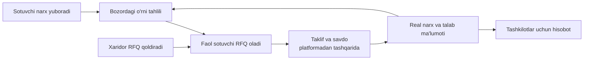
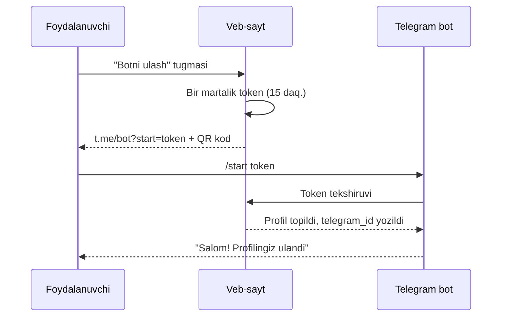
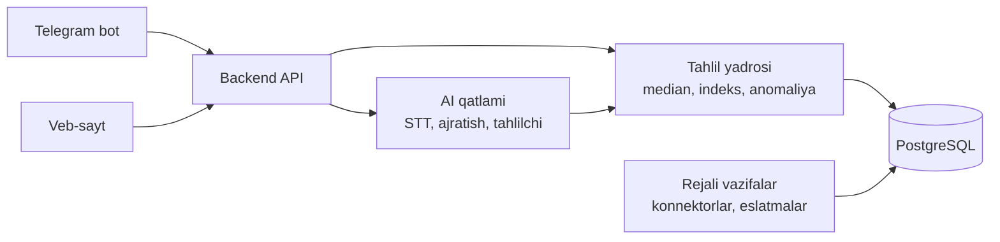

> **Bugun** — loyihaning yakuniy nomi (TZ dagi ishchi nom: "Bozor-Analitika").
>
> **Amaldagi holat bo'yicha aniqliklar (26-sentabr 2026)** — kod bilan moslash uchun:
> - Rejali ishlar gocron emas, o'zimiz yozgan scheduler (`backend/internal/jobs`): slotlar `job_runs` jadvalida `UNIQUE (job, slot)`, ishlayotgan ishga lease (`heartbeat_at`), vaqtlar Toshkent bo'yicha va `SCHEDULE_*` bilan sozlanadi.
> - Grafik va xarita Recharts/react-leaflet emas, o'zimiz yozgan d3 komponentlari (`d3-scale`, `d3-shape`, `d3-geo`; `frontend/src/components/charts`).
> - Rasmlar JPEG'ga qayta kodlanadi (EXIF o'chadi), WebP emas. Ombor: server diski (`MEDIA_STORAGE=disk`) yoki S3-mos bucket (`MEDIA_STORAGE=s3`, `cmd/mediasync`). Yashirin e'lon rasmlari faqat egasi va admin'ga.
> - Bot webhook emas, long polling bilan ishlaydi (14.2 dagi webhook maxfiy tokeni shuning uchun kerak emas). Bot tokenini faqat bitta jarayon o'qiydi (`BOT_ENABLED`); foydalanuvchiga daqiqalik limit bor.
> - Migratsiyalar productionda alohida qadam (`cmd/migrate`, advisory lock), deploy image'ni git SHA bilan teglaydi va sog'lom bo'lmasa oldingi image'ga qaytadi. Shuning uchun migratsiyalar faqat qo'shuvchi.
> - AI komponentlari (9-bo'lim) OpenAI-mos API orqali, hammasi standart o'chiq va o'chiq bo'lganda qoidali yo'l ishlaydi. Model raqam bermaydi: raqam deterministik funksiyadan, model matnidagi har son tekshiriladi (`internal/numcheck`). `ai_log` matn saqlamaydi. O'lchov: `make eval`, natija `backend/eval/RESULTS.md`.
> - Jonli konnektor faqat UzEx (3 mahsulot, `UZEX_ENABLED`, standart o'chiq; `reference_prices`). narxtahlil va OLX konnektorlari yo'q.
> - Sayt Vercel `fra1` da; 14.3 dagi "ma'lumot O'zbekistonda" talabi hozircha faqat API va bazaga tegishli — cheklov sifatida README'da yozilgan.
> - Asl reja fayllari (DINAMIK_NARX, TAHLIL_REJA, ML_REJA, KANAL_ULASH, QIZIQISH_VA_SAVDO) repoda yo'q; ularning mazmuni `docs/` da: avtomatik narx — `docs/06`, tahlil — `docs/04`, ML — `docs/12`, kanallar — `docs/07` §8, qiziqish va savdo — `docs/05`.
>
> **Stek bo'yicha qaror (25-sentabr 2026)** — 13-bo'limdagi tavsiya o'rniga:
> - Veb: Next.js 16 (App Router) + TypeScript + Tailwind v4 + shadcn/ui, TanStack Query, Hey API (OpenAPI dan tiplar), grafik va xarita — o'z d3 komponentlari (26-sentabr aniqligi).
> - Backend API, bot, tahlil yadrosi: Go 1.26 — Huma v2 + chi, pgx v5 + sqlc, goose migratsiyalar, go-telegram/bot, o'z scheduler (`internal/jobs`; gocron ishlatilmadi).
> - Kirish: Telegram OpenID Connect (oauth.telegram.org). Kirishning o'zi `telegram_id` ni profilga bog'laydi — bot alohida ulanmaydi.
> - Baza: PostgreSQL 16. Paketlar: npm.
>
> Arxitektura va qoidalar o'zgarmaydi.
>
> **Yo'nalish o'zgarishi (25-sentabr 2026): market-ilova ko'rinishi.**
> - Platforma market ilovasiga o'xshaydi: katalog, toifalar, mahsulotlar, filtrlar, mahsulot sahifasi. **Savatcha, to'lov va buyurtma yo'q** — savdo platformadan tashqarida.
> - Mahsulot = **katalogga bog'langan e'lon**: sotuvchi katalogdan mahsulotni tanlaydi va o'z e'lonini to'ldiradi (rasm, nav, narx, birlik, minimal buyurtma, zaxira, tavsif). Katalogda yo'q mahsulotni sotuvchi taklif qiladi, admin qo'shadi.
> - Mahsulot sahifasida: har bir sotuvchining narxi + o'rtacha (median) narx, tanlangan hudud bo'yicha.
> - Bog'lanish: sotuvchi o'zi tanlaydi — Telegram orqali yozish va/yoki telefonni ko'rsatish.
> - Moderatsiya: e'lon darhol chiqadi; narx mediandan keskin farq qilsa yoki taqiqlangan so'z bo'lsa "tekshirilsin" holatiga o'tadi.
> - Rasmlar: server diskida yoki S3-mos omborda (repoga tushmaydi), JPEG'ga qayta kodlanadi (26-sentabr aniqligi).
> - Hudud: butun respublika — barcha viloyatlar, Qoraqalpog'iston, Toshkent shahri va ularning tuman/shaharlari.
> - Bot: mahsulot yuklash bot ichida Telegram Mini App (WebApp) orqali; tezkor matnli narx yangilash saqlanadi.

> **RFQ bo'yicha qarorlar (25-sentabr 2026, 8.4 ga aniqlik):**
> - So'rov RFQ viloyatida shu mahsulotdan faol e'loni bor sotuvchilarga boradi; javobni ham faqat ular bera oladi.
> - Muddat standart 3 kun (1–7 kun); bitta xaridorda bir vaqtda ko'pi bilan 3 ta ochiq so'rov (bazada qulf bilan).
> - Kontakt ikkala tomon rozi bo'lgach almashadi: xaridor taklifni tanlaydi (`chosen`), sotuvchi tasdiqlaydi (`confirmed`) yoki rad etadi (`rejected`). "Menda yo'q" — `declined`, narxsiz.
> - Taklif narxi medianga `rfq_offer` manbasi sifatida (vazn 1,0) RFQ muddatigacha kiradi; keskin farq qilsa kirmaydi. RFQ — ulgurji.

> **Avtomatik narx bo'yicha qaror (25-sentabr 2026, 14.4 ni o'zgartiradi):**
> - Sotuvchi e'lon uchun **o'zi yoqsa**, tizim narxni uning **eng past–eng yuqori** oralig'ida o'zgartiradi (rejim `auto`; standart `manual`). Chegara faqat `auto` da majburiy, max ≤ 3 × min, hozirgi narx oraliq ichida.
> - Kuniga 3 marta (07:30, 12:00, 16:30 Toshkent) tekshiriladi; bir kundagi o'zgarishlar yig'indisi **±5%** dan oshmaydi.
> - Himoyalar: narx hech qachon viloyat P75 dan oshmaydi (bozorni yetaklamaydi, ergashadi); qo'lda o'zgartirilgan narxga 24 soat tegilmaydi; har o'zgarish sababi bilan jurnalga yoziladi va sotuvchiga botda "Qaytarish" tugmasi bilan xabar qilinadi; avtomatik narx medianga `seller_auto` (vazn 0,4) sifatida kiradi.

> **Qiziqish va savdo bo'yicha qaror (25-sentabr 2026; batafsil — `docs/05-savdo-va-talab.md`):**
> - Kontakt ochish **savdo emas**, faqat niyat. Savdo (`deals`) faqat kimdir aytganda yoziladi: `confirmed` = ikki tomon aytgan (yoki RFQ da «Roziman»), `reported` = bir tomon. Ochiq raqamlar, median, hisobot va reyting faqat `confirmed` ni oladi.
> - Kontaktdan 24 soat keyin bot xaridordan «Kelishdingizmi?» deb so'raydi (09:00–20:00, kuniga ≤ 3 ta, bir e'lon uchun haftada bir marta). Har kuni 19:00 da sotuvchidan so'raladi. Javoblar qaysi tartibda kelsa ham bitta savdoga moslashtiriladi. Miqdor va narx ixtiyoriy; farq qilsa xaridorniki olinadi.
> - Tasdiqlangan savdo narxi medianga `deal` (vazn 1,0) sifatida kiradi; e'lon narxining 0,5–2 barobaridan tashqarisi tekshiruvga ushlanadi. Savdolar bosim indeksida talab (vazn 8) va avtomatik narxda `sales` omili.
> - Ochiq raqamlar (qiziqqanlar, savdolar, viloyat o'rtachasi) faqat **≥ 5** bo'lganda, reyting **≥ 3** baho bo'lganda ko'rsatiladi. 1–2 yulduzli izoh admin tasdiqlaguncha chiqmaydi.
> - «Kuzatish»: 20 tagacha; yangi arzon narx yoki median 5% tushsa, kuniga bir marta (08:00, 17:00) xabar.

# Bozor-Analitika — Texnik topshiriq (TZ)

Sep 24, 2026 · @E-investment

## 1. Hujjat haqida va loyiha xulosasi

Bozor-Analitika — Namangan bozorlari uchun aqlli savdo-axborot tizimi: sotuvchilardan real narxni, xaridorlardan real talabni yig'ib, ikkala tomonga AI tavsiya beradi. Loyiha Umummilliy AI Xakaton Namangan bosqichi (24–27-sentabr 2026), Tadbirkorlik treki, dolzarb muammolar ro'yxatidagi 19-muammo uchun ishlab chiqiladi.

**Pozitsiya.** Biz market emasmiz: to'lov, yetkazib berish va buyurtma yo'q. Biz barcha bozor va marketlar ustidagi neytral tahlil qatlamimiz. Asosiy formula: **"Narx bering — xaridor oling"**.

**Mahsulot tarkibi:**

- Veb-platforma — asosiy kirish nuqtasi: ro'yxatdan o'tish, profil, narx joylash, RFQ, narxlar paneli, talab-taklif xaritasi, AI tahlilchi, hisobotlar.
- Telegram bot — ixtiyoriy tezkor kanal: saytdagi profilga bir bosishda ulanadi, qayta ro'yxatdan o'tish talab qilinmaydi; narxni ovoz bilan yuborish va bildirishnomalar uchun.
- Tahlil yadrosi — deterministik statistika; AI faqat ma'lumot ajratadi va tushuntiradi.

**Hujjatdan foydalanish.** Bu TZ repoda spec.md sifatida ham saqlanadi. Har bir AI chat shu faylni o'qib boshlaydi va faza oxirida uni yangilaydi (21-bo'lim).

| Parametr | Qiymat |
|---|---|
| Ishchi nom | Bozor-Analitika (yakuniy nom finalgacha tanlanadi) |
| Trek | Tadbirkorlik |
| Muammo egasi | O'zbekiston Savdo-sanoat palatasi |
| Pilot hudud | Namangan viloyati, 1–2 dehqon va ulgurji bozor |
| Hujjat versiyasi | v1.0 |

## 2. Muammo, dalillar va raqobat muhiti

Tadbirkor ulgurji xarid qilishda narxni bozorma-bozor yurib yoki telefon qilib bilib oladi, chunki bozorlar bo'yicha yagona real vaqtdagi narx va talab-taklif bazasi yo'q. Natijada vaqt va pul yo'qotiladi.

**Rasmiy muammo matni (19-muammo):** bozorlardagi real narx-navo va talab-taklif bo'yicha yagona tahliliy ma'lumotlar bazasining yo'qligi sababli tadbirkorlarning mahsulot xarid qilishda ortiqcha vaqt va mablag' yo'qotishi.

**Hakaton davomida yig'iladigan dalillar** (hozir taxmin, 25-sentabr kuni bozorda tasdiqlanadi):

- ☐ 5–10 ta sotuvchi va 3–5 ta xaridor tadbirkor bilan Mom Test suhbatlari.
- ☐ Bitta xaridor narx bilish uchun haftasiga necha soat sarflashi.
- ☐ Bir xil mahsulotning bozorlar yoki sotuvchilar orasidagi narx farqi (%).
- ☐ Sotuvchi yangi xaridorni hozir qanday topishi.

**Mavjud yechimlar va bizning farqimiz:**

| Mavjud yechim | Nima beradi | Nimasi yetishmaydi |
|---|---|---|
| narxtahlil.uz | 30 ta asosiy mahsulot, hudud va tuman kesimida narx, prognoz | Ulgurji narx yo'q, xizmatlar yo'q, talab signali yo'q, xaridor-sotuvchini bog'lamaydi |
| UzEx birjasi | Birja kotirovkalari va bitimlar | Bozor darajasidagi mayda ulgurji savdoni qamramaydi |
| Uzum, OLX va boshqa marketlar | E'lon va chakana narx | Narxlar statik, tahlil yo'q, bozor narxi emas |
| Telegram ulgurji kanallar | Kundalik narx postlari | Tuzilmasiz, qidirib bo'lmaydi, solishtirib bo'lmaydi |

**Bizning uchta farqimiz:** (1) sotuvchining o'zidan keladigan real vaqtdagi ulgurji narx; (2) xaridor so'rovlaridan kelib chiqqan talab ma'lumoti — bu hech qayerda ochiq yo'q; (3) sotuvchi uchun forma to'ldirishsiz, ovoz orqali kirish.

## 3. Maqsadlar va baholash mezonlariga moslik

Maqsad: CP1da kamida 7,5, CP2da kamida 8,5 ball olib, Tadbirkorlik trekidan Top-5ga va g'olib sifatida Toshkent finaliga chiqish. Yakuniy reyting 0,4 × CP1 + 0,6 × CP2 bo'lgani uchun CP2dagi o'sish ustuvor.

Har bir mezon uchun loyihada aniq "dalil" bor. Mentorga har doim shu dalilni ko'rsatamiz.

| Mentor | Mezon | Loyihadagi dalil | TZ bo'limi |
|---|---|---|---|
| Texnik | Texnik amalga oshirish | Ishlaydigan bot + veb + tahlil yadrosi, jonli demo | 7, 8, 13 |
| Texnik | Kod tayyorligi | 40+ kichik commit, testlar, README, .env | 17, 21 |
| Texnik | Innovatsionlik | O'zbekcha ovozdan narx ajratish, talab-taklif bosim indeksi | 9, 10 |
| Texnik | Jamoa bilimi | Har a'zo o'z qismini tushuntira oladi, arxitektura diagrammasi | 13, 18 |
| Texnik | Texnologiyalar to'plami | Asoslangan tanlov: nima uchun shu model, nima uchun raqamni SQL hisoblaydi | 9, 13 |
| Biznes | Dolzarblik | 19-rasmiy muammo, bozordagi suhbatlar natijasi | 2 |
| Biznes | Biznes model | 3 ta to'lovchi, qiymatdan kelib chiqqan narx | 15 |
| Biznes | Raqobat ustunligi | Talab ma'lumoti va sotuvchi tarmog'i — nusxa ko'chirib bo'lmaydi | 2, 5 |
| Biznes | Moliyaviy barqarorlik | AI so'rov narxi hisobi, unit economics | 15 |
| Biznes | O'sish | Namangan → Farg'ona vodiysi → respublika | 20 |
| Soha | Muammo dolzarbligi | Real sotuvchi va xaridorlar soni, raqamlar | 2, 16 |
| Soha | Sohani tushunish | Bozor ma'muriyati roli, ulgurji va chakana farqi, birliklar | 4, 12 |
| Soha | Amaliy qo'llanish | 2 kunda ro'yxatdan o'tgan real sotuvchilar | 16, 17 |
| Soha | Qonunchilik | Shaxsiy ma'lumotlar, manba ko'rsatish, algoritmik kelishuvga yo'l qo'ymaslik | 14 |
| Soha | Ta'sir ko'lami | Tejalgan vaqt va narx farqi hisobi | 15, 16 |

**Ustuvor yo'nalish (+2 ball).** 19-muammo rasmiy ro'yxatda bor. Ochiq savol: "ustuvor yo'nalish" aynan shu ro'yxatmi — koordinatordan 24-sentabr kuni so'raladi.

## 4. Foydalanuvchilar va rollar

Platformada beshta rol bor; asosiy foydalanuvchi — ulgurji xarid qiladigan tadbirkor, oddiy iste'molchi emas.

| Rol | Kim | Asosiy ehtiyoj | Kirish nuqtasi | To'laydimi |
|---|---|---|---|---|
| Sotuvchi | Bozordagi sotuvchi, ulgurjichi, fermer, xizmat ko'rsatuvchi | Yangi xaridor, bozordagi narxim qanday | Veb (asosiy), bot (ixtiyoriy) | Ixtiyoriy (Pro) |
| Xaridor tadbirkor | Do'kon, oshxona, restoran, kafe egasi, ta'minotchi | Eng arzon va ishonchli taklifni tez topish | Veb (asosiy), bot (ixtiyoriy) | Ha (obuna) |
| Bozor ma'muriyati | Bozor rahbariyati xodimi | Bozor bo'yicha narx va faollik hisoboti, sotuvchilarni ulash | Veb | Hamkor / hisobot |
| Tashkilot tahlilchisi | Savdo-sanoat palatasi, hokimlik, bank, distribyutor | Hudud bo'yicha talab-taklif tahlili | Veb | Ha (hisobot) |
| Administrator | Platforma jamoasi | Moderatsiya, anomaliyalar, manbalar holati | Veb (admin) | — |

**Rol bo'yicha tamoyil** (Startup Reality Check): foydalanuvchi uchun dizayn qilamiz, qaror qiluvchiga sotamiz, to'lovchidan pul olamiz.

**Asosiy persona (MVP):** Namangandagi oshxona egasi. Haftasiga 2–3 marta sabzavot, go'sht va yog' oladi. Narxni bilish uchun 2–3 sotuvchiga qo'ng'iroq qiladi yoki bozorga o'zi boradi.

**Oddiy iste'molchilar** keyingi bosqichda: saytdagi ochiq narx sahifalari va AI tahlilchi ular uchun ham ishlaydi, lekin MVP ularga optimallashtirilmaydi.

## 5. Qiymat taklifi va aylanma mexanizmi

Sotuvchi narx beradi, chunki evaziga xaridor oladi; xaridor ehtiyojini aytadi, chunki evaziga eng arzon taklifni oladi; platforma o'rtada real talab-taklif xaritasini yig'adi.

| Tomon | Beradi | Oladi (darhol) | Oladi (tarmoq o'sgach) |
|---|---|---|---|
| Sotuvchi | Narx va hajm, haftasiga 1 marta | "Narxingiz bozorda qayerda" tahlili | Xaridor so'rovlari (RFQ), ishonch belgisi |
| Xaridor | Ehtiyoj (RFQ), savollar | Bozor o'rtacha narxi, eng arzon takliflar | Sotuvchilardan to'g'ridan-to'g'ri narx takliflari |
| Tashkilot | Pul | Hudud bo'yicha talab-taklif hisoboti | Trend va prognozlar |



"Tovuq va tuxum" muammosini birinchi kundan beriladigan qiymat hal qiladi: sotuvchi xaridorlar hali kam bo'lsa ham o'z narxining bozordagi o'rnini ko'radi.

**Narxning yaroqlilik muddati.** Har bir narx 7 kun amal qiladi. Muddati o'tgan narx xaridorga ko'rsatilmaydi va sotuvchi RFQ olmaydi. Har dushanba bot bir tugmali tasdiq so'raydi: "Narxlaringiz hali shumi?" — [Ha, o'zgarmadi] [O'zgardi].

**Qo'shimcha rag'batlar:**

- "Faol sotuvchi" belgisi — 4 hafta ketma-ket yangilagan sotuvchiga; RFQda birinchi o'rinda turadi.
- Juma kungi bepul bozor xulosasi — faqat faol sotuvchilarga.
- Jonli onboarding — birinchi 100 sotuvchini jamoa bozorda o'zi ro'yxatdan o'tkazadi ("do things that don't scale").

## 6. Loyiha doirasi: MVP va keyingi bosqichlar

MVP 2 ish kunida (25–26-sentabr) quriladi va faqat demo zanjirini to'liq yopadigan funksiyalarni o'z ichiga oladi. Qolgani yo'l xaritasida.

| Funksiya | Ustuvorlik | Bosqich |
|---|---|---|
| Veb: ro'yxatdan o'tish va profil (rol, bozor, tuman) + botni bir bosishda ulash | P0 | MVP |
| Narx yuborish: veb-forma va bot (matn, ovoz) | P0 | MVP |
| AI: xabardan narxni ajratish + sotuvchi tasdig'i | P0 | MVP |
| Anomaliya tekshiruvi ("tekshirilsin") | P0 | MVP |
| Sotuvchiga "bozordagi o'rningiz" javobi | P0 | MVP |
| RFQ: xaridor so'rovi → mos sotuvchilarga → taklif | P0 | MVP |
| Veb: narxlar paneli va mahsulot sahifasi | P0 | MVP |
| Veb: AI tahlilchi (savol-javob, manba bilan) | P0 | MVP |
| Talab-taklif bosim indeksi va tumanlar xaritasi | P1 | MVP |
| Bot: narxlar ro'yxati suratidan o'qish | P1 | MVP |
| Tashqi manbalar: UzEx, narxtahlil, OLX (Namangan) | P1 | MVP |
| Tashkilot uchun haftalik PDF hisobot | P1 | MVP |
| Dushanbalik bir tugmali yangilash eslatmasi | P1 | MVP |
| Sotuvchi Telegram kanalini ulash (avtomatik o'qish) | P2 | 2-bosqich |
| Hajmga qarab narx (tiered pricing) | P2 | 2-bosqich |
| Sotuvchi reytingi va sharhlar | P2 | 2-bosqich |
| Narx prognozi (1–4 hafta) | P2 | 2-bosqich |
| To'lov, obuna billingi | P3 | 2-bosqich |
| Tranzaksiya, logistika hamkorlari | P3 | 3-bosqich |

**MVP'ga kirmaydi:** mobil ilova, to'lov tizimi, buyurtma va yetkazib berish, 20+ tashqi manba, ko'p tillilik (faqat o'zbek lotin; rus tili 2-bosqichda).

**P0 — demo shusiz ishlamaydi; P1 — ball qo'shadi, vaqt qolsa; P2/P3 — faqat slaydda.**

## 7. Funksional talablar: veb-platforma (asosiy kirish)

Veb-sayt — platformaning asosiy kirish nuqtasi: ro'yxatdan o'tish, profil, narx joylash, RFQ va tahlil shu yerda. Telegram bot ixtiyoriy tezkor kanal bo'lib, saytdagi profilga bir bosishda ulanadi. Sayt telefon brauzerida ham to'liq ishlaydi, chunki sotuvchilarning ko'pchiligi telefondan kiradi.

**7.1. Ro'yxatdan o'tish va kirish (W-02)**

- Telefon raqami + SMS kod (bir martalik parol). MVPda SMS o'rniga Telegram Login yoki demo kod ishlatiladi — SMS provayderni ulash vaqt oladi (ochiq savol).
- Rol tanlash: Sotuvchi, Xaridor, Bozor ma'muriyati, Tashkilot. Oxirgi ikkitasi admin tasdig'idan keyin faollashadi.
- Hudud va bozor — ro'yxatdan tanlanadi (Namangan viloyati tumanlari va bozorlari).
- Sotuvchi uchun toifalar: sabzavot, meva, go'sht, don, oziq-ovqat, qurilish mollari, xizmatlar.
- Shaxsiy ma'lumotlarni qayta ishlashga rozilik — bitta belgi, qisqa matn bilan.
- Yakunda profil sahifasida taklif: "Narxni tezroq yuborish uchun Telegram botni ulang" (7.3).

**7.2. Sahifalar**

| ID | Sahifa | Kim uchun | Asosiy tarkib |
|---|---|---|---|
| W-01 | Bosh sahifa | Hamma | Qidiruv, bugungi 10 ta mahsulot narxi, haftalik o'zgarish, ro'yxatdan o'tish |
| W-02 | Ro'yxatdan o'tish va kirish | Hamma | 7.1 bo'yicha |
| W-03 | Mahsulot sahifasi | Xaridor | Median, min–max, 4 haftalik grafik, tumanlar bo'yicha narx, manbalar, faol sotuvchilar |
| W-04 | Talab-taklif xaritasi | Xaridor, tashkilot | Namangan tumanlari, bosim indeksi rangi, mahsulot filtri |
| W-05 | AI tahlilchi | Hamma | Chat, har javob ostida raqamlar jadvali va manbalar |
| W-06 | Narx joylash | Sotuvchi | Matn maydoni, brauzerda ovoz yozish tugmasi, surat yuklash; AI-2 tasdiq kartochkasi (bot bilan bir xil) |
| W-07 | Sotuvchi kabineti | Sotuvchi | Faol narxlarim, bozordagi o'rnim, kelgan RFQlar va taklif berish, narxlarni bir bosishda yangilash |
| W-08 | Xaridor kabineti | Xaridor | RFQ yaratish, olingan takliflar, narx ogohlantirishlari |
| W-09 | Sotuvchi ommaviy profili | Hamma | Nom (ixtiyoriy), bozor, faol narxlar, "Faol sotuvchi" belgisi. Telefon ko'rsatilmaydi |
| W-10 | Hisobotlar | Tashkilot | Haftalik viloyat hisoboti (PDF), filtrlar |
| W-11 | Profil va sozlamalar | Hamma | Ma'lumotlar, bildirishnomalar, botni ulash va uzish, ma'lumotlarimni o'chirish |
| W-12 | Admin panel | Administrator | "Tekshirilsin" navbati, manbalar holati, statistika, foydalanuvchilar |

Ochiq sahifalar (W-01, W-03, W-04) ro'yxatdan o'tmasdan ko'rinadi.

**7.3. Botni profilga ulash (W-11)** — qayta ro'yxatdan o'tish yoki kirish talab qilinmaydi.



Shundan keyin bot va sayt bitta profil bilan ishlaydi: botdan yuborilgan narx sayt kabinetida darhol ko'rinadi va aksincha.

**Ulash xavfsizligi:**

- Token tasodifiy, bazada faqat xeshi saqlanadi; 15 daqiqa amal qiladi va faqat bir marta ishlatiladi.
- Bitta Telegram hisobi faqat bitta profilga ulanadi. Boshqa profilga ulansa, eskisi uziladi va saytda ogohlantirish chiqadi.
- Kompyuterdan kirgan foydalanuvchi uchun QR kod ko'rsatiladi — telefon kamerasi bilan skanerlab botga o'tadi.
- Profilda "Botni uzish" tugmasi bor; uzilgach bot hech qanday amal bajarmaydi.

**7.4. Raqamlarni ko'rsatish qoidasi.** Har bir raqam yonida uchta belgi: manba, kuzatuvlar soni va sana oralig'i. Masalan: "4 200 so'm · 12 sotuvchi · 18–24-sentabr · manba: sotuvchilar, UzEx".

**Qabul mezonlari:** ro'yxatdan o'tish 2 daqiqadan kam; botni ulash ko'pi bilan 2 ta bosish va 10 soniya; W-03 2 soniyada yuklanadi; W-05 javobi 8 soniyadan oshmaydi; sahifalar 1920×1080 projektorda va 390 px telefon ekranida buzilmaydi.

## 8. Funksional talablar: Telegram bot (qo'shimcha kanal)

Bot saytdagi profilning tezkor pulti: unda alohida ro'yxatdan o'tish ham, kirish ham yo'q, u faqat saytdan ulanadi (7.3). Bot ulamagan foydalanuvchi ham platformadan to'liq foydalanadi; bot narxni ovoz bilan 10 soniyada yuborish va bildirishnomalarni tez olish uchun.

**8.1. Ulanish (B-01)**

- Sayt havolasi yoki QR kod orqali /start <token> — profil avtomatik ulanadi.
- Tokensiz /start yuborilsa, bot qisqa tushuntirish va saytga ro'yxatdan o'tish havolasini beradi.

**8.2. Narx yuborish (B-02, sotuvchi)**

- Kirish: matn ("kartoshka 4500, 2 tonna"), ovozli xabar, narxlar ro'yxati surati (P1). Bir xabarda bir nechta mahsulot bo'lishi mumkin.
- Bot ajratilgan ma'lumotni kartochka qilib qaytaradi: mahsulot · navi · birlik · narx · hajm · ulgurji/chakana.
- Sotuvchi [To'g'ri] yoki [Tuzatish] bosadi; tasdiqlanmagan narx bazaga yozilmaydi.
- Tasdiqdan so'ng darhol javob: "12 sotuvchi o'rtachasi 4 200 so'm, siz 9-o'rindasiz" va sayt kabinetiga havola.

**8.3. Haftalik yangilash (B-03)**

- Har dushanba 09:00 (Asia/Tashkent) — faol narxlar va [Ha, o'zgarmadi] / [O'zgardi] tugmalari.
- Bot ulanmagan sotuvchi xuddi shu eslatmani sayt bildirishnomasi sifatida oladi (SMS — 2-bosqich).

**8.4. RFQ (B-04)**

- Xaridor RFQni saytda yoki botda yaratadi: "Chortoqqa 200 kg kartoshka kerak, 5 kun ichida".
- Sotuvchiga yangi RFQ botga keladi (ulangan bo'lsa) va sayt kabinetida ham ko'rinadi. [Taklif berish] yoki [Menda yo'q].
- Xaridor takliflarni narx bo'yicha saralangan holda oladi; [Bog'lanish] ikkala tomon rozi bo'lsagina kontakt almashadi.

**8.5. Tezkor savol (B-05).** "Bugun Namanganda piyoz qancha?" — sayt AI tahlilchisi bilan bir xil javob, qisqa ko'rinishda, manba va batafsil sahifa havolasi bilan.

**8.6. Buyruqlar**

| Buyruq | Kim uchun | Vazifa |
|---|---|---|
| /narx | Sotuvchi | Yangi narx yuborish |
| /mening | Sotuvchi | Faol narxlarim va bozordagi o'rnim |
| /sorov | Xaridor | Yangi RFQ |
| /savol | Hamma | Narx haqida savol |
| /profil | Hamma | Saytdagi profilni ochish havolasi |
| /uzish | Hamma | Botni profildan uzish |
| /yordam | Hamma | Qisqa yo'riqnoma |

**Qabul mezonlari:** ulangan sotuvchi narxni 30 soniyadan kam vaqtda yuborib tasdiqlaydi; ovozli xabarga javob 10 soniyadan oshmaydi; botdagi har amal sayt kabinetida 5 soniya ichida ko'rinadi.

## 9. AI komponentlari

Asosiy tamoyil: **raqamni AI qo'ymaydi.** AI tushunadi, ajratadi va tushuntiradi; har bir narx, o'rtacha va indeksni deterministik kod hisoblaydi. Shu sababli natija takrorlanadi va tekshiriladi.

| ID | Komponent | Kirish → chiqish | Yondashuv |
|---|---|---|---|
| AI-1 | Nutqni matnga | Ovozli xabar (OGG) → o'zbekcha matn | Ko'p tilli STT modeli (Whisper sinfidagi yoki MMS o'zbek adapteri); 2 ta model hakaton kunlarida o'z yozuvlarimizda solishtiriladi |
| AI-2 | Narx ajratish | Matn → JSON: mahsulot, navi, birlik, narx, hajm, turi | Amalda: qoidaga asoslangan parser asosiy (xato yozilgan so'zlarni ham taniydi, sotuvchi tasdiqlagan yangi nomlarni o'rganadi). Sayt, bot yoki kanal matni qoidalarga to'liq tushmasa, ixtiyoriy LLM (OpenAI'ga mos API, `LLM_*` sozlamalari) nomzodlarni beradi. Mahsulot katalogda, birlik ma'lum va narx raqami postda aynan yozilgan bo'lishi shart, keyin odatiy anomaliya tekshiruvi (`docs/12-ml-usullari.md` §9) |
| AI-3 | Suratdan o'qish (P1) | Narxlar ro'yxati surati → AI-2 bilan bir xil JSON | Vision imkoniyatli LLM |
| AI-4 | Katalogga moslash | "pamidor", "помидор", "tomat" → pomidor | Lug'at + sinonimlar + embedding o'xshashlik; ishonch past bo'lsa sotuvchidan so'raladi |
| AI-5 | AI tahlilchi va yordamchi | Savol yoki suhbat → javob + jadval + manba | LLM faqat oldindan belgilangan 30 ta funksiyani chaqiradi (tool calling), raqamlarni funksiya qaytaradi; noaniq savolda qayta so'raydi, javob bera olmagan savol adminlarga tushadi (CHATBOT_REJA.md) |
| AI-6 | Tavsiya matni | Hisoblangan statistika → tushunarli o'zbekcha matn | LLM, shablon bilan; yangi raqam qo'shish taqiqlangan |
| AI-7 | Kontent moderatsiyasi | E'lon matni → ruxsat / rad | Spam, haqorat, taqiqlangan tovar, toifaga mos kelmaslik |

**AI-2 normalizatsiya qoidalari** (o'zbek bozori xususiyatlari):

- Birliklar: kilo, kg, kilasi → kg; tonna → 1 000 kg; qop, yashik, bog' — mahsulotga bog'liq og'irlik jadvali orqali kg ga o'tkaziladi, jadvalda yo'q bo'lsa sotuvchidan so'raladi.
- Narx: "to'rt yarim ming", "4 500", "4,5 ming" → 4500 so'm. "4.5" kabi noaniq qiymat kontekstdan aniqlanadi va tasdiqlash kartochkasida ko'rsatiladi.
- Yozuv: lotin, kirill va aralash yozuv lotinga keltiriladi; o', g' belgilari yagona ko'rinishga keltiriladi.
- Turi: "optom", "ulgurji" → ulgurji; aks holda chakana.

**AI-5 funksiyalari** (LLM faqat shularni chaqira oladi):

| Funksiya | Qaytaradi |
|---|---|
| narx_statistikasi(mahsulot, hudud, sana_dan, sana_gacha) | median, min, max, kuzatuvlar soni, manbalar |
| narx_dinamikasi(mahsulot, hudud, haftalar) | haftalik median qatori |
| eng_arzon_takliflar(mahsulot, hudud, hajm) | faol sotuvchilar ro'yxati, narx bo'yicha |
| bosim_indeksi(mahsulot, hudud) | talab, taklif, indeks, trend |
| hududlarni_solishtir(mahsulot, hududlar) | har hudud bo'yicha median |

Ma'lumot yetarli bo'lmasa (masalan, 3 tadan kam kuzatuv), AI-5 "ma'lumot yetarli emas" deb aytishi shart va taxmin qilmaydi.

**Nega bu arxitektura:** LLM raqamni to'qib chiqara olmaydi, chunki raqam faqat funksiyadan keladi. Bu hakamlarning "AI xato qilsa kim javob beradi" savoliga aniq javob.

## 10. Tahlil algoritmlari

Barcha hisob-kitoblar oddiy, tushuntiriladigan statistika bilan bajariladi; ulgurji va chakana narxlar hech qachon aralashtirilmaydi.

**10.1. Bozor narxi — vaznli median.** Har bir kuzatuvning vazni manbaning ishonchliligi va yangiligiga bog'liq:

```
w_i = s_{manba} \cdot e^{-\lambda \cdot t_i}, \qquad \lambda = 0{,}2 \text{ kun}^{-1}
```

Bu yerda t — kuzatuv yoshi (kunda). Bozor narxi = kuzatuvlarning vaznli medianasi.

| Manba | Vazn s |
|---|---|
| RFQ javobidagi taklif (aniq xaridorga aytilgan narx) | 1,0 |
| Sotuvchi tasdiqlagan narx | 0,8 |
| Telegram kanal posti (2-bosqich) | 0,6 |
| OLX va marketlar e'loni | 0,5 |
| UzEx, narxtahlil.uz | median'ga qo'shilmaydi — alohida etalon chiziq sifatida ko'rsatiladi |

**10.2. Anomaliya aniqlash.** Robust z-ball (MAD asosida):

```
z_i = \frac{0{,}6745 \cdot (x_i - \tilde{x})}{\mathrm{MAD}}
```

|z| > 3,5 bo'lsa narx "tekshirilsin" holatini oladi va median'ga kirmaydi. Kuzatuvlar 5 tadan kam bo'lsa, etalon (UzEx yoki narxtahlil) narxidan ±50% chegarasi ishlatiladi. Sotuvchiga xabar yuboriladi: "Narx odatdagidan juda farq qiladi, to'g'rimi?"

**10.3. Talab-taklif bosim indeksi.** Joriy haftani oxirgi 4 haftaning o'rtachasi bilan solishtiradi:

```
I = \frac{T_{hafta} / \bar{T}_{4}}{S_{hafta} / \bar{S}_{4}}
```

T — talab (RFQ hajmi + narx savollari soni), S — taklif (faol sotuvchilar e'lon qilgan hajm). Talqin: I < 0,8 — taklif ortiqcha, xarid uchun qulay; 0,8–1,2 — muvozanat; I > 1,2 — tanqislik belgisi. Xaritada rang shu zonalar bo'yicha.

**10.4. Sotuvchining bozordagi o'rni.** Shu mahsulot, shu hudud, yaroqli narxlar ichidagi foizli o'rin (percentile) va median'dan farq (%).

**10.5. Sotuvchi uchun narx tavsiyasi.** Tavsiya oralig'i raqobatchilar narxining 25–50-foizli qismi; I > 1,2 bo'lsa 50–75-foizli qismi. Tavsiya hech qachon 75-foizlikdan yuqori bo'lmaydi va qaror har doim sotuvchida.

**10.6. Xaridor uchun tejash hisobi.**

```
\text{Tejash} = (P_{median} - P_{eng\ arzon\ faol}) \times \text{hajm}
```

Bu raqam RFQ natijasida va pitchdagi "ta'sir ko'lami" hisobida ishlatiladi.

**10.7. Minimal ma'lumot qoidasi.** Mahsulot va hudud bo'yicha kuzatuv 3 tadan kam bo'lsa, median ko'rsatilmaydi; o'rniga "ma'lumot yig'ilmoqda" va etalon narx chiqadi.

**10.8. ML usullari (`docs/12-ml-usullari.md`, 2026-09-26).** Hammasi Go'da, tashqi kutubxonasiz, deterministik (seed 42). Model faylga saqlanmaydi, har ishga tushishda ma'lumotdan qayta o'rganadi. Ma'lumot kam bo'lsa, natija chiqmaydi.

| Usul | Qayerda | Qoida |
|---|---|---|
| Prognoz musobaqasi | Tahlil `forecast` | `naive`, `last_year` va `season_trend` usullari o'tgan yilning bir xil haftalarida sinaladi, eng kichik MAPE tanlanadi; `skill` = oddiy usulga nisbatan yutuq |
| Aniq Shapley qiymatlari | Prognoz `drivers`, avtomatik narx `contrib` | Barcha koalitsiyalar sanaladi (≤12 omil); hissalar yig'indisi aynan umumiy o'zgarishga teng, chegara (cap) qo'llanganda ham |
| Tizim monitoringi | `monitoring_alerts`, botda adminlarga | Har soatda: manbalar oqimi (median 14 kunga nisbatan), tekshiruv ulushi, job xatosi, osilib qolishi, kechikishi, kurs va ob-havo eskirgani |
| Kunlik anomaliya | `price_anomalies`, `price_daily_clean` | Log narxda median + MAD, \|z\| > 3,5: viloyatning 28 kunlik o'tmishiga nisbatan va boshqa viloyatlarga nisbatan. Davom etgan sakrash, bayram yoki voqea yonidagi kun belgilanmaydi. Oxirgi 4 kun faqat belgilanadi. Aniq belgilangan kun grafik va hisoblardan chiqadi |
| Isolation Forest | `seller_scores`, admin | Sotuvchining 60 kunlik belgilari, 100 daraxt, ≥30 sotuvchi; ball ≥ 0,6 bo'lsa sabab kodlari bilan ko'rsatiladi. Bu faqat maslahat, bloklash emas |
| K-Means + silhouette | `/v1/analytics/clusters`, hudud `similar` | Viloyat narx profili toifalar bo'yicha; k = 2..5; silhouette < 0,25 bo'lsa guruh yo'q deb aytiladi |
| Local Moran I (LISA) | Issiqlik xaritasi `spot` | Qo'shnilik chegaralardan olinadi, 999 almashtirish; p < 0,01 va farq ≥ 5% bo'lsagina belgilanadi |

## 11. Tashqi ma'lumot manbalari

MVPda to'rtta manba ulanadi; asosiy va eng qimmatli manba — platformaning o'z sotuvchi va xaridorlari. Qolgan manbalar 2-bosqichda, har biri alohida modul ("konnektor") sifatida qo'shiladi.

| Manba | Havola | Nima olinadi | Turi | Bosqich |
|---|---|---|---|---|
| Platforma sotuvchilari va RFQ | — | Ulgurji narx, hajm, talab | Asosiy | MVP |
| UzEx birjasi | uzex.uz | Kotirovkalar, o'rtacha sotilish narxi | Ulgurji etalon | MVP |
| Narx tahlili | narxtahlil.uz | Namangan tumanlari bo'yicha chakana narx | Chakana etalon | MVP |
| OLX (Namangan) | olx.uz | Mahsulot va xizmat e'lonlari narxi | Qo'shimcha | MVP |
| Davlat xaridlari | xarid.uzex.uz | Shartnoma narxlari (tovar va xizmat) | B2B etalon | 2-bosqich |
| Statistika | stat.uz, hudud.stat.uz | INI, savdo aylanmasi | Makro kontekst | 2-bosqich |
| Marketlar | uzum.uz, sello.uz va boshqalar | Chakana va B2B e'lon narxlari | Qo'shimcha | 2-bosqich |
| Markaziy bank | cbu.uz | Valyuta kursi | Import narxlari uchun | 2-bosqich |
| Telegram ulgurji kanallar | Sotuvchi o'z kanalini ulaydi | Kundalik narx postlari | Asosiy (avto) | 2-bosqich |

**Konnektor talablari:**

- Har konnektor bir xil formatga yozadi: mahsulot, birlik, narx, hudud, sana, manba, havola.
- Jadval bo'yicha ishga tushadi (MVPda kuniga 1 marta) va har ishga tushish natijasi logga yoziladi (nechta yozuv, xato bormi).
- Manba ishlamay qolsa, platforma to'xtamaydi: oxirgi ma'lumot sanasi bilan ko'rsatiladi.
- Faqat narx, mahsulot va hudud olinadi. Sotuvchilarning ismi, telefoni va boshqa shaxsiy ma'lumotlari olinmaydi va saqlanmaydi.
- Har bir narx saytda o'z manbasi va sanasi bilan ko'rsatiladi.
- Manba saytining foydalanish shartlari va so'rov chastotasi hurmat qilinadi; tijoriy bosqichda rasmiy hamkorlik yoki API so'raladi.

**Demo xavfsizligi:** tashqi manbalardan olingan ma'lumot 26-sentabr kechqurun bazaga saqlab qo'yiladi. Finalda jonli scraping qilinmaydi — internet uzilsa ham demo ishlaydi.

## 12. Ma'lumotlar modeli

Baza — PostgreSQL; asosiy jadval narx_kuzatuv bo'lib, platformadagi va tashqi manbalardagi har bir narx shu yerga bitta formatda yoziladi.

| Jadval | Asosiy maydonlar | Izoh |
|---|---|---|
| foydalanuvchi | id, telefon_hash, telegram_id (ixtiyoriy, bot ulanganda), rol, hudud_id, bozor_id, rozilik_sanasi, yaratilgan | Telefon ochiq saqlanmaydi: shifrlangan + qidiruv uchun hash |
| hudud | id, nomi, turi (viloyat, tuman), ota_id, geometriya | Namangan tumanlari xaritasi uchun |
| bozor | id, nomi, hudud_id, turi (dehqon, ulgurji, qurilish) |  |
| mahsulot | id, kanonik_nom, toifa, standart_birlik, sinonimlar[] | Katalog; AI-4 shu yerga moslaydi |
| birlik_jadvali | mahsulot_id, birlik (qop, yashik), kg_ekvivalent | Qop → kg kabi o'girishlar |
| narx_kuzatuv | id, mahsulot_id, narx_som, birlik, hajm, turi (ulgurji, chakana), hudud_id, bozor_id, manba, sotuvchi_id?, kuzatilgan_sana, yaroqli_gacha, holat (faol, eskirgan, tekshirilsin, rad), xom_matn, ai_ishonch | Yagona narx jadvali |
| sorov_rfq | id, xaridor_id, mahsulot_id, hajm, birlik, hudud_id, muddat, max_narx?, holat | Talab ma'lumotining manbai |
| taklif | id, rfq_id, sotuvchi_id, narx_som, hajm, holat (yuborildi, tanlandi, rad) | RFQ javoblari |
| savol_log | id, foydalanuvchi_id?, savol, aniqlangan_mahsulot, hudud, vaqt | Talab signali (anonimlashtirilgan) |
| manba_ishga_tushish | id, manba, boshlangan, tugagan, yozuvlar_soni, xato | Konnektor loglari |
| ai_log | id, komponent, kirish_hash, chiqish, model, kechikish_ms, narx_usd | O'lchov va xarajat hisobi uchun |

Botni ulash uchun qo'shimcha jadval bot_ulash_token: token_hash, foydalanuvchi_id, amal_qilish_muddati (15 daqiqa), ishlatilgan_vaqt. foydalanuvchi.telegram_id ustunida unique cheklov bor — bitta Telegram hisobi faqat bitta profilga.

**Qoidalar:**

- Pul — butun son (so'm), numeric yoki bigint; kasr so'm yo'q.
- Barcha vaqtlar UTC da saqlanadi, foydalanuvchiga Asia/Tashkent vaqtida ko'rsatiladi (mentor misolidagi vaqt zonasi xatosiga qarshi).
- xom_matn va audio fayl ID si saqlanadi — AI xatosini keyin tekshirish uchun. Audio faylning o'zi 30 kundan keyin o'chiriladi.
- Tahlil uchun narx_kuzatuv ustida kunlik materiallashtirilgan ko'rinish (materialized view): mahsulot × hudud × kun bo'yicha median va soni.

## 13. Arxitektura va texnologiyalar

Tizim bitta backend atrofida quriladi: bot va veb bir xil API va bir xil tahlil yadrosidan foydalanadi, shuning uchun raqamlar hamma joyda bir xil.



AI qatlami raqamni bazadan to'g'ridan-to'g'ri emas, faqat tahlil yadrosi funksiyalari orqali oladi.

> **Amalda (25–26-sentabr qarori):** quyidagi jadval dastlabki tavsiya. Haqiqiy stek: Go 1.26 (Huma v2 + chi, pgx v5 + sqlc, goose, go-telegram/bot long polling, o'z scheduler, go-pdf/fpdf), PostgreSQL 16, Next.js 16 + d3, Docker Compose + nginx (TLS) bitta VPS'da, sayt Vercel'da. Batafsil: `docs/02-arxitektura.md`.

| Qatlam | Tavsiya etilgan texnologiya | Sabab |
|---|---|---|
| Bot | Python, aiogram 3, webhook | Tez, o'zbek jamoalarida keng tarqalgan |
| Backend API | Python, FastAPI, Pydantic | Avtomatik /docs, JSON sxema bilan AI chiqishini tekshirish oson |
| Tahlil yadrosi | Python modul (SQL + pandas yoki sof SQL) | Deterministik, test yozish oson |
| Baza | PostgreSQL 16 | Materialized view, JSON maydonlar, geometriya (PostGIS ixtiyoriy) |
| Rejali vazifalar | APScheduler (MVP) | Qo'shimcha xizmat kerak emas |
| AI | LLM API (JSON va tool calling qo'llaydigan) + ochiq STT modeli | Tanlov hakaton kunlarida o'lchov bilan asoslanadi (16-bo'lim) |
| Veb | React + Vite + Tailwind, Recharts, Leaflet | Tez yig'iladi; xarita uchun Namangan tumanlari GeoJSON |
| PDF hisobot | HTML shablon → PDF (WeasyPrint) | Oddiy va chiroyli |
| Joylashtirish | Docker Compose, bitta VPS, HTTPS (Caddy yoki Nginx) | Demo uchun barqaror; bot webhook HTTPS talab qiladi |
| Repo | GitHub, main + qisqa branchlar | Hakamlar tarixni ko'radi |

**Repo tuzilishi:**

```
backend/cmd/api/          API + bot + scheduler (bitta binar)
backend/cmd/migrate/      migratsiyalar alohida qadam sifatida
backend/cmd/seed/         demo ma'lumot (sotuvchilar, e'lonlar, 3 yillik tarix)
backend/cmd/eval/         AI o'lchovi (make eval)
backend/cmd/mediasync/    rasmlarni diskdan S3 ga ko'chirish
backend/cmd/openapi/      openapi.json generatori
backend/internal/         paketlar: httpapi, bot, pricing, market, rfq, deals, watch,
                          insight, analytics, ml, analyst, llm, external (CBU, Open-Meteo, UzEx),
                          jobs, store, media, geo (viloyatlar GeoJSON), ...
backend/migrations/       goose migratsiyalari (katalog va hududlar ham shu yerda)
backend/queries/          SQL (sqlc)
backend/eval/             belgilangan to'plamlar va RESULTS.md
backend/openapi.json      API sxemasi
frontend/src/             Next.js sayt (app/, components/, lib/, messages/ uz/en/ru)
frontend/e2e/             Playwright testlari
deploy/                   docker-compose, deploy/backup/restore skriptlari, nginx, systemd
docs/                     texnik hujjatlar
.github/workflows/ci.yml  CI
spec.md                   shu TZ
HOLAT.md                  fazalar holati
README.md                 muammo, yechim, demo, ishga tushirish, cheklovlar
```

Jamoa boshqa stekni yaxshiroq bilsa (masalan, Node.js), stek almashtiriladi; arxitektura va qoidalar o'zgarmaydi.

## 14. Nofunksional talablar, xavfsizlik va qonunchilik

Platforma real odamlarning telefon raqami va savdo ma'lumoti bilan ishlaydi, shuning uchun xavfsizlik va qonunchilik birinchi kundan loyihalanadi, keyinga qoldirilmaydi.

**14.1. Unumdorlik va barqarorlik**

| Ko'rsatkich | Talab |
|---|---|
| Bot matnli xabarga javob | ≤ 3 s |
| Bot ovozli xabarga javob (1 daqiqagacha audio) | ≤ 10 s |
| AI tahlilchi javobi | ≤ 8 s |
| Veb sahifa yuklanishi | ≤ 2 s |
| Bot qayta ishga tushganda ma'lumot yo'qolishi | 0 (hamma narsa bazada, xotirada emas) |
| Bir vaqtdagi ikkita RFQ javobi | Tranzaksiya bilan, dublikatsiz |
| Baza zaxira nusxasi | Kuniga 1 marta + demo oldidan qo'lda |

**14.2. Xavfsizlik (mentor qoidalari asosida)**

- Barcha tokenlar va kalitlar faqat .env da; .env .gitignore da; repoda .env.example bor.
- GitHub'ga real telefon raqami, ism yoki audio tushmaydi; demo ma'lumotlari to'qima yoki roziligi olingan.
- Telegram webhook maxfiy token bilan tekshiriladi; admin panel alohida rol bilan himoyalangan. *(Amalda bot long polling bilan ishlaydi, webhook yo'q; admin — `role = admin` yoki `ADMIN_TELEGRAM_IDS`.)*
- Har bir kirish (matn, fayl) hajmi va turi tekshiriladi; so'rovlar soni cheklanadi (rate limit).
- Loglarda shaxsiy ma'lumot yo'q: telefon o'rniga foydalanuvchi ID si.
- Push qilishdan oldin kod "yangi chat" AI tekshiruvidan o'tadi: kalitlar, ma'lumot saqlanishi, qayta ishga tushish, bir vaqtdagi yozuvlar.

**14.3. Shaxsiy ma'lumotlar**

- "Shaxsga doir ma'lumotlar to'g'risida"gi Qonun talablariga amal qilinadi: aniq rozilik, maqsad cheklovi, o'chirish huquqi (/profil → "Ma'lumotlarimni o'chirish").
- O'zbekiston fuqarolarining shaxsiy ma'lumotlari O'zbekiston hududidagi serverda saqlanishi talabi hisobga olinadi: tijoriy bosqichda baza mahalliy hostingda joylashadi.
- LLM va STT xizmatiga faqat xabar matni yoki audio yuboriladi; ism, telefon va Telegram ID yuborilmaydi.
- Tashkilotlarga faqat agregat ma'lumot beriladi (kamida 5 ta sotuvchi yoki kuzatuvdan iborat guruhlar). Alohida sotuvchi narxi uning roziligisiz sotilmaydi.

**14.4. Raqobat va narx etikasi**

- Narx tavsiyasi faqat maslahat; avtomatik narx o'zgartirish yo'q.
- Tavsiya 75-foizlikdan yuqori bo'lmaydi va raqobatchilarning ismini ko'rsatmaydi — bu algoritmik kelishuvga (til biriktirishga) yo'l qo'ymaslik uchun.
- Ijtimoiy ahamiyatli mahsulotlar bo'yicha keskin narx o'sishi admin panelda alohida belgilanadi.

**14.5. Ochiq manba va litsenziyalar**

- Foydalanilgan har bir model va kutubxonaning litsenziyasi README'da yoziladi. Notijorat litsenziyali model tijoriy bosqichda almashtiriladi.

Ochiq savol: huquqiy talablar yuristga tekshirtiriladi — jamoa yurist emas, bu bo'lim ehtiyot choralarini belgilaydi.

## 15. Biznes model va unit economics

Model — freemium + tashkilotlar uchun tahlil: asosiy funksiyalar bepul (tarmoqni o'stirish uchun), pulni qiymat eng ko'p bo'lgan uch toifa to'laydi. Barcha narxlar taxmin va bozordagi suhbatlarda tekshiriladi.

| Tarif | Kim | Narx (taxmin) | Nima kiradi |
|---|---|---|---|
| Bepul | Sotuvchi | 0 | Narx yuborish, bozordagi o'rin, RFQ olish |
| Bepul | Xaridor | 0 | Ochiq narxlar, haftasiga 3 ta RFQ, kuniga 10 ta AI savol |
| Xaridor Pro | Oshxona, do'kon, restoran | 49 000 so'm/oy | Cheksiz RFQ, narx ogohlantirishlari, haftalik xarid hisoboti |
| Sotuvchi Pro | Ulgurjichi | 29 000 so'm/oy | Batafsil tahlil, talab trendlari, profilni ajratib ko'rsatish |
| Tashkilot | Bozor ma'muriyati, bank, distribyutor, hokimlik | 1–5 mln so'm/oy | Hudud bo'yicha agregat hisobotlar, eksport, API |

**Qiymatdan narxga** (Startup Reality Check usuli): oshxona oyiga taxminan 30 mln so'mlik xarid qiladi. 3% tejash = 900 000 so'm. Obuna 49 000 so'm — tejashning ~5%. Bu raqamlar 25-sentabr suhbatlarida tasdiqlanadi.

**AI unit economics.** Har bir so'rov xarajat, shuning uchun bepul tarifda limit bor (GitHub Copilot saboq'i: cheksiz AI + qat'iy narx = zarar).

| Amal | Oyiga (1 faol foydalanuvchi) | Taxminiy AI xarajat |
|---|---|---|
| Sotuvchi: 8 ta narx xabari (yarmi ovozli) | 8 | ~$0,03 |
| Xaridor: 30 ta AI savol + 4 ta RFQ | 34 | ~$0,15 |

Haqiqiy xarajat ai_log jadvalidagi narx_usd orqali hakaton kunlarida o'lchanadi va CP2 slaydiga qo'yiladi.

**Bozor hajmi (bottom-up, Namangan viloyati):**

```
SOM = N_{xaridor} \times P_{obuna} \times 12 + N_{tashkilot} \times P_{hisobot} \times 12
```

Illyustrativ misol: 1 500 xaridor × 49 000 × 12 ≈ 882 mln so'm + 20 tashkilot × 2 mln × 12 = 480 mln so'm; jami ≈ 1,36 mlrd so'm/yil. N qiymatlari (viloyatdagi oshxona, do'kon va ulgurjichilar soni) statistika ma'lumotlaridan olinib, pitchdan oldin yangilanadi.

**Kengayish:** Farg'ona vodiysining uch viloyati → respublika. Har yangi viloyat uchun qo'shimcha xarajat asosan onboarding jamoasi va mahalliy hamkorlik.

**Investitsiya imkoniyati:** g'olib startaplarga "Yoshlar ventures" jamg'armasidan investitsiya nazarda tutilgan (PF-189, 9-band).

## 16. O'lchov, KPI va AI baholash

CP2 va finalda "ishlaydi" deb emas, raqam bilan ko'rsatamiz: AI aniqligi o'z yozuvlarimizda o'lchanadi, tarmoq ko'rsatkichlari esa real sotuvchi va xaridorlardan olinadi.

**16.1. North Star metrika:** haftalik yangilangan faol narxlar soni (mahsulot × hudud × sotuvchi). U o'ssa — xaridor uchun qiymat ham, tashkilotlar uchun ma'lumot ham o'sadi.

**16.2. Hakaton maqsadlari (27-sentabrgacha)**

| Ko'rsatkich | Maqsad |
|---|---|
| Ro'yxatdan o'tgan real sotuvchilar | ≥ 15 |
| Real narx kuzatuvlari | ≥ 100 |
| Real xaridor RFQlari | ≥ 5 |
| Mom Test suhbatlari | ≥ 10 |
| Ro'yxatdan o'tish → birinchi narx (aktivatsiya) | ≥ 70% |
| Sotuvchilarning "bozordagi o'rin" tahlilini foydali deb baholashi | ≥ 60% |

**16.3. AI baholash to'plami (eval)**

- 25-sentabr kuni bozorda 60–100 ta real xabar yig'iladi (ovoz va matn), sotuvchi roziligi bilan.
- Jamoa har bir xabar uchun "haqiqat" JSONni qo'lda yozadi: mahsulot, birlik, narx, hajm.
- Skript (backend/eval/) tizim natijasini haqiqat bilan solishtiradi va jadvalni README'ga yozadi.

| AI ko'rsatkichi | Maqsad |
|---|---|
| Narx to'g'ri ajratildi (±0 so'm) | ≥ 90% |
| Mahsulot katalogga to'g'ri moslandi | ≥ 90% |
| Birlik to'g'ri aniqlandi | ≥ 85% |
| STT: so'z xatosi darajasi (WER), bozor shovqinida | ≤ 25% |
| Ovozli xabar → kartochka vaqti | ≤ 10 s |
| Anomaliya tekshiruvi: sun'iy qo'shilgan xato narxlarni topish | ≥ 90% |
| AI tahlilchi: 20 ta test savolida raqamlar baza bilan mos | 100% |

**16.4. Model taqqoslovi.** Kamida ikkita STT yoki LLM varianti bir xil to'plamda solishtiriladi va tanlov raqam bilan asoslanadi. Bu "texnologiyalar to'plami" va "innovatsionlik" mezonlari uchun asosiy dalil.

**16.5. Keyingi bosqich KPI:** haftalik faol sotuvchilar, 4 haftalik retention, narx yangilash darajasi (dushanba eslatmasiga javob %), RFQ → taklif konversiyasi, Pro obunaga o'tish %.

## 17. Hakaton ish rejasi, fazalar va jamoa

Kod 25-sentabr 09:00 da noldan boshlanadi va har faza alohida commitlar bilan yopiladi; 24-sentabr faqat reja, TZ va bozor safari tayyorgarligi uchun.

**17.1. Fazalar**

| Faza | Vaqt | Natija (qabul mezoni) | Namuna commitlar |
|---|---|---|---|
| M0 | 25-sen, 09:00–10:30 | Repo, spec.md, Docker, baza sxemasi, veb ro'yxatdan o'tish, bot token orqali ulanadi — /start javob beradi | init repo and spec, add db schema, bot start handler |
| M1 | 25-sen, 10:30–13:00 | Matn va ovozdan narx ajratiladi, tasdiq kartochkasi, bazaga yoziladi | voice to text, price extraction json, confirm card |
| — | 25-sen, 10:00–13:00 | 2 kishi bozorda: suhbatlar, sotuvchilarni ulash, eval yozuvlari | — |
| CP1 | 25-sen, 14:00–18:00 | Muammo dalillari + ishlaydigan narx yuborish oqimi | — |
| M2 | 25-sen, 18:00–21:00 | Median, anomaliya, "bozordagi o'rin", RFQ oqimi | median and anomaly, seller position, rfq flow |
| M3 | 26-sen, 09:00–12:00 | Veb: bosh sahifa, mahsulot sahifasi, AI tahlilchi | product page, ai analyst tools |
| M4 | 26-sen, 12:00–13:30 | Konnektorlar (UzEx, narxtahlil, OLX), bosim indeksi, xarita, eval natijalari | uzex connector, pressure index, eval report |
| — | 26-sen, 13:30 gacha | Taqdimot va GitHub havolasi tayyor (CP2 boshlanguncha — qat'iy muddat) | readme |
| CP2 | 26-sen, 14:00–18:00 | CP1 izohlari tuzatilgan, o'lchov jadvali, to'liq demo | — |
| M5 | 26-sen, 19:30–23:00 | PDF hisobot, dushanba eslatmasi, polishing, ma'lumotni muzlatish, demo video | pdf report, demo data freeze |
| Final | 27-sen, 09:30–12:50 | 3 daq. pitch + 2 daq. demo + 2 daq. savol | — |

**17.2. Jamoa rollari (5 kishilik variant)**

| Rol | Mas'uliyat | Checkpointda kimga javob beradi |
|---|---|---|
| Texnik lider / backend | Arxitektura, tahlil yadrosi, baza, deploy | Texnik mentor |
| AI muhandis | STT, narx ajratish, AI tahlilchi, eval | Texnik mentor |
| Bot va frontend | Bot oqimlari, veb sahifalar | Texnik mentor |
| Soha va ma'lumot | Bozor safari, sotuvchi onboarding, "haqiqat" JSONlar | Soha mentori |
| Biznes va pitch | Suhbatlar tahlili, biznes model, taqdimot, final spikeri | Biznes mentori |

3–4 kishilik jamoada: "bot va frontend" roli backend bilan, "soha va ma'lumot" roli biznes bilan birlashtiriladi.

**17.3. Qat'iy qoidalar**

- Barcha a'zolar binoda; har 2 soatda koordinator tekshiruvi. Bozor safari uchun koordinatordan oldindan ruxsat olinadi (ochiq savol).
- Har tugallangan qadam — commit; butun hakatonda kamida 40 ta commit.
- Har checkpointdan oldin mentor bilan 5 daqiqalik tayyorgarlik suhbati.
- Har a'zo o'z qismini "10 yoshli bolaga tushuntirgandek" tushuntira oladi.

## 18. Demo ssenariysi va pitch

Final 7 daqiqa: 3 daqiqa pitch, 2 daqiqa jonli demo, 2 daqiqa savol-javob. Demo real ma'lumot bilan va zaxira video bilan tayyorlanadi.

**18.1. Pitch tuzilishi (3 daqiqa)**

| Vaqt | Slayd | Asosiy fikr |
|---|---|---|
| 0:00–0:25 | Muammo | Real suhbatdan bitta hikoya + bitta raqam (masalan, narx farqi %) |
| 0:25–0:50 | Nega hozirgi yechimlar yetmaydi | narxtahlil — chakana, 30 mahsulot; marketlar — statik; ulgurji va talab ma'lumoti yo'q |
| 0:50–1:30 | Yechim | "Narx bering — xaridor oling" aylanmasi, bitta diagramma |
| 1:30–2:00 | Dalil | X sotuvchi, Y narx, Z RFQ, AI aniqligi % |
| 2:00–2:30 | Biznes | 3 ta to'lovchi, qiymatdan narx, AI xarajati |
| 2:30–3:00 | O'sish va so'rov | Namangan → vodiy → respublika; bizga pilot bozor va Savdo-sanoat palatasi hamkorligi kerak |

**18.2. Jonli demo (2 daqiqa)**

- Sotuvchi saytdagi profilidan [Botni ulash] bosadi — bot qayta ro'yxatdansiz ochiladi. So'ng ovozli xabar yuboradi: "kartoshka, kilosi to'rt ming besh yuz, ikki tonna bor".
- Bot kartochka qaytaradi → [To'g'ri] → "12 sotuvchidan 9-o'rindasiz, o'rtacha 4 200 so'm".
- Xaridor RFQ yozadi: "200 kg kartoshka kerak" → 3 ta taklif keladi, eng arzoni tepada, tejash summasi bilan.
- Veb: kartoshka sahifasi — median, grafik, UzEx va narxtahlil etalon chiziqlari.
- Xarita: Namangan tumanlari, bosim indeksi bo'yicha ranglar.
- AI tahlilchi: "Qaysi tumanda piyoz arzon?" → javob + jadval + manba.
- [Hisobot] → haftalik PDF.

**Zaxira:** demo ssenariysi 26-sentabr kechqurun videoga yoziladi; internet uzilsa video qo'yiladi. Demo telefon va noutbuk alohida hotspotga ulanadi.

**18.3. Kutilayotgan hakam savollari va javoblar**

| Savol | Qisqa javob |
|---|---|
| Sotuvchilar nega har hafta yuboradi? | Chunki narxi yaroqsiz bo'lsa, xaridor so'rovlarini olmaydi; yangilash — bitta tugma |
| Sotuvchi yolg'on narx yozsa? | Anomaliya tekshiruvi, RFQ narxlari, UzEx va narxtahlil bilan solishtirish |
| AI xato qilsa kim javob beradi? | Raqamni AI qo'ymaydi; har narx sotuvchi tasdig'idan o'tadi |
| OpenAI yoki Uzum buni qilsa? | Bizning aktivimiz — Namangan sotuvchilari tarmog'i va talab ma'lumoti, ularni nusxalab bo'lmaydi |
| Qanday pul topasiz? | Xaridor Pro, sotuvchi Pro, tashkilot hisobotlari (15-bo'lim) |
| Shaxsiy ma'lumotlar? | Rozilik, minimal ma'lumot, agregat hisobot, LLMga ism va telefon yuborilmaydi |
| Kod hakatonda yozilganmi? | Birinchi commit 25-sentabr 09:00, butun tarix GitHub'da |

## 19. Xavflar va ularni kamaytirish

Eng katta xavf — texnik emas, balki bozorga chiqa olmaslik va real ma'lumot yig'a olmaslik; shuning uchun uning zaxira rejasi birinchi turadi.

| Xavf | Ehtimol | Ta'sir | Choralar |
|---|---|---|---|
| Jismoniy ishtirok qoidasi tufayli bozorga chiqib bo'lmaydi | O'rta | Yuqori | 24-sentabr koordinatordan so'rash; ruxsat bo'lmasa — telefon orqali suhbatlar, tanish sotuvchilarni botga masofadan ulash, bino yonidagi do'kon va oshxonalar |
| Sotuvchilar kam ulanadi | O'rta | Yuqori | Jonli onboarding, bozor ma'muriyati orqali, "bozordagi o'rin" darhol foyda sifatida |
| O'zbekcha STT bozor shovqinida yomon ishlaydi | Yuqori | O'rta | 2 modelni solishtirish, matnli kiritish zaxira sifatida, tasdiq kartochkasi |
| LLM noto'g'ri JSON yoki noto'g'ri narx qaytaradi | O'rta | O'rta | JSON sxema tekshiruvi, qayta so'rash, sotuvchi tasdig'i, qoida asosidagi parser |
| Tashqi sayt tuzilishi o'zgaradi yoki bloklaydi | O'rta | Past | Ma'lumotni oldindan saqlash, manba yo'q bo'lsa ham platforma ishlaydi |
| AI API limiti yoki internet uzilishi | O'rta | Yuqori | Zaxira API kaliti, kesh, zaxira video, alohida hotspot |
| Vaqt yetmaydi | Yuqori | Yuqori | P0/P1/P2 ustuvorligi (6-bo'lim), avval demo qismi, har faza oxirida ishlaydigan holat |
| "Vibe coding loop" — tuzatish yangi xato keltiradi | O'rta | O'rta | Kichik qadamlar, har qadamdan keyin commit, 3 ta muvaffaqiyatsiz urinishdan keyin oldingi commitga qaytish |
| Shaxsiy ma'lumot GitHub'ga tushib qoladi | Past | Yuqori | .gitignore, push oldidan AI tekshiruvi, demo ma'lumotlari to'qima |
| Hakamlar "narxtahlil.uz bor-ku" deydi | Yuqori | O'rta | Farq jadvali (2-bo'lim): ulgurji, talab, xizmatlar, xaridor-sotuvchi bog'lanishi |

## 20. Yo'l xaritasi

Avval ma'lumot va tarmoq, keyin daromad, oxirida tranzaksiya: market funksiyalari faqat ma'lumot va ishonch to'plangandan keyin qo'shiladi.

| Bosqich | Muddat | Asosiy natija | Muvaffaqiyat mezoni |
|---|---|---|---|
| 1. MVP | 25–27-sentabr 2026 | Bot, veb, tahlil yadrosi, 4 manba, real pilot ma'lumot | Namangan g'olibi, Toshkent finaliga yo'llanma |
| 2. Pilot | Oktyabr–noyabr 2026 | 1–2 bozor bilan rasmiy hamkorlik, Telegram kanal ulash, rus tili, narx prognozi | 300 faol sotuvchi, 60% haftalik yangilash |
| 3. Katta final | Dekabr 2026 | Toshkent finalida pilot natijalari, birinchi pullik tashkilot mijozi | Birinchi daromad, investitsiya muzokarasi |
| 4. Vodiy | 2027-yil 1-yarmi | Farg'ona va Andijon, hajmga qarab narx, sotuvchi reytingi, Pro obunalar | 3 viloyat, ijobiy unit economics |
| 5. Respublika | 2027-yil 2-yarmi | Barcha viloyatlar, xizmatlar bozori, API tashkilotlar uchun | Respublika bo'yicha narx indeksi mahsuloti |
| 6. Tranzaksiya | 2028 | To'lov va logistika hamkorlari orqali savdo ("aqlli B2B market") | Komissiya daromadi |

**Toshkent finaligacha foydali davlat imkoniyatlari:** GPU va "katta ma'lumotlar"dan imtiyozli foydalanish hamda "President AI Award" tanlovi (PF-189). Namangan davlat texnika universitetida ochilayotgan AI laboratoriya — potensial mahalliy hamkor.

## 21. AI agentlar uchun ish qoidalari

Bu bo'lim spec.md ning oxiriga qo'yiladi va har bir AI yordamchi ishni shu qoidalarni o'qib boshlaydi. Kontekst chatda emas, faylda yashaydi.

**21.1. Boshlash rituali**

- spec.md va HOLAT.md ni o'qi.
- Joriy fazani va uning qabul mezonini aniqla.
- Kod yozishdan oldin reja tuz va noaniq joylar bo'yicha savol ber.

**21.2. Ish qoidalari**

- Bir vaqtda bitta kichik vazifa. Har tugallangan qadamdan keyin to'xta va commit qil (tushunarli, inglizcha commit xabari).
- Hech qachon token, parol yoki kalitni kodga yozma — faqat .env.
- Raqamlarni hech qachon LLM hisoblamaydi — faqat tahlil yadrosi funksiyalari.
- Vaqt — UTC da saqla, Asia/Tashkent da ko'rsat.
- Ma'lumot faqat bazada; xotiradagi ro'yxatlarda saqlanmaydi.
- Bir vaqtdagi yozuvlar (RFQ taklifi, narx yangilash) tranzaksiya bilan.
- Tahlil yadrosi va AI-2 uchun test yoz; testlar o'tmasa commit qilma.
- Uchta muvaffaqiyatsiz tuzatish urinishidan keyin to'xta va oldingi commitga qaytishni taklif qil.

**21.3. Yakunlash rituali**

- Qabul mezonini foydalanuvchi kabi tekshir (qayta ishga tushirish, ikki telefondan bir vaqtda, noto'g'ri kiritish).
- HOLAT.md da fazani "bajarildi" deb belgila va nima qolganini yoz.
- Commit qil.

**21.4. Push oldidan tekshiruv (yangi chatda)**

> Loyihani tekshir: kodda parol, token yoki API kalit bormi? Ma'lumotlar qayerda saqlanadi? Bot qayta ishga tushsa nima yo'qoladi? Bir vaqtda ikki kishi RFQga javob bera oladimi? GitHub'ga shaxsiy ma'lumot tushyaptimi?

**Manbalar**

- PF-189 farmoni — Umummilliy sun'iy intellekt xakatoni
- narxtahlil.uz
- UzEx — tovar-xom ashyo birjasi
- Davlat xaridlari elektron tizimi
- O'qiyman — Xorazm bosqichi namunaviy repo
- Tashkilotchilar materiallari: "Umummilly AI Xakaton" taqdimoti, Namangan dolzarb muammolar ro'yxati, "Vibe coding" (U. Khamidov) va "Startup Reality Check" ma'ruzalari
